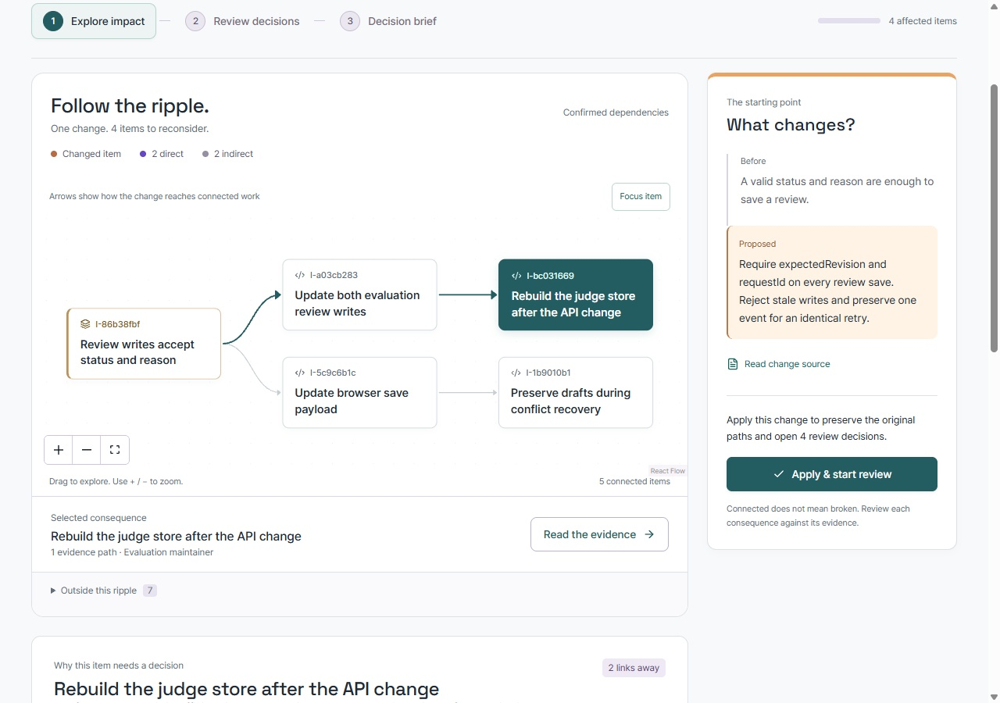

# Ripple

**One change. See the ripple.**

[](https://github.com/piecemakerz/Ripple/actions/workflows/verify.yml)
[](LICENSE)

Ripple is a local change-impact workbench. Follow a changed assumption to the decisions and tasks that depend on it, inspect the original evidence, and record a review decision. Built for the [Relate by Neo4j Hackathon](https://relate.devpost.com/).



## Quick start

Choose **Language → 한국어** in the top bar for Korean, or **English** to switch back. English is the default; your browser remembers the choice. Navigation, forms, walkthroughs, review, History and downloaded decision briefs follow the selected language. Switching preserves the current view and in-memory drafts. The bundled inventory example includes Korean titles, descriptions and all three source documents. Use **View English original** beneath a translation to compare the preserved text. Translations are reading aids; evidence selection, character ranges, hashes and stored content remain based on the English original. Korean brief downloads include both versions. Your own documents and written reasons remain verbatim; there is no automatic translation service. The preference is browser/origin-specific; denied storage keeps the selection only for the current page.

Validated on **Windows x64 with Node 22.17.1**; Node **22.12+** is required. Native Relate platform packages install through npm. Other operating systems have not been verified. No AI API key, Python, Rust toolchain, or separate database server is needed.

```powershell
git clone --branch codex/hackathon-verified-20261126 https://github.com/piecemakerz/Ripple.git
cd Ripple
npm ci
npm run evaluate:ripple:demo
```

Open the **full case URL printed by the command** (normally **http://127.0.0.1:4326**). It selects an actual Ripple review API change and **Rebuild the judge store after the API change**, two links away. Explore **four review targets across four paths**, open the original worker code, then apply explicitly. Record **Keep / Revise / Defer** with a reason and **Save & continue**. The saved change/item URL restores the review after reload or restart. **Decision brief → Download brief** exports saved reasons, paths, source versions and original evidence. The independent language preference is excluded. A decision records intended work, not completion.

This command builds the app and prepares a separate persistent store outside the repository; retain its printed directory and stop its owner before reopening. The [actual change case](docs/RIPPLE_CHANGE_CASE.md) uses six frozen code excerpts and four manually confirmed connections. Preparation uses 21 API writes; source reading and graph-authoring time remain unmeasured. The graph is AI-curated, not automatically extracted or independently human-validated. Use the candidate branch shown above or its matching source package; main remains the earlier version while the PR is a draft. See the [publication record](docs/PUBLICATION_2026-11-26.md) and [judge runbook](docs/HACKATHON_SUBMISSION.md).

Review saves reject stale revisions and preserve the draft for explicit comparison. Retrying the same request does not duplicate history. New document versions appear beside preserved evidence without rewriting quotes or automatically invalidating connections.

For the supporting SemVer case, run `npm run evaluate:semver:demo` on its default port 4323. Its hypothetical deprecation delay has five targets and seven paths. The [historical AI semantic assessment](docs/HACKATHON_SEMANTIC_ASSESSMENT.md) explains the two disclosed planning inferences.

For the simpler synthetic inventory example, run `npm run dev` and open **http://127.0.0.1:4317**. A1 changes from real-time inventory to daily updates; D1/D2 and T1/T2 are affected, while T3 is excluded. This uses the ordinary local workspace, separate from the evaluation demo.

In a fresh inventory workspace, start with **Find affected work**. Select a real consequence to see its preserved evidence, then choose **Apply & start review** when ready to save the update locally. Review defaults to one item at a time: read its evidence, choose Keep/Revise/Defer, write a reason and **Save & continue**. The item selector and **Show full queue** keep every item reachable. **Start with my own document** opens the existing document editor; **Open full workspace** skips the introduction. Before applying, **Try the interactive example** reopens it. The introduction is an example-specific presentation of native results, not an automatic extractor or a second database.

For more detail, choose **Follow the detailed walkthrough** or **Start sample walkthrough** for seven guided tasks: source, relationship, impact evidence, explicit Apply, four saved review decisions, decision brief and History. Pause/resume and replay retain existing records. Guide progress is browser-local; changes and decisions remain in Relate. The previous [first-use audit](docs/ONBOARDING_AUDIT.md) remains historical evidence; current checks are in [QA](docs/QA.md).

To create your first review from your own document:

1. In **Documents & relationships**, choose **Start with a document**. Paste text or upload UTF-8 Markdown/text, enter a title, then save. Follow **Select a quote** in the saved-source receipt.
2. Add an assumption or requirement from an exact quote, then a separate decision/task from its supporting quote. The receipt leads to the next item or relationship form.
3. Choose the dependent and prerequisite, cite why the former needs the latter, save the candidate and explicitly confirm it. Candidates do not carry impacts until confirmed.
4. Save the new information as another source version/document. Select its quote, choose **Use for an update**, select the prerequisite that changed and enter its updated description. Preview shows the native impact; **Apply & start review** saves the change. Write and save each review reason.

Empty states link to the missing preparation; save failures retain your input and offer **Return to save form**. A zero-impact change is allowed, with a route back to check relationships. Source versions and old quotes remain preserved. Receipts, recent-item grouping and unsaved drafts last for the current session; saved records persist after reload.

For a production build, stop the development server, then run `npm run build` and `npm start`. `npm run verify` checks formatting, strict types, real-database integration tests and the build. `npm run doctor` checks persistence across separate processes; `npm run reproduce` repeats installation and checks in a temporary copy.

## Inspectable judge bundle

```powershell
npm run judge:prepare:ripple
```

This creates a new bundle outside the repository and prints its location. It contains current source under `app/`, a closed native Ripple-case store under `snapshot/db/`, fixture/file hashes, a read-only inspection report and `JUDGE_README.md`. No live workspace, `.env`, installed dependencies or build output is copied. The source manifest distinguishes exact local bytes from the last Git commit; preparation does not publish or submit anything. `npm run judge:prepare` retains the earlier SemVer default.

To inspect or run it from this source checkout, replace `BUNDLE_DIRECTORY` with the printed directory:

```powershell
npm run judge:inspect -- BUNDLE_DIRECTORY
npm run build
npm run judge:start -- BUNDLE_DIRECTORY
```

Inspection checks hashes and native paths/evidence/review in a temporary read-only copy. Start opens a **new writable copy**, on port 4325 by default, and prints the exact saved-case URL. The included Defer is a curator-authored fixture decision, not independent feedback. For ongoing reviews, stop the owner and restart `npm start` with `RIPPLE_DB_PATH` set to the printed **working database**. Each `judge:start` creates another copy. A recipient starts with `cd app`, `npm ci` and the runbook. Only Windows x64 has been exercised.

[Current hackathon assessment and remaining submission steps](docs/HACKATHON_READINESS_2026-11-26.md).

## Evaluate the three curated cases

Run `npm run evaluate` to score **all three** cases in separate temporary native databases, including impacts, paths, exact quotes and process-restart persistence. Select one with `npm run evaluate:ripple`, `npm run evaluate:semver` or `npm run evaluate:owner`.

Run `npm run evaluate:semver:demo` for the external **SemVer 2.0.0** case at **http://127.0.0.1:4323**. Select **Public API deprecation plan · proposed update**: five impacted items, seven paths, five reviews. The original `npm run evaluate:demo` still opens the Ripple ownership case at port **4322**. Each demo builds the UI and creates a new retained store outside the repository; neither opens your existing workspace.

The two earlier cases use separately sourced documents with three queries each, hypothetical changes and synthetic controls. The added Ripple case follows this actual API change using six pre-change excerpts. All are AI-curated without independent human semantic review. They measure graph regression, not customer accuracy or extraction quality. SemVer excerpts retain [CC BY 3.0 attribution](THIRD_PARTY.md). [Inputs and limitations](docs/EVALUATION.md), [actual change case](docs/RIPPLE_CHANGE_CASE.md).

## How it uses Relate

- **Mode: persistent directory**, using the native `@relate/relate` Node binding, pinned to 1.0.1.
- **Why this mode:** a local single-user application needs durable evidence and review history without a separate database service. WAL and Parquet checkpoints survive process restarts.
- **Graph:** items, source versions, evidence, changes and reviews. `downstream -[:DEPENDS_ON]-> upstream`; parameterized Cypher traverses confirmed dependencies. Paths and original evidence are snapshotted atomically before a change.
- **Data location:** `%LOCALAPPDATA%/Ripple/demo-v1` by default on Windows, outside this repository and OneDrive. `RIPPLE_DB_PATH` overrides it. Only one backend process may open a database. The first start creates synthetic seed data; subsequent starts preserve it.
- **Submission status:** the repository is public with the required `relate` topic and both `relate-neo4j-hackathon` and `relate-hackathon`. The latest implementation, a reproducible source/native-store bundle and a 110-second captioned screen presentation are local candidates. Publishing those matching versions, checking public playback and submitting the Devpost entry remain pending. The active local database is excluded from Git. See the [submission readiness record](docs/HACKATHON_SUBMISSION.md).

This release includes the M0/M1 sample workflow, manual M2 document ingestion, confirmed relationship amendments and searchable item history. AI extraction is not implemented. See [the audit](docs/HACKATHON_AUDIT.md), [verification evidence](docs/QA.md) and [AI/tool-use disclosure](docs/AI_DISCLOSURE.md).

## Import your own context (manual M2)

**Workflow guide** shows the full route from Sources & items to Relationships, Explore impact, Review decisions, Decision brief and History. Select a stage to see what to start with, what to do, and what it produces; use its **Open** action to enter that screen. The guide collapses to leave room for work and can be reopened at any time. Its current-location marker follows your screen. Workspace source/link counts and the selected change's saved-decision progress are separate; drafts and failed saves do not count. [Desktop guide](docs/evidence/workflow-desktop-guide.jpg) · [mobile](docs/evidence/workflow-mobile-overview.jpg).

1. Open **Documents & relationships → Sources & items**. Paste text or upload a UTF-8 `.md`, `.markdown` or `.txt` file, name the document, then **Save source version**. Select an existing imported document to append a version; previous versions are preserved.
2. Select a saved source and copy a passage into **Exact evidence quote**. If repeated, choose its occurrence. The application preserves the exact original slice, including Windows line endings.
3. Add an assumption, decision or task with its title, description and owner. Each item records the selected evidence.
4. Open **Relationships**, choose **Dependent item → Prerequisite item** and save a relationship candidate. Inspect **View original evidence**, then confirm or reject it. Only confirmed relationships enter impact analysis.
5. Select evidence for an update in **Sources & items**, then open **Preview change**. Choose **Item to change**, write its updated description and **Preview impact**. The workbench shows direct/indirect impacts and original evidence. Apply the change and record per-item reviews.

The evidence strip carries the selected source/version and exact range between sections. **Change evidence** returns to the source panel. All section forms stay mounted so navigation preserves their drafts. On mobile, the section controls stay visible above the current form. [Desktop](docs/evidence/workspace-desktop-documents.jpg) · [mobile evidence selection](docs/evidence/workspace-mobile-evidence.jpg).

Limits: 20,000 characters per source; upload size 80 KB; 50 saved source versions, 100 items, 200 dependency records and 100 proposals per workspace, including sample records. There is no AI extraction. Unsaved drafts survive panel navigation and failed requests, but not a full page reload. Source, candidate and replacement history is retained. The dependency cap includes superseded generations. A stale candidate/proposal must be recreated from current item revisions. Existing version-1 stores upgrade additively to schema 2 on startup.

## Edit or replace a confirmed relationship

Open **Documents & relationships → Relationships → Confirmed relationships**, then **Edit or replace**. Keep or change either endpoint, select the saved source and exact quote (choose its occurrence if repeated), and enter a reason. **Confirm replacement** immediately updates the confirmed graph. The previous edge and its original evidence stay in **Relationship history**, alongside the replacement and reason.

Current impact previews use the replacement. Previously applied changes and their reviews keep their original paths and evidence. A stale editor must be reopened against current revisions. A replacement counts toward the 200 dependency-record limit; there is no deletion or retirement-only action.

## Explore item history

**Change review → Switch change → Change to explore** lists proposed updates and 25 saved changes at a time. Use **Older changes / Newer changes** to browse and **Refresh changes** to return to the newest page. Paging preserves the selected change and review draft. Saved paths, evidence and review history load when you select a change. A selection opened from History stays available even when it is outside the current page; list failures have a retry button.

Open **History**, or **View item history** in the review panel. Expand **Filter history**, select an item, event type, review decision, text or calendar range, then **Apply filters**. Collapse the filter panel to read the events on a narrow screen; values stay in place. **Clear filters** restores all events; **Refresh history** reloads the applied filters from the first page. Results show up to 25 events per page, newest first.

- Changes match both the changed item and its originally impacted items. Compare before/after, open change evidence, or return to the saved impact snapshot.
- Reviews include every saved decision, even if a later decision differs. The decision filter matches that historical event. Opening a review selects its item and shows its latest decision with the original paths. Pending reviews are not decision events.
- Relationship replacements match either endpoint in either generation. Read the reason and open both preserved evidence quotes. Item chips narrow the current filters.

Search covers record IDs, item IDs/titles, changed text and reasons; it does not search source-document contents. Dates include both selected calendar days in the browser's local timezone. Filters survive switching views in the current page, but reset on reload. The history screen is read-only and does not mark implementation complete. See [desktop](docs/evidence/workspace-desktop-history.jpg) and [390px](docs/evidence/workspace-mobile-history.jpg) captures.

## License and development tools

Ripple uses the repository owner's existing [MIT license](LICENSE). Dependencies retain their own licenses; see [third-party notices](THIRD_PARTY.md). Codex assisted implementation and validation. Astra/high is configured for future development; the configuration alone is not evidence of an Astra model invocation. The application itself makes no model calls.

## 한국어 안내

새 재고 예제에서는 **영향받는 작업 찾아보기**로 시작하세요. 항목을 눌러 변경과 연결된 이유·원문을 확인하고, **적용하고 검토 시작**을 누르면 실제 변경이 저장됩니다. 이후 한 항목씩 유지·수정·보류와 이유를 기록합니다. **전체 목록 펼치기**로 목록을 볼 수 있고 **내 문서로 시작하기**로 바로 문서를 입력할 수도 있습니다. 적용 전에는 **직접 체험하는 예제 열기**로 첫 화면에 돌아올 수 있습니다. 기존 상세 안내의 진행 상황과 저장 데이터는 그대로 유지됩니다.

해커톤의 제품 판단·가설·검증·결과 회고는 [판단과 학습 기록](docs/learning/README.md)에 모읍니다. [다음 해커톤용 양식](docs/learning/TEMPLATE.md)으로 새 프로젝트에 같은 기록 방식을 적용할 수 있습니다.

상단 **Language → 한국어**를 선택하면 메뉴, 문서 입력, 예제 안내, 영향 검토, 이력, 내려받는 판단 요약을 한국어로 사용할 수 있습니다. **English**로 언제든 돌아갈 수 있고, 언어를 바꿔도 현재 화면과 작성 중인 내용은 유지됩니다. 선택한 언어는 같은 브라우저·주소에 저장됩니다. 기본 재고 예제의 제목·항목 설명·문서 3개·근거 문장은 한국어 번역으로 읽을 수 있습니다. 번역 아래 **영어 원문 보기**를 펼치면 원문과 비교할 수 있고, 판단 요약 다운로드에도 원문과 번역이 함께 들어갑니다. 번역은 이해를 돕는 참고이며, 근거를 선택할 때는 영어 원문을 복사하세요. 저장된 본문·근거 위치·해시·직접 쓴 이유는 그대로 보존됩니다. 사용자가 추가한 문서와 별도 평가용 자료는 자동 번역하지 않습니다.

Ripple은 전제가 바뀌었을 때 다시 검토할 결정과 작업을 찾고, 실제 의존 경로와 원문 근거를 보여주는 로컬 웹앱입니다. M0·M1과 수동 M2 문서 입력 흐름을 구현했습니다. 샘플은 가상의 재고 관리 제품을 위한 합성 자료입니다. 실제 고객 문서나 AI가 실시간 추출한 결과가 아닙니다.

## 실행

검증 환경: Windows x64, Node **22.17.1**, npm **11.10.0**. Node 22.12 이상이 필요합니다. Relate의 네이티브 라이브러리는 npm의 플랫폼별 패키지로 설치됩니다. Python, Rust, Neo4j 서버, AI API 키는 필요하지 않습니다.

```powershell
npm ci
npm run doctor
npm run dev
```

브라우저에서 **http://127.0.0.1:4317**을 엽니다. Ctrl+C로 종료합니다. 개발 서버는 한 프로세스에서 API와 Vite를 제공합니다. 프론트엔드 파일 변경 후 브라우저를 새로고침하고, 서버 파일 변경 후 서버를 재시작하세요.

프로덕션 빌드로 실행하려면 개발 서버를 종료한 뒤:

```powershell
npm run build
npm start
```

첫 실행에만 샘플 그래프를 생성합니다. 다시 실행해도 기존 변경과 검토 기록을 덮어쓰지 않습니다.

## 2분 사용 흐름

1. **Change review → Explore impact**의 **What changes?**에서 API 갱신 주기가 실시간에서 하루 한 번으로 바뀌는 내용을 읽습니다. **Read change source**로 새 API 문서를 엽니다.
2. 지도에서 직접 영향 D1·D2와 간접 영향 T1·T2를 확인합니다. T3는 제외됩니다.
3. T1을 선택하고 **Read the evidence**로 각 의존 관계의 정확한 인용을 읽습니다. 원문 버튼을 누르면 보존된 문서의 해당 구간이 열립니다. 화살표는 의존 항목에서 전제 항목을 가리킵니다.
4. **Apply & start review**로 변경을 확정하고 **Keep / Revise / Defer**, 사유를 선택한 뒤 **Save & continue**로 저장합니다. Revise는 대응 방침이며 구현 완료를 뜻하지 않습니다.
5. **Decision brief**에서 저장 결과를 확인하거나 **History**에서 변경·검토·관계 수정 이력을 검색합니다. 새로고침 후에도 적용한 변경을 선택하면 원래 경로와 저장된 검토를 다시 볼 수 있습니다.

작은 화면에서도 **Explore impact / Review decisions / Decision brief**로 이동합니다. 문서 입력은 **Documents & relationships → Sources & items**, 관계 관리는 **Relationships**, 변경 제안은 **Preview change**에서 진행합니다. History의 **Filter history**는 접어서 이력 목록을 넓게 볼 수 있습니다. 작성 중인 입력은 저장 실패와 패널 이동 시 유지되지만, 브라우저를 완전히 새로고침하면 복구되지 않습니다.

## Astra로 개발 이어가기

```powershell
npm run ai:doctor
npm run relate:context
npm run ai:check
npm run ai
```

프로젝트에는 Relate, React, UI·접근성 검토, Ripple 검증 스킬이 설치되어 있습니다. `ai:doctor`는 고정된 스킬 원본과 무결성을 검사하며 Astra 런처와 `verify`에서도 실행됩니다. 사용 범위와 플러그인 상태는 [AI 도구 구성](docs/AI_TOOLING.md)에 있습니다. `npm run ci:status`로 현재 커밋의 GitHub Actions 결과를 조회할 수 있습니다.

`relate:context`는 설치된 Relate 버전·공식 Node 스킬·타입 정의를 확인하고 메모리 DB에서 매개변수 조회를 실행합니다. 라이브 DB는 열지 않습니다. `ai:check`는 같은 검사와 로컬 Codex CLI·로그인 상태를 확인하며 모델을 호출하지 않습니다. 기본 실행은 현재 프로젝트에서 `gpt-6-astra`, reasoning `high`를 명시해 Codex를 시작하고 프로젝트 지침·진행 기록·공식 Relate 스킬을 읽게 합니다. Codex 설치 및 로그인은 필요합니다. 실제 모델 사용 가능 여부는 계정/실행 환경에 따릅니다.

`.codex/config.toml`에도 같은 기본 모델을 선언했습니다. 프로젝트 설정은 신뢰된 프로젝트에서 적용되며, 실행 중인 데스크톱 대화의 모델은 설정 파일을 쓴 것만으로 바뀌지 않습니다. 데스크톱에서 이어갈 때는 모델 선택기에서 Astra를 선택하세요. 전역 Codex 설정·인증·승인 정책은 변경하지 않습니다.

- [AGENTS.md](AGENTS.md): AI가 지켜야 할 데이터 불변 조건과 완료 기준
- [AI 개발 운영 방법](docs/AI_WORKFLOW.md): 새 세션 시작, 작업·리뷰·검증 흐름
- [현재 상태](docs/STATUS.md), [실행 계획](docs/PLAN.md), [설계와 결정](docs/ARCHITECTURE.md)
- [인수인계 공개본](docs/RIPPLE_HANDOFF.md): 출발 명세, 개인 PC 경로만 익명화한 복사본

## 검증

평가 사례의 의미를 직접 검토하려면 `npm run evaluate:review`로 **http://127.0.0.1:4324**를 여세요. 세 사례 51개 항목의 원문·관계·예상 경로와 판단을 버전별 JSON으로 기록합니다. 기존 39개 [AI 의미 검토](docs/HACKATHON_SEMANTIC_ASSESSMENT.md)는 새 Ripple 사례를 포함하지 않으며 독립 사람 검토는 남아 있습니다. [실제 Ripple 데모와 제출 설명](docs/HACKATHON_SUBMISSION.md), [검토·수작업 비교 계획](docs/SEMANTIC_REVIEW.md)을 참고하세요.

```powershell
npm run verify
npm run doctor
npm run reproduce
npm run evaluate
```

`verify`는 포맷 검사, strict TypeScript 검사, 실제 Relate를 사용하는 통합 테스트, Vite 프로덕션 빌드입니다. `doctor`는 임시 DB에 저장한 뒤 **쓰기 프로세스를 종료하고 별도 읽기 프로세스로** 영향·변경·검토·이력·롤백을 검증합니다. 사용자 DB는 열지 않습니다. `reproduce`는 임시 복사본에서 깨끗한 `npm ci`, 검증, doctor를 실행합니다. 코드 포맷은 `npm run format`으로 정리합니다.

검증 항목: 정확한 영향 집합과 경로, 동일 담당자/단어와 무관 작업 제외, 미확인 관계 제외, 순환, 여러 경로, 깊이/결과 제한, 원문 인용과 해시, 변경 전 스냅샷, 실패 시 롤백, 중복 요청, revision 충돌, 두 번째 변경의 독립 검토, HTTP 입력 검증, 체크포인트 및 WAL 재시작 복원. 브라우저 검증 절차와 실제 결과는 [QA 기록](docs/QA.md)에 있습니다.

`.github/workflows/verify.yml`은 push와 pull request마다 Windows에서 설치·검증·doctor를 실행합니다. 실제 원격 실행 결과는 [GitHub Actions](https://github.com/piecemakerz/Ripple/actions/workflows/verify.yml)와 [현재 상태](docs/STATUS.md)에서 확인할 수 있습니다.

## 저장 위치와 Relate를 사용하는 이유

실제 저장소는 Windows에서 기본적으로 **`%LOCALAPPDATA%\Ripple\demo-v1`** 입니다. OneDrive 동기화 폴더 밖이며 `RIPPLE_DB_PATH`로 바꿀 수 있습니다. 프로젝트의 `.env.example`을 참고해 `.env`를 만들거나 셸 환경변수를 설정하세요. 포트는 `PORT`로 지정합니다. 앱 안의 Developer details에서 실제 경로를 확인할 수 있습니다.

Relate **1.0.1**은 Node 프로세스 안에서 실행되는 네이티브 그래프 엔진입니다. Item·SourceVersion·Evidence·Change·Review·ReviewEvent와 연결을 디스크의 **WAL + Parquet 체크포인트**로 저장합니다. 의존 탐색은 Relate의 매개변수 Cypher 질의이며 클라이언트의 모의 목록을 반환하지 않습니다. 변경 시 전체 영향·원문 경로 스냅샷을 Relate 노드 속성에 저장합니다. JSON으로 직렬화한 스냅샷은 DB 속성이며 별도 JSON 데이터베이스가 아닙니다.

같은 DB를 여러 서버에서 동시에 열지 마세요. Node 바인딩에는 명시적인 close API가 없어 종료 시 체크포인트 후 프로세스가 네이티브 핸들을 해제합니다. 라이브 DB를 복사하지 말고 서버를 종료한 뒤 전체 디렉터리를 복사하세요. Ripple 실제 사례와 기존 SemVer 심사용 묶음을 지원하며, 현재 로컬 후보의 공개 배포는 남아 있습니다.

새 데모를 기존 기록과 분리해서 시작하려면 서버를 종료한 뒤 사용한 적 없는 경로를 지정합니다:

```powershell
$env:RIPPLE_DB_PATH = Join-Path $env:LOCALAPPDATA ('Ripple/demo-' + (Get-Date -Format 'yyyyMMdd-HHmmss'))
npm run dev
```

이는 기존 DB를 삭제하지 않습니다. 종료 후 `Remove-Item Env:RIPPLE_DB_PATH`로 기본 경로로 돌아갈 수 있습니다.

## 현재 범위

[해커톤 적합성 검증](docs/HACKATHON_AUDIT.md): 핵심 구현과 로컬 심사용 저장소 준비를 마쳤고, 공개 데모·자료 배포·Devpost 제출은 남아 있습니다. 공개 GitHub 저장소에는 필수 `relate`, 권장 `relate-neo4j-hackathon`, 기존 `relate-hackathon` Topic이 설정되어 있습니다.

완료: M0 실제 DB 검증, M1 변경·영향·근거·검토 이력, 수동 M2 문서 입력, 확정 관계 수정·대체와 이력 보존, 두 공개 문서 평가, AI 의미 검토와 영문 제출 초안. 미구현: AI 관계 추출, 관계 삭제/대체 없는 폐기, 사용자/조직, 외부 동기화, 공개 서비스 배포. 그래프 UI는 작은 데모 규모를 위한 계층 배치이며 대규모 그래프 편집기가 아닙니다. 경로는 최대 8단계·500개이며 제한에 닿으면 경고하고 변경 적용을 막습니다. 평가는 합성 회귀 테스트와 실제 공개 문서에서 AI가 구성한 가상 변경 사례를 포함하며, 사람이 검증한 실제 사용자 성과를 뜻하지 않습니다.

폰트와 아이콘도 로컬 번들로 제공합니다. 앱 실행 중 외부 AI·분석 서비스·CDN 요청은 없습니다.

## 공식 자료

- [주최 측이 연결한 네 자료와 구현 대조](docs/RELATE_RESOURCES.md): 공식 스킬, 설치 방식, 버전 기준과 아이디어 적용 결정
- [Relate 홈페이지](https://relatedb.ai/), [설치 안내](https://relatedb.ai/docs/get-started/install/)
- [Relate 소스 저장소](https://github.com/relatedb/relate), [Relate Ideas](https://github.com/jexp/relate-ideas)
- [Relate Node API와 설치](https://github.com/relatedb/relate/tree/v1.0.1/clients/javascript)
- [Relate 1.0.1 릴리스](https://github.com/relatedb/relate/releases/tag/v1.0.1)
- [Relate 제약사항](https://github.com/relatedb/relate/blob/v1.0.1/docs/limitations.md)
- [Astra 모델 ID](https://developers.openai.com/api/docs/models/gpt-6-astra)
- [Codex 프로젝트 설정](https://learn.chatgpt.com/docs/config-file/config-basic), [AGENTS.md](https://learn.chatgpt.com/docs/agent-configuration/agents-md)
