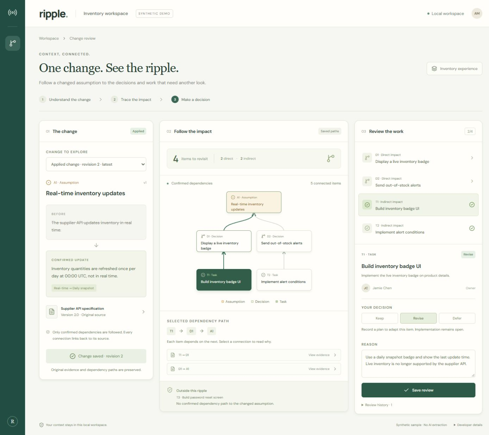

# Ripple

**One change. See the ripple.**

[](https://github.com/piecemakerz/Ripple/actions/workflows/verify.yml)
[](LICENSE)

Ripple is a local change-impact workbench. Follow a changed assumption to the decisions and tasks that depend on it, inspect the original evidence, and record a review decision. Built for the [Relate by Neo4j Hackathon](https://relate.devpost.com/).



## Quick start

Validated on **Windows x64 with Node 22.17.1**; Node **22.12+** is required. Native Relate platform packages install through npm. Other operating systems have not been verified. No AI API key, Python, Rust toolchain, or separate database server is needed.

```powershell
git clone https://github.com/piecemakerz/Ripple.git
cd Ripple
npm ci
npm run doctor
npm run dev
```

Open **http://127.0.0.1:4317**. In the synthetic inventory example, A1 changes from real-time inventory to daily updates. Explore **D1/D2 directly and T1/T2 indirectly**; unrelated T3 is excluded. Select T1, inspect both dependency evidence links, apply the change, then save **Keep / Revise / Defer** with a reason. Restart the server to inspect persisted reviews. A review decision does not mean its implementation is complete.

For a production build, stop the development server, then run `npm run build` and `npm start`. `npm run verify` checks formatting, strict types, 31 tests including real-database integration and the build. `npm run doctor` checks persistence across separate processes; `npm run reproduce` repeats installation and checks in a temporary copy.

## How it uses Relate

- **Mode: persistent directory**, using the native `@relate/relate` Node binding, pinned to 1.0.1.
- **Why this mode:** a local single-user application needs durable evidence and review history without a separate database service. WAL and Parquet checkpoints survive process restarts.
- **Graph:** items, source versions, evidence, changes and reviews. `downstream -[:DEPENDS_ON]-> upstream`; parameterized Cypher traverses confirmed dependencies. Paths and original evidence are snapshotted atomically before a change.
- **Data location:** `%LOCALAPPDATA%/Ripple/demo-v1` by default on Windows, outside this repository and OneDrive. `RIPPLE_DB_PATH` overrides it. Only one backend process may open a database. The first start creates synthetic seed data; subsequent starts preserve it.
- **Submission status:** the source is public with the `relate-hackathon` topic. A separate inspectable submission store and public demo/video are still pending. The active local database is excluded from Git.

This release includes the M0/M1 sample workflow, manual M2 document ingestion, confirmed relationship amendments and searchable item history. AI extraction is not implemented. See [the audit](docs/HACKATHON_AUDIT.md), [verification evidence](docs/QA.md) and [AI/tool-use disclosure](docs/AI_DISCLOSURE.md).

## Import your own context (manual M2)

1. Open **Documents & relationships**. Paste text or upload a UTF-8 `.md`, `.markdown` or `.txt` file, name the document, then **Save source version**. Select an existing imported document to append a version; previous versions are preserved.
2. Select a saved source and copy a passage into **Exact evidence quote**. If repeated, choose its occurrence. The application preserves the exact original slice, including Windows line endings.
3. Add an assumption, decision or task with its title, description and owner. Each item records the selected evidence.
4. Choose **Dependent item → Prerequisite item** and save a relationship candidate. Inspect **View original evidence**, then confirm or reject it. Only confirmed relationships enter impact analysis.
5. Select evidence for an update, choose **Item to change**, write its updated description and **Preview impact**. The existing workbench shows direct/indirect impacts and original evidence. Apply the change and record per-item reviews.

Limits: 20,000 characters per source; upload size 80 KB; 50 saved source versions, 100 items, 200 dependency records and 100 proposals per workspace, including sample records. There is no AI extraction. Unsaved drafts survive panel navigation and failed requests, but not a full page reload. Source, candidate and replacement history is retained. The dependency cap includes superseded generations. A stale candidate/proposal must be recreated from current item revisions. Existing version-1 stores upgrade additively to schema 2 on startup.

## Edit or replace a confirmed relationship

Open **Documents & relationships → Confirmed relationships**, then **Edit or replace**. Keep or change either endpoint, select the saved source and exact quote (choose its occurrence if repeated), and enter a reason. **Confirm replacement** immediately updates the confirmed graph. The previous edge and its original evidence stay in **Relationship history**, alongside the replacement and reason.

Current impact previews use the replacement. Previously applied changes and their reviews keep their original paths and evidence. A stale editor must be reopened against current revisions. A replacement counts toward the 200 dependency-record limit; there is no deletion or retirement-only action.

## Explore item history

Open **History**, or **View item history** in the review panel. Select an item, event type, review decision, text or calendar range, then **Apply filters**. **Clear filters** restores all events; **Refresh history** reloads the applied filters from the first page. Results show up to 25 events per page, newest first.

- Changes match both the changed item and its originally impacted items. Compare before/after, open change evidence, or return to the saved impact snapshot.
- Reviews include every saved decision, even if a later decision differs. The decision filter matches that historical event. Opening a review selects its item and shows its latest decision with the original paths. Pending reviews are not decision events.
- Relationship replacements match either endpoint in either generation. Read the reason and open both preserved evidence quotes. Item chips narrow the current filters.

Search covers record IDs, item IDs/titles, changed text and reasons; it does not search source-document contents. Dates include both selected calendar days in the browser's local timezone. Filters survive switching views in the current page, but reset on reload. The history screen is read-only and does not mark implementation complete. See [desktop](docs/evidence/history-desktop.jpg), [past decision search](docs/evidence/history-review.jpg) and [390px](docs/evidence/history-mobile.jpg) captures.

## License and development tools

Ripple uses the repository owner's existing [MIT license](LICENSE). Dependencies retain their own licenses; see [third-party notices](THIRD_PARTY.md). Codex assisted implementation and validation. Astra/high is configured for future development; the configuration alone is not evidence of an Astra model invocation. The application itself makes no model calls.

## 한국어 안내

Ripple은 전제가 바뀌었을 때 다시 검토할 결정과 작업을 찾고, 실제 의존 경로와 원문 근거를 보여주는 로컬 웹앱입니다. M0·M1과 수동 M2 문서 입력 흐름을 구현했습니다. 샘플은 가상의 재고 관리 제품을 위한 합성 자료입니다. 실제 고객 문서나 AI가 실시간 추출한 결과가 아닙니다.

## 실행

검증 환경: Windows x64, Node **22.17.1**, npm **11.10.0**. Node 22.12 이상이 필요합니다. Relate의 네이티브 라이브러리는 npm의 플랫폼별 패키지로 설치됩니다. Python, Rust, Neo4j 서버, AI API 키는 필요하지 않습니다.

```powershell
npm ci
npm run doctor
npm run dev
```

브라우저에서 **http://127.0.0.1:4317**을 엽니다. Ctrl+C로 종료합니다. 개발 서버는 한 프로세스에서 API와 Vite를 제공합니다. 프론트엔드 파일 변경 후 브라우저를 새로고침하고, 서버 파일 변경 후 서버를 재시작하세요.

프로덕션 빌드로 실행하려면 개발 서버를 종료한 뒤:

```powershell
npm run build
npm start
```

첫 실행에만 샘플 그래프를 생성합니다. 다시 실행해도 기존 변경과 검토 기록을 덮어쓰지 않습니다.

## 2분 사용 흐름

1. **The change**에서 API 갱신 주기가 실시간에서 하루 한 번으로 바뀌는 내용을 읽습니다. 원문 버튼으로 새 API 문서를 엽니다.
2. **Follow the impact**에서 직접 영향 D1·D2와 간접 영향 T1·T2를 확인합니다. T3는 제외됩니다.
3. T1을 선택하고 **T1 → D1**, **D1 → A1 · View evidence**를 눌러 원문의 정확한 인용을 확인합니다. 화살표는 왼쪽 항목이 오른쪽 항목에 의존함을 뜻합니다.
4. **Apply change & start review**로 변경을 확정하고 **Keep / Revise / Defer**, 사유를 저장합니다. Revise는 대응 방침이며 구현 완료를 뜻하지 않습니다.
5. 새로고침하거나 서버를 종료·재시작합니다. 선택 목록에서 적용한 변경을 열면 원래 경로와 검토 이력을 다시 볼 수 있습니다.

작은 화면에서는 Change / Impact path / Review 탭으로 이동합니다. 검토 사유는 저장 실패와 패널 이동 시 유지됩니다. 저장 전 브라우저를 완전히 새로고침하면 미저장 입력은 복구되지 않습니다.

## Astra로 개발 이어가기

```powershell
npm run ai:doctor
npm run relate:context
npm run ai:check
npm run ai
```

프로젝트에는 Relate, React, UI·접근성 검토, Ripple 검증 스킬이 설치되어 있습니다. `ai:doctor`는 고정된 스킬 원본과 무결성을 검사하며 Astra 런처와 `verify`에서도 실행됩니다. 사용 범위와 플러그인 상태는 [AI 도구 구성](docs/AI_TOOLING.md)에 있습니다. `npm run ci:status`로 현재 커밋의 GitHub Actions 결과를 조회할 수 있습니다.

`relate:context`는 설치된 Relate 버전·공식 Node 스킬·타입 정의를 확인하고 메모리 DB에서 매개변수 조회를 실행합니다. 라이브 DB는 열지 않습니다. `ai:check`는 같은 검사와 로컬 Codex CLI·로그인 상태를 확인하며 모델을 호출하지 않습니다. 기본 실행은 현재 프로젝트에서 `gpt-6-astra`, reasoning `high`를 명시해 Codex를 시작하고 프로젝트 지침·진행 기록·공식 Relate 스킬을 읽게 합니다. Codex 설치 및 로그인은 필요합니다. 실제 모델 사용 가능 여부는 계정/실행 환경에 따릅니다.

`.codex/config.toml`에도 같은 기본 모델을 선언했습니다. 프로젝트 설정은 신뢰된 프로젝트에서 적용되며, 실행 중인 데스크톱 대화의 모델은 설정 파일을 쓴 것만으로 바뀌지 않습니다. 데스크톱에서 이어갈 때는 모델 선택기에서 Astra를 선택하세요. 전역 Codex 설정·인증·승인 정책은 변경하지 않습니다.

- [AGENTS.md](AGENTS.md): AI가 지켜야 할 데이터 불변 조건과 완료 기준
- [AI 개발 운영 방법](docs/AI_WORKFLOW.md): 새 세션 시작, 작업·리뷰·검증 흐름
- [현재 상태](docs/STATUS.md), [실행 계획](docs/PLAN.md), [설계와 결정](docs/ARCHITECTURE.md)
- [인수인계 공개본](docs/RIPPLE_HANDOFF.md): 출발 명세, 개인 PC 경로만 익명화한 복사본

## 검증

```powershell
npm run verify
npm run doctor
npm run reproduce
```

`verify`는 포맷 검사, strict TypeScript 검사, 실제 Relate를 사용하는 통합 테스트, Vite 프로덕션 빌드입니다. `doctor`는 임시 DB에 저장한 뒤 **쓰기 프로세스를 종료하고 별도 읽기 프로세스로** 영향·변경·검토·이력·롤백을 검증합니다. 사용자 DB는 열지 않습니다. `reproduce`는 임시 복사본에서 깨끗한 `npm ci`, 검증, doctor를 실행합니다. 코드 포맷은 `npm run format`으로 정리합니다.

검증 항목: 정확한 영향 집합과 경로, 동일 담당자/단어와 무관 작업 제외, 미확인 관계 제외, 순환, 여러 경로, 깊이/결과 제한, 원문 인용과 해시, 변경 전 스냅샷, 실패 시 롤백, 중복 요청, revision 충돌, 두 번째 변경의 독립 검토, HTTP 입력 검증, 체크포인트 및 WAL 재시작 복원. 브라우저 검증 절차와 실제 결과는 [QA 기록](docs/QA.md)에 있습니다.

`.github/workflows/verify.yml`은 push와 pull request마다 Windows에서 설치·검증·doctor를 실행합니다. 실제 원격 실행 결과는 [GitHub Actions](https://github.com/piecemakerz/Ripple/actions/workflows/verify.yml)와 [현재 상태](docs/STATUS.md)에서 확인할 수 있습니다.

## 저장 위치와 Relate를 사용하는 이유

실제 저장소는 Windows에서 기본적으로 **`%LOCALAPPDATA%\Ripple\demo-v1`** 입니다. OneDrive 동기화 폴더 밖이며 `RIPPLE_DB_PATH`로 바꿀 수 있습니다. 프로젝트의 `.env.example`을 참고해 `.env`를 만들거나 셸 환경변수를 설정하세요. 포트는 `PORT`로 지정합니다. 앱 안의 Developer details에서 실제 경로를 확인할 수 있습니다.

Relate **1.0.1**은 Node 프로세스 안에서 실행되는 네이티브 그래프 엔진입니다. Item·SourceVersion·Evidence·Change·Review·ReviewEvent와 연결을 디스크의 **WAL + Parquet 체크포인트**로 저장합니다. 의존 탐색은 Relate의 매개변수 Cypher 질의이며 클라이언트의 모의 목록을 반환하지 않습니다. 변경 시 전체 영향·원문 경로 스냅샷을 Relate 노드 속성에 저장합니다. JSON으로 직렬화한 스냅샷은 DB 속성이며 별도 JSON 데이터베이스가 아닙니다.

같은 DB를 여러 서버에서 동시에 열지 마세요. Node 바인딩에는 명시적인 close API가 없어 종료 시 체크포인트 후 프로세스가 네이티브 핸들을 해제합니다. 라이브 DB를 복사하지 말고 서버를 종료한 뒤 전체 디렉터리를 복사하세요. 제출용 공개 DB 내보내기는 M4에서 별도로 준비합니다.

새 데모를 기존 기록과 분리해서 시작하려면 서버를 종료한 뒤 사용한 적 없는 경로를 지정합니다:

```powershell
$env:RIPPLE_DB_PATH = Join-Path $env:LOCALAPPDATA ('Ripple/demo-' + (Get-Date -Format 'yyyyMMdd-HHmmss'))
npm run dev
```

이는 기존 DB를 삭제하지 않습니다. 종료 후 `Remove-Item Env:RIPPLE_DB_PATH`로 기본 경로로 돌아갈 수 있습니다.

## 현재 범위

[해커톤 적합성 검증](docs/HACKATHON_AUDIT.md): M0/M1 기술 구현은 요건에 부합하며, 심사용 DB·데모·Devpost 제출 준비는 아직 남아 있습니다. 공개 GitHub 저장소에는 `relate-hackathon` Topic이 설정되어 있습니다.

완료: M0 실제 DB 검증, M1 변경·영향·근거·검토 이력, 수동 M2 문서 입력, 확정 관계 수정·대체와 이력 보존. 미구현: AI 관계 추출, 관계 삭제/대체 없는 폐기, 사용자/조직, 외부 동기화, 배포·제출 패키지. 그래프 UI는 작은 데모 규모를 위한 계층 배치이며 대규모 그래프 편집기가 아닙니다. 경로는 최대 8단계·500개이며 제한에 닿으면 경고하고 변경 적용을 막습니다. 평가 결과는 합성 그래프의 회귀 테스트이며 실제 사용자 성과를 뜻하지 않습니다.

폰트와 아이콘도 로컬 번들로 제공합니다. 앱 실행 중 외부 AI·분석 서비스·CDN 요청은 없습니다.

## 공식 자료

- [주최 측이 연결한 네 자료와 구현 대조](docs/RELATE_RESOURCES.md): 공식 스킬, 설치 방식, 버전 기준과 아이디어 적용 결정
- [Relate 홈페이지](https://relatedb.ai/), [설치 안내](https://relatedb.ai/docs/get-started/install/)
- [Relate 소스 저장소](https://github.com/relatedb/relate), [Relate Ideas](https://github.com/jexp/relate-ideas)
- [Relate Node API와 설치](https://github.com/relatedb/relate/tree/v1.0.1/clients/javascript)
- [Relate 1.0.1 릴리스](https://github.com/relatedb/relate/releases/tag/v1.0.1)
- [Relate 제약사항](https://github.com/relatedb/relate/blob/v1.0.1/docs/limitations.md)
- [Astra 모델 ID](https://developers.openai.com/api/docs/models/gpt-6-astra)
- [Codex 프로젝트 설정](https://learn.chatgpt.com/docs/config-file/config-basic), [AGENTS.md](https://learn.chatgpt.com/docs/agent-configuration/agents-md)
