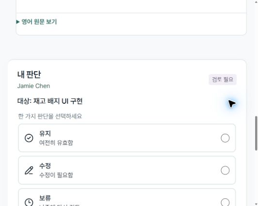

# 실제 확대·스크린리더와 첫 사용 흐름 후속 검토

2026-11-25 KST. 사용자가 요청한 실제 200% 확대, 스크린리더 주요 경로, 처음 사용하는 사람의 전체 작업 흐름을 확인하고 네 가지 문제를 수정했다. 사용자의 “스크린리더는 여기까지 확인하고 모두 완료로 처리” 요청에 따라 이 범위로 검증을 종료했다. 독립 사용자가 참여한 사용성 연구는 아니다.

## 환경과 판정 범위

- Windows의 연결된 Chrome, 별도 검증 창, 실제 Windows 내레이터를 사용했다. 내레이터의 **음성 요약에 나타난 실제 출력**을 화면으로 읽었다. 접근성 트리만으로 스크린리더 통과를 선언하지 않았으며, 발음·음질을 청취 평가한 것은 아니다.
- 실제 Chrome 확대 UI에서 **200%**를 확인했다. `devicePixelRatio=2`, 콘텐츠 영역 `539×430 CSS px`, 문서 너비 `531px`였다. [브라우저 확대 표시 기록](evidence/accessibility-review-2026-11-25/chrome-zoom.txt), [네이티브 렌더링](evidence/accessibility-review-2026-11-25/02-chrome-200-percent.jpg), [200% 첫 화면](evidence/accessibility-review-2026-11-25/03-entry-200-percent.jpg).
- 별도로 **390×844 CSS px**를 확인했다. 최초 viewport 요청은 남아 있던 110% 때문에 355px로 측정되어, 실제 CSS 너비를 390px로 맞추고 최종 캡처를 교체했다. 둘을 실제 200% 검증과 혼동하지 않았다.
- 테스트는 `%LOCALAPPDATA%/Ripple` 아래 별도 임시 Relate 저장소와 loopback 4364에서 수행했다. 기존 미리보기 4363의 샘플은 적용하지 않았다. 동일 저장소를 두 프로세스가 동시에 열지 않았다.
- 종료 시 내레이터를 끄고, 원래 배율 110%와 기본 viewport를 복원했다. 검증 서버 4364는 종료했다. [최신 미리보기](http://127.0.0.1:4363/)는 영어 기본 화면으로 남겼다.

판정 참고는 [W3C의 텍스트 확대 설명](https://www.w3.org/WAI/WCAG22/Understanding/resize-text.html), [WAI의 모달 대화상자 패턴](https://www.w3.org/WAI/ARIA/apg/patterns/dialog-modal/), [Microsoft 내레이터 안내](https://support.microsoft.com/en-us/accessibility/windows/narrator/complete-guide-to-narrator), [Web Interface Guidelines](https://raw.githubusercontent.com/vercel-labs/web-interface-guidelines/main/command.md)다. 전체 WCAG 인증이나 모든 보조기술 지원 판정은 아니다.

## 발견과 개선

| ID  | 실제 관측                                                                                                                    | 수정                                                                                                                                                                                                                      | 재확인                                                                                                                                                                                 |
| --- | ---------------------------------------------------------------------------------------------------------------------------- | ------------------------------------------------------------------------------------------------------------------------------------------------------------------------------------------------------------------------- | -------------------------------------------------------------------------------------------------------------------------------------------------------------------------------------- |
| A01 | 유지·수정·보류가 내레이터에 각각 켜고 끄는 버튼으로 읽혔다. 한 가지 판단을 고르는 관계와 짧은 설명이 충분히 전달되지 않았다. | 같은 이름의 네이티브 radio, fieldset/legend, 선택지별 이름과 설명을 연결했다. 새 검토에는 선택을 미리 넣지 않는다.                                                                                                        | 내레이터가 라디오 역할·선택 상태·설명·전체 중 순서를 읽었다. 스캔 모드를 끈 상태에서 방향키로 유지→수정, Tab으로 이유→저장까지 진행했다. 세 판단 모두 실제 저장했다.                   |
| A02 | 확대해서 판단 영역까지 내려오면 현재 대상 이름이 보이지 않았다. 기존 대상 문장이 CSS로 숨겨져 있었다.                        | 판단 바로 위에 `대상: …`를 표시하고 선택 그룹 설명에도 연결했다.                                                                                                                                                          | 한국어/영어, 200%, 390px에서 대상과 선택지가 함께 보였다. 저장하고 계속한 뒤 다음 대상도 변경됐다.                                                                                     |
| A03 | 이유 입력란에 진입할 때 접힌 예시 도움말 전체가 강제로 읽혔고, 필수라는 표현이 이름과 상태에 중복됐다.                       | 선택형 도움말을 입력란의 필수 설명에서 분리했다. 화면의 필수 표시는 유지하며 접근성에서는 native required 상태를 사용한다.                                                                                                | 공통 입력란의 이름·값·필수 상태를 실제 발화에서 확인했다. 예시 도움말은 다음 Tab으로 접근할 수 있는 별도 펼침 항목으로 남는다.                                                         |
| A04 | 첫 화면의 비동기 원문을 닫기 버튼으로 닫으면 포커스가 BODY로 빠졌다. 단순히 dialog를 먼저 닫는 수정만으로는 해결되지 않았다. | 요청 때문에 버튼이 비활성화되기 **전에** 호출 버튼을 기억한다. 대화상자 닫기 후 그 버튼으로 명시적으로 복귀하며, 버튼이 사라졌다면 작업 영역으로 복귀한다. 안내의 다음 단계 이동은 해당 단계의 기존 포커스 이동을 따른다. | 영어 첫 화면의 Enter 닫기와 Escape, 최종 빌드의 한국어 Enter 닫기에서 원래 원문 버튼으로 돌아왔다. [포커스 표시](evidence/accessibility-review-2026-11-25/26-dialog-return-focus.jpg). |

구현 위치:

- `src/DecisionChoices.tsx:27` — 단일 선택 그룹과 선택지별 설명.
- `src/ReviewStudio.tsx:644` — 보이는 검토 대상, 선택지 연결, 이유의 간결한 접근성 이름.
- `src/App.tsx` — 원문 호출 버튼 보존, 닫기 순서와 복귀. `src/SampleWalkthrough.tsx`, `src/History.tsx` — 비동기 요청 전 호출 버튼 전달.
- `src/studio.css`, `src/first-look.css`, `src/ripple-map.css`, `src/first-use.css` — radio의 선택·포커스·비활성 상태와 기존 시각 스타일 연결.
- `src/locales/ko-guidance.json` — 새 선택 안내의 한국어 문구. 영어 메시지와 한국어 카탈로그 검사 통과.

## 처음부터 끝까지의 흐름

| 단계                     | 현재 판정      | 확인한 행동과 근거                                                                                                                                                                                                                                                                                                                                     |
| ------------------------ | -------------- | ------------------------------------------------------------------------------------------------------------------------------------------------------------------------------------------------------------------------------------------------------------------------------------------------------------------------------------------------------ |
| 첫 진입·시스템 이해      | 기능·읽기 확인 | 목적, 직접 준비할 항목/관계, 자동 영향 계산, 판단 이후 실제 작업이라는 구분을 화면에서 확인했다. 내레이터는 H1과 예제 시작 버튼을 읽었다. [최신 첫 화면](evidence/accessibility-review-2026-11-25/25-fresh-preview.jpg). 이해도 자체는 독립 사용자에게 측정하지 않았다.                                                                                |
| 샘플 영향 선택           | 확인           | 정확히 D1/D2/T1/T2를 검토하며 T3는 제외됐다. 선택한 대상의 경로와 근거로 이동했다. [200% 영향](evidence/accessibility-review-2026-11-25/06-impact-200-percent.jpg).                                                                                                                                                                                    |
| 보존 원문 열기·닫기      | 수정 후 확인   | 제목·버전·원문·인용 범위를 확인했다. 내레이터로 원문 핵심 문장과 이어지는 문장을 줄 단위로 읽었다. 대화상자 내부 Tab 순환과 Escape 복귀, A04의 닫기 버튼 복귀를 구분해 검증했다. [200% 원문](evidence/accessibility-review-2026-11-25/07-dialog-200-percent.jpg).                                                                                      |
| 변경 적용·검토 진입      | 확인           | 적용과 미리보기가 구분되고, 선택했던 D2가 적용 후 검토 대상으로 유지됐다. [적용 직후](evidence/accessibility-review-2026-11-25/08-review-200-baseline.jpg).                                                                                                                                                                                            |
| 판단 선택·이유·저장      | 개선 후 확인   | 선택 전 저장 비활성, 하나의 선택, 이유 입력, 저장하고 다음 항목 이동, 유지/수정/보류 저장을 확인했다. [개선 전](evidence/accessibility-review-2026-11-25/09-decision-200-baseline.jpg), [개선 후](evidence/accessibility-review-2026-11-25/11-decision-200-after.jpg), [영어](evidence/accessibility-review-2026-11-25/24-english-decision-after.jpg). |
| 샘플 완료·내 문서로 이동 | 확인           | 4/4 기록, 유지 1·수정 2·보류 1의 요약과 내 문서 시작 버튼이 나타났다. 실제 구현 완료와는 구분된다. [완료 안내](evidence/accessibility-review-2026-11-25/21-sample-complete-200.jpg).                                                                                                                                                                   |
| 개인 원문·두 항목        | 확인           | 새 배송 문서 v1을 저장하고 사실 `당일 발송 마감`, 작업 `결제 화면 배송 안내`를 원문과 함께 추가했다. [문서 시작](evidence/accessibility-review-2026-11-25/10-documents-200-baseline.jpg), [저장 영수증](evidence/accessibility-review-2026-11-25/13-personal-source-200.jpg).                                                                          |
| 관계 후보·확정           | 확인           | 작업→사실 방향으로 후보를 저장하고 명시적으로 확정했다. 원문 v1의 문자 23–56을 관계 근거로 유지했다. [관계 확인](evidence/accessibility-review-2026-11-25/14-relationship-200.jpg).                                                                                                                                                                    |
| 새 정보·개인 변경        | 확인           | v2에서 마감을 오후 3시→1시로 변경했다. 새 정보 0–22로 미리보기 후 적용했고, 작업 1개만 영향받았다. 관계 근거는 v1이었다. [보존 원문](evidence/accessibility-review-2026-11-25/15-personal-original-200.jpg), [개인 판단](evidence/accessibility-review-2026-11-25/16-personal-decision-200.jpg).                                                       |
| 저장 실패·복구           | 확인           | 검증 서버를 중단한 상태에서 저장했다. 선택과 이유가 남고, 오류/다시 시도 안내가 내레이터에 나타났다. 서버를 같은 저장소로 다시 시작한 뒤 같은 입력을 저장했다. [실패 화면](evidence/accessibility-review-2026-11-25/17-failed-save-200.jpg).                                                                                                           |
| 요약·이력·재방문         | 확인           | 개인 검토 1/1, 원문을 유지한 요약, T1의 수정→유지 두 판단 이력, 새로고침 후 전체 기록 8건을 확인했다. 언어를 바꿔도 직접 쓴 한국어 문서/이유는 그대로였다. [요약 진입](evidence/accessibility-review-2026-11-25/19-personal-brief-200.jpg), [요약 내용](evidence/accessibility-review-2026-11-25/20-personal-brief-content-200.jpg).                   |
| 좁은 화면                | 확인           | 실제 390×844 CSS px에서 판단 대상·선택·이유·저장과 이력 기록이 줄바꿈됐다. 검사한 화면에서 가로 넘침은 없었다. [판단](evidence/accessibility-review-2026-11-25/22-decision-narrow-390.jpg), [이력](evidence/accessibility-review-2026-11-25/23-history-narrow-390.jpg).                                                                                |

## 실제 내레이터 출력 관측

다음은 음성 요약 창에서 직접 확인한 발화의 관련 부분이다. 앱 접근성 트리에서 추정한 문장이 아니다. 전사는 시스템 안내와 개인 프로필 이름을 제외한다.

| 동작         | 관측한 출력                                                                                                                                                                                                                                                            |
| ------------ | ---------------------------------------------------------------------------------------------------------------------------------------------------------------------------------------------------------------------------------------------------------------------- |
| 첫 화면      | `When requirements change, find the work to review. 제목 수준 1` / `Learn with an example, 단추`                                                                                                                                                                       |
| 영향 열기    | `4 items deserve a second look. 제목 수준 2` / 선택 대상과 원문 열기 버튼                                                                                                                                                                                              |
| 원문 읽기    | `Supplier API · Updated specification 대화 상자`, `Preserved original text 그룹`, `Original source, version 2.0` 뒤에 실제 원문이 읽혔다. `Inventory quantities are refreshed once per day at 00:00 UTC, not in real time.` 및 다음 문장, 문자 범위 56–135를 확인했다. |
| 개선 전 결정 | `Your decision 그룹, Keep, 전환 버튼, 끔`                                                                                                                                                                                                                              |
| 개선 후 결정 | `한 가지 판단을 선택하세요 그룹, 유지, 라디오 단추, 선택됨, 여전히 유효함, 1 / 3` / `수정, 라디오 단추, 선택됨, 수정이 필요함, 2 / 3`                                                                                                                                  |
| 이유 입력    | `이유, 편집`과 실제 입력한 이유, 필수 상태. 개선 전에는 접힌 도움말의 긴 예시까지 설명으로 붙었다.                                                                                                                                                                     |
| 성공         | `판단 저장됨`                                                                                                                                                                                                                                                          |
| 실패         | `작성한 이유는 유지됩니다. 다시 저장해 계속하세요.` / `서버에 연결하지 못했습니다. 연결을 확인한 뒤 다시 시도하세요.`                                                                                                                                                  |

라디오의 방향키 검증은 내레이터 스캔 모드를 해제한 입력 상태에서 했다. 스캔 모드의 화살표 탐색과 일반 입력 상태의 radio 방향키 조작을 같은 결과로 세지 않았다.

## 자동 검사와 수동 회귀

최종 `npm run verify`는 **81/81**, 실패·건너뜀 0으로 통과했다. 포맷, TypeScript strict, 스킬 무결성, 설치된 Relate 문맥, 실제 DB 통합, 프로덕션 빌드를 포함한다. 기록은 ignored `.runtime/accessibility-verify-final.log`에 있다. 새 두 검사는 새 판단의 무선택 상태/동일 이름 그룹/설명 연결과 저장된 판단의 단일 선택/저장 중 비활성 계약을 검사한다. 방향키·포커스·읽기는 실제 브라우저와 내레이터에서 확인했다.

최종 빌드: 초기 JS **441.92 kB / 132.77 gzip**, canvas **235.34 / 77.25**, CSS **133.68 / 24.70**. 새 패키지, 서버/API/스키마/Cypher 변경은 없다.

닫기 복귀의 수동 회귀 절차는 `원문 버튼에 포커스 → Enter → 닫기 버튼 Enter 또는 Escape → 원래 버튼에 포커스`다. 첫 화면의 영어/한국어 비동기 원문 진입에서 확인했다. 이력·문서도 같은 presenter에 연결했지만, 마지막 수정 후 해당 진입점과 상세 안내 다음 단계의 포커스 경로를 다시 전부 실행하지는 않았다. 사용자가 현재 범위를 완료로 수락했다.

`npm run ci:status`는 HEAD `e7d28a70028ff87a2934fbdf14d9cef21ba9ee5e`의 [기존 CI](https://github.com/piecemakerz/Ripple/actions/runs/43597641255)가 성공했고 working tree가 dirty임을 보고했다. 원격 CI는 이번 미커밋 변경의 검증 증거가 아니다. 게시·커밋·push·추가 에이전트·유료 AI 호출은 하지 않았다.

## 도구 실패와 한계

- 이전 연결 차단 시도는 통과로 계산하지 않았다. 이번에 연결된 Chrome 전용 창에서 다시 수행했다.
- 내레이터의 전체 경로 실행은 실패했다. 실행 파일 이름으로 시작한 뒤에도 도구가 targetable window 오류를 반환했지만, 별도 창 목록과 음성 요약 화면에서 실제 실행을 확인한 뒤 검증을 진행했다.
- 내레이터 창의 접근성 텍스트는 Windows integrity 차이로 제한됐다. 화면에 표시된 음성 요약을 읽었다. 도구가 보여 준 화면과 달리 저장용 반환 이미지에는 본문이 빠진 캡처가 있어 이를 공개 증거에서 제외했다. 초기 프로필명이 포함된 캡처와 로딩 중 캡처도 ignored runtime으로 옮겼다. 보고서에는 확인한 발화 전사와 앱 화면 **21장**만 사용한다.
- 원문 닫기 순서만 고친 첫 시도는 첫 화면의 비동기 진입에서 여전히 BODY로 복귀했다. 이후 요청 전 호출 버튼을 보존하도록 수정하고 재검증했다. 이 실패를 성공으로 바꾸어 기록하지 않는다.
- 전체 보조기술 조합, 모든 지도 조작, 물리 모바일 기기, 발음/청각 평가를 확인한 것은 아니다. NVDA·JAWS·VoiceOver, 모든 WCAG 기준과 독립 초심자의 무도움 이해도는 이 결과에서 추론하지 않는다. 이번 요청은 사용자 수락 범위로 완료하며 추가 스크린리더 검증을 진행하지 않는다.
