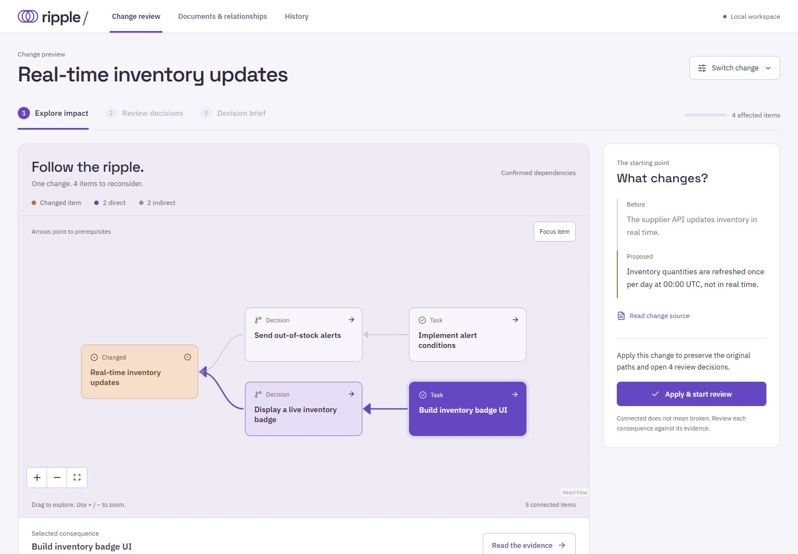
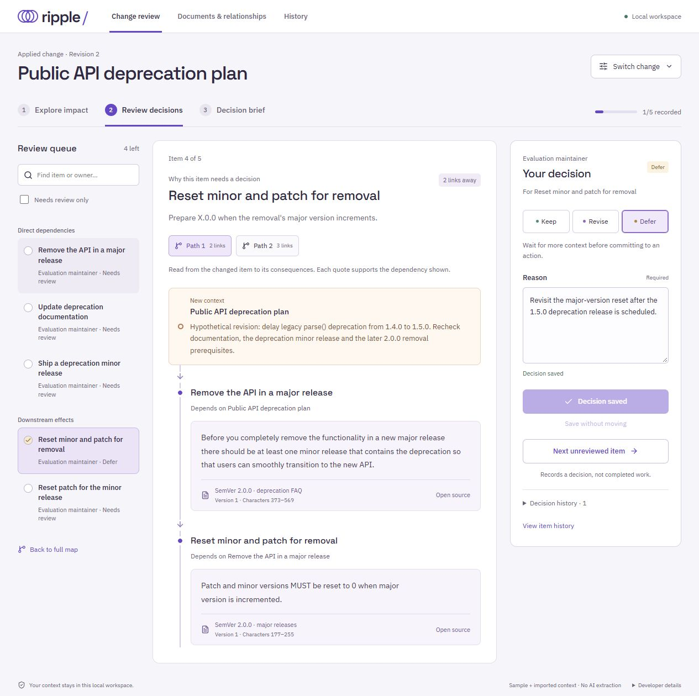
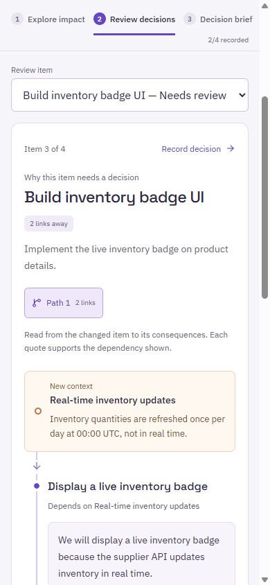
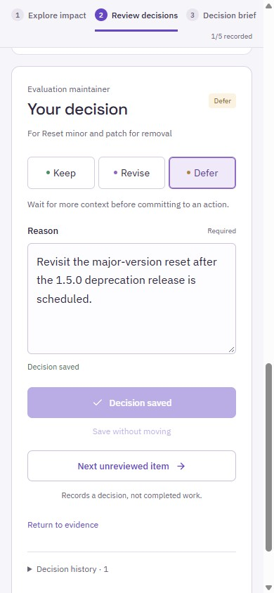
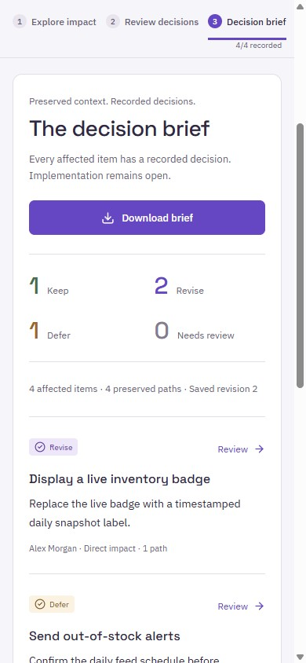

# From consequences to decisions

2026-11-15 KST. Working local preview: http://127.0.0.1:4333.

The user rejected cosmetic improvements as insufficient for the competition. This iteration changes the task itself: explore a proposed change, read the evidence while recording decisions, then take a portable decision brief away. Existing native Relate traversal and saved snapshots remain authoritative.

## Design judgment

The current-run [baseline capture](evidence/studio-01-before.jpg) showed three structural problems: original quotes were behind buttons beneath a large map, each decision required manual item selection, and finishing the queue produced no useful handoff. The previous blue surface dominated the screen without making its evidence easier to read.

The new palette uses porcelain, plum, iris and a restrained warm change marker. Space Grotesk and IBM Plex Sans remain local assets. The graph is one stage of the workflow; a readable evidence trail is the center of the actual review. Product Design's audit framework, frontend-design, React guidance and the current [Web Interface Guidelines](https://raw.githubusercontent.com/vercel-labs/web-interface-guidelines/main/command.md) informed the work. No new dependency, framework, model call or external design upload was needed.

The [official judging rules](https://relate.devpost.com/rules) name creativity, usefulness, completeness, clarity and connected context. The [main page](https://relate.devpost.com/) still presents a different weighted breakdown; this iteration targets the shared criteria without assuming a final scoring interpretation. It does not establish human validation or predict a competition outcome.

## 1. Explore impact — working

An actual change title replaces the repeated generic heading. Before/after and Apply sit beside the pale interactive graph; Switch change retains the bounded, paged selector. Direct/indirect node labels supplement color. Pan, zoom, fit, focus and keyboard node selection remain available. Exclusions explicitly distinguish bounded results from completed traversal.

Inventory preview/apply returned exactly D1/D2/T1/T2; T3 stayed outside the ripple. The independent SemVer fixture returned five targets, three direct and two indirect. Applying starts the direct-first review queue and preserves revision-1 evidence. The graph is a dependency map, not a prediction of failure.

## 2. Read evidence and record a decision — working

The queue groups direct dependencies and downstream effects, with owner/title/ID search and a needs-review filter on desktop. Narrow screens use a labeled native item selector. The evidence trail places the new context above exact original quotes; alternate paths remain individually selectable and synchronize their edge highlight with the map. Original source versions still open in the existing native dialog.

Save & continue waits for a successful write before selecting the next unreviewed item; the last saved decision opens the brief. Save without moving retains the current item. Skipping preserves the in-memory draft. Failed saves retain the decision/reason, stay on the same item and keep the error scoped to that item. Saved values, unsaved changes and missing reasons remain distinct. An unload guard protects review drafts from accidental page departure; drafts are still not durable storage.

Inventory review exercised all four decisions. A deliberately blocked D2 save stayed on D2; switching to T1 did not inherit its error; returning restored the draft/error and retry advanced only after success. SemVer's two- and three-link CORE_RESET paths retained all quotes. The FAQ source opened at UTF-16 [373, 569); Escape restored trigger focus. Mobile source: [capture](evidence/studio-07-mobile-source.jpg). Mobile map: [capture](evidence/studio-09-mobile-map.jpg).

## 3. Take away a decision brief — working

The brief separates Keep, Revise, Defer and Needs review, lists owners/reasons and links each item back to review. It explicitly says implementation remains open. Unsaved edits are disclosed and excluded. The local Markdown download includes the change's original evidence, all saved decisions and history, every path, unique dependency evidence, source versions/hashes/UTF-16 ranges, exclusions and traversal warnings. It is a review artifact, not a database backup.

Inventory finished with one Keep, two Revise and one Defer. Automatic transition, refresh persistence and the downloaded file were checked. The earlier incomplete download included saved reasons and excluded a typed-but-unsaved T1 reason. After adding the change's own evidence to the export, blocking that evidence request prevented an incomplete file and exposed retry; unblocking produced a SemVer brief with all seven paths, six unique edge evidence blocks, the change source hash and the exact saved reason. All generated review decisions are automated QA data in an isolated demo store, not human adjudication.

## Verification and limits

Final `npm run verify` passed **54/54 tests** plus formatting, strict types, skill integrity, native Relate context and the production build. Initial JS is 289.61 kB (87.94 kB gzip); lazy canvas 234.39 kB (76.88 kB gzip); CSS 66.51 kB (12.89 kB gzip). These are build sizes, not a responsiveness benchmark. Full check details: [QA.md](QA.md).

Native integration tests cover queue ordering, recorded/missing reviews, wraparound and empty results; the exporter tests exact Unicode/multiline/backtick text, native saved records/history, source identity matching, original ranges/hashes, multiple paths and limited/missing-evidence disclosure. Existing native DB/API/rollback/reopen tests remain in the full gate.

Actual responsive checks covered initial 1440×1000 exploration, final 1280×720 desktop review (1265px document/client width), 1024×900 intermediate review (1009px) and 390×844 mobile (375px), with no document overflow. The final desktop full-page capture is above; the [1024px capture](evidence/studio-10-tablet.jpg) shows the native selector and evidence/form columns. Mobile Apply focused `studio-content` at approximately 94px below the sticky navigation. View item history focused `main-content` at the top after a long review; Documents received a mobile layout/navigation smoke check. These shared-view checks do not rerun every ingestion workflow.

Resolved implementation attempts: a new test initially used the wrong store accessor (`changeDetail` instead of `getChange`); a missing-evidence fixture left another valid copy of the same edge and was corrected to make every copy unavailable. TypeScript also caught a preview-only branch accessing an already-narrowed-away saved detail. Mobile inspection exposed adjacent links running together and History landing at the previous scroll position; both were fixed and rechecked. These failed attempts were corrected, not counted as passing checks. Some new-tab screenshots failed or repeated tiles after viewport changes. Those were rejected; accepted CDP viewport captures and a normal final desktop full-page capture were saved and visually reopened. Earlier Explore/mobile captures document the states tested during implementation; the final desktop and mobile decision captures include the subsequent corrections.

The final clean desktop tab had no warning/error logs. Expected failed-request logs came from deliberate network blocking, which was cleared. Temporary viewport/device overrides were reset, and the separate fresh-apply owner at port 4334 was stopped. The deliverable owner remains at port 4333. Exact-HEAD CI passed for `e7d28a70028ff87a2934fbdf14d9cef21ba9ee5e` ([Windows run](https://github.com/piecemakerz/Ripple/actions/runs/43597641255)); it reports a dirty worktree and does not cover these new local edits.

The check uses browser emulation, not physical devices or every browser engine. It is not full screen-reader/WCAG certification or a measured usability improvement. Dense graphs can still require Focus item or the textual evidence trail. Unsaved review drafts remain memory-only; UI stage/search/selection are not deep-linked. No new server/API/schema/fixture behavior, dependency version, paid agent, publication or deployment was introduced.

Next competition evidence: observe real users doing the same change review with their current method and Ripple, measuring missed dependencies, correct evidence retrieval and time to a defensible decision. Then record a two-minute demonstration ending with the decision brief. Those measurements and a public recording remain outstanding.
