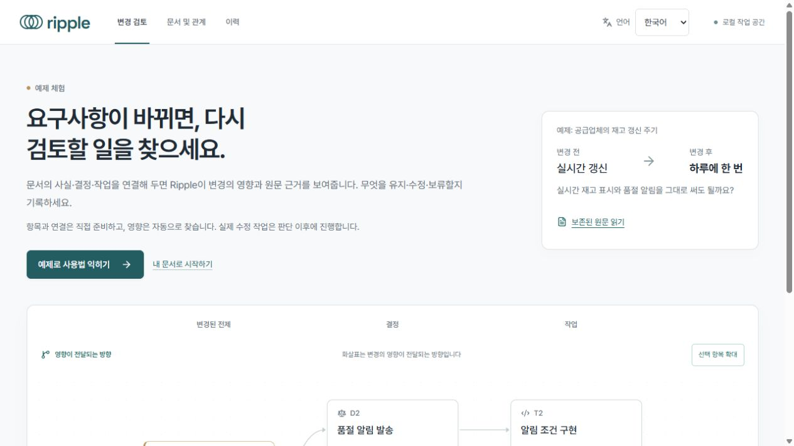
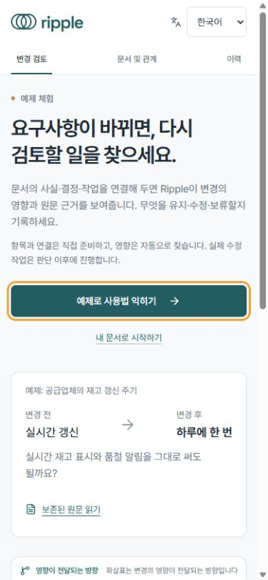
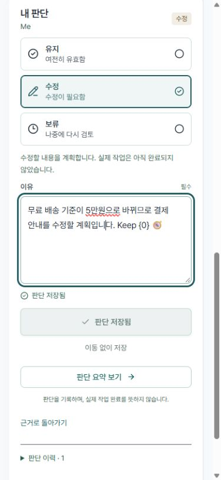

# 처음 사용하는 사람을 위한 개선 결과

2026-11-25 KST · [종합 감사](NOVICE_UX_AUDIT.md)의 F01–F11을 구현했다. 기존 미커밋 작업 트리 위에서 수행했으며, 변경 내용의 이해도와 실제 조작 가능성을 구분한다. 이 기록은 **AI 개발·화면 검증**이다. 독립 사람 참가자는 0명이며 학습 시간·성공률·만족도 향상을 측정하지 않았다.

## 개선 사항과 확인 결과

| 감사 항목               | 구현한 개선                                                                                                                                                                                 | 이번 실행에서 확인한 근거                                                                                                                                                                                      |
| ----------------------- | ------------------------------------------------------------------------------------------------------------------------------------------------------------------------------------------- | -------------------------------------------------------------------------------------------------------------------------------------------------------------------------------------------------------------- |
| F01 초안 손실           | 문서 제목·본문, 항목, 관계 후보, 변경 준비 및 관계 대체 입력을 검토 초안과 함께 이탈 경고에 포함했다. 성공한 저장만 해당 입력의 기준을 갱신한다.                                            | 실제 문서 및 관계 수정 중 새로고침에서 브라우저 `beforeunload` 발생. 이동 취소 후 입력 유지. 문서 저장 뒤에는 경고 없이 새로고침됐다.                                                                          |
| F02 목적·입출력         | 첫 화면에 “요구사항이 바뀌면, 다시 검토할 일을 찾으세요”와 문서→항목/연결→영향/원문→판단의 역할을 명시했다. 수동 준비와 이후 실제 수정 작업도 설명한다.                                     | [최종 첫 화면](evidence/first-use-2026-11-25/23-final-entry.jpg), [영어 첫 화면](evidence/first-use-2026-11-25/01-entry-en.jpg).                                                                               |
| F03 안내 불일치         | 한국어 안내의 작업·원문 제목을 실제 표시와 맞췄다. 영향 전달 방향은 API→결정→작업, 저장된 의존 관계는 작업→필요한 항목으로 설명한다.                                                        | [간접 영향 안내](evidence/first-use-2026-11-25/12-guide-impact.jpg), T1 원문 49–138 열기.                                                                                                                      |
| F04 준비 단계 혼선      | 문서 준비를 원문 저장→근거가 있는 항목 추가→항목 연결→변경 미리보기의 네 과업으로 맞추고 현재 과업만 표시한다. 관계/변경의 근거 선택 중에는 항목 추가 양식을 숨기고 원래 작업으로 돌아간다. | [모바일 네 단계](evidence/first-use-2026-11-25/20-mobile-documents.jpg), [변경용 근거 선택](evidence/first-use-2026-11-25/13-update-evidence.jpg). 새 원문 저장 뒤에도 변경용 근거 선택 맥락이 유지됐다.       |
| F05 읽기 과업 방해      | 상세 예제의 원문·관계 읽기에서는 생성·편집 양식을 숨긴다. 선택적으로 도구를 열 수 있으며 입력은 보존한다. 안내에 다시 진입해도 읽기 화면부터 시작한다.                                      | [관계 읽기 화면](evidence/first-use-2026-11-25/11-guide-reading.jpg), 개인 문서 도구 사용 후 안내 재진입 확인.                                                                                                 |
| F06 기본 판단 편향      | 새 검토는 미선택으로 시작한다. 유지·수정·보류와 이유를 직접 입력해야 저장할 수 있다. 저장된 판단은 그대로 불러온다.                                                                         | [미선택 검토](evidence/first-use-2026-11-25/03-review-unselected.jpg). 이유만 입력하면 저장 비활성. 연속 선택/입력이 이전 상태를 덮어쓰지 않도록 최신 상태에 병합하고 회귀 테스트를 추가했다.                  |
| F07 예제 이후 단절      | 빠른 예제와 상세 안내 완료 후 모두 ‘내 문서로 첫 검토 시작’을 바로 노출한다. 선택 안내는 접고, 일시정지 시에는 재개 안내를 펼친다.                                                          | [빠른 완료](evidence/first-use-2026-11-25/05-sample-handoff.jpg), [상세 안내 완료](evidence/first-use-2026-11-25/14-guide-handoff.jpg). 두 버튼 모두 문서 시작으로 이동.                                       |
| F08 검토 맥락·선택 소실 | 변경 전후를 검토 화면에 항상 보여 준다. 전체 지도와 영어 원문은 필요할 때 펼치되 모든 근거 경로는 유지한다. 적용 후 선택한 영향 항목을 유지한다.                                            | T1 선택→적용→T1 검토 유지. [개인 변경 비교](evidence/first-use-2026-11-25/09-personal-review.jpg), [모바일 비교](evidence/first-use-2026-11-25/18-mobile-review.jpg).                                          |
| F09 보이는 제목 검색    | 정확한 한국어 예제 제목은 해당 항목 필터로 변환한다. 일부 제목은 일치하는 항목을 제안한다. 일반 검색과 저장된 원문은 바꾸지 않는다.                                                         | ‘실시간 재고 배지 표시’로 D1의 변경/검토 2건, ‘배지’ 제안에서 T1 선택 후 해당 기록 확인. [검색 결과](evidence/first-use-2026-11-25/10-history-title.jpg).                                                      |
| F10 인용 오류 설명      | 원문에 없는 문장과 반복 구절을 구분해 설명한다. 오류 상태와 설명을 입력란의 ARIA 속성으로 연결한다.                                                                                         | 번역·의역 문장 0건 오류, `30,000원`의 두 위치 7–14/39–46 선택, 전체 원문의 정확한 범위 확인. [오류 화면](evidence/first-use-2026-11-25/07-quote-error.jpg).                                                    |
| F11 시각 위계           | 문서·이력 입력을 밝은 표면으로 정리하고 주요 행동·선택을 petrol로 맞췄다. 주요 보조 문구/상태 크기를 올리고 기술 ID보다 제목을 우선한다.                                                    | [최종 첫 화면](evidence/first-use-2026-11-25/23-final-entry.jpg), [모바일 판단](evidence/first-use-2026-11-25/19-mobile-decision.jpg), [640px 변경 준비](evidence/first-use-2026-11-25/22-compact-update.jpg). |

## 실제 데이터로 실행한 흐름

샘플에서 A1 변경의 영향은 D1/D2/T1/T2 네 항목이며 T3는 제외됐다. T1의 원문과 간접 경로를 읽고 적용하자 리비전 2와 T1 검토가 열렸다. 새 판단은 미선택이었다. 검토 요청을 일시 차단한 실패에서는 이유와 0/4 상태가 유지됐고, 차단 해제 후 재시도와 세 판단 유형을 저장해 4/4에 도달했다. 판단은 유지 1·수정 2·보류 1이며 실제 구현 완료를 뜻하지 않는다.

새 한국어 사례는 ‘배송 정책 · 개선 검증’으로 만들었다. v1의 30,000원 무료배송 사실과 결제 화면 안내 작업을 각각 원문에서 만들고, 두 번째 문장 29–79를 근거로 작업→사실의 후보를 확인·확정했다. v2의 50,000원 기준 0–35로 사실을 변경하자 결제 화면 안내 작업 하나가 영향받았다. 기존 관계의 v1 근거는 그대로 유지됐다. 이유 `무료 배송 기준이 5만원으로 바뀌므로 결제 안내를 수정할 계획입니다. Keep {0} 🧭`를 저장한 후 새로고침과 새 탭에서 동일한 판단·문장을 확인했다. 추가 모바일 검사에서는 새 보완 공지를 저장하고 ‘인용문 선택’이 변경용 선택으로 돌아오는 것을 확인했다.

상세 안내는 이미 저장된 샘플로 7단계를 재생해 원문·관계·간접 영향·적용 기록·4/4 판단·요약·이력을 확인했다. 새 변경을 중복 적용하지 않았다. 완료 시 바로 개인 문서로 이동할 수 있었고, 이후 안내 일시정지는 재개 버튼을 펼치고 초점을 이동했다.

초안 보호의 실제 경고는 CDP `Page.javascriptDialogOpening`의 `type: beforeunload`, 브라우저 처리 가능 상태와 이어진 취소 결과(`result: false`)로 확인했다. 브라우저 도구가 이동을 취소했으며 사용자가 수동으로 경고 버튼을 눌렀다고 주장하지 않는다. 문서 제목/본문과 관계 대체 이유가 각각 보존됐다. **영구 자동 저장은 아니다.** 강제 종료·브라우저가 경고를 생략한 상황까지 복원하는 기능은 추가하지 않았다.

## 검증과 한계

- 최종 `npm run verify`: **79/79 통과**, 실패·건너뜀 0. 포맷, strict TypeScript, skill integrity, 설치된 native Relate 문맥, 실제 DB 테스트와 production build 포함. 로그는 Git 제외 경로 `.runtime/first-use-verify-final.log`다. 앞선 78개 통과 이후 연속 입력 회귀 검사와 UI 보완을 포함해 최종 게이트를 다시 실행했다.
- 최종 빌드: 초기 JS 441.27 kB / gzip 132.50, lazy canvas 235.34 / 77.25, CSS 132.78 / 24.52. 이번 변경에서 패키지·백엔드·Cypher·스키마·원문 fixture는 수정하지 않았다.
- 브라우저: 1280×720, 390×844, 640×900에서 실제 캡처와 DOM 크기를 함께 확인했다. 수락한 좁은 화면에서 가로 문서 넘침은 없었다. 원문 모달의 Escape 닫기와 트리거 초점 복귀, 오류 설명 연결, 언어/화면 이동 중 입력 유지도 확인했다. 전체 키보드 감사·물리 기기·스크린리더 검사는 수행하지 않았다.
- 실제 200% 브라우저 확대는 키 입력 후 폭/DPR이 변하지 않아 검증하지 못했다. 640px 리플로 확인을 200% 확대 통과로 대체하지 않는다.
- 검증 도중 잘못된 역할 선택자, 비동기 표시/초점 이동 중의 빠른 클릭, 중복 텍스트 선택자, 일부 full-page 캡처 시간 초과가 있었다. 현재 상태를 다시 읽고 정확한 대상·표시 대기로 재검증했다. 다른 탭/크기를 찍은 캡처와 영수증 대신 상단을 찍은 이미지는 수락 근거에서 제외했다. 의도적 요청 차단을 제외한 마지막 세 탭의 경고/오류 로그는 비어 있었다.
- `npm run ci:status`는 커밋 `e7d28a70028ff87a2934fbdf14d9cef21ba9ee5e`의 [CI 성공](https://github.com/piecemakerz/Ripple/actions/runs/43597641255)과 dirty 작업 트리를 보고했다. **원격 CI는 이번 미커밋 변경을 검증하지 않는다.** 이번 변경의 게이트는 위 로컬 실행이다.
- 운영 DB와 별개인 두 native store를 사용했고 각각 한 서버만 소유했다. 요청 차단을 해제하고 임시 탭/4362 서버를 닫았다. viewport reset 후 새 1280px 탭에서 확인한 **[로컬 미리보기](http://127.0.0.1:4363/)**만 유지한다. 추가 에이전트·유료 모델 API·커밋·푸시·공개 배포는 없었다.

처음 보는 사람의 무도움 성공 여부는 [감사의 사람 관찰 과업](NOVICE_UX_AUDIT.md)과 X06/X07로 확인해야 한다. 핵심 다음 검증은 제품의 용도 설명, 간접 영향의 이유 설명, 자기 문서의 첫 판단 저장, 판단과 구현 완료의 구별이다. D16/X16은 구현 선택과 실제 관측을 보존한다.

## 화면 근거 목록

수락한 현재 실행의 JPEG는 `evidence/first-use-2026-11-25/`의 01–23번 23장이다. 초기 01–10은 핵심 구현 후, 11–14는 안내/작업 맥락 보완 과정, 15–23은 마지막 전체 게이트 이후 확인한 화면이다. 해당 화면의 관측 범위만 주장하며 모든 이미지를 마지막 빌드 캡처로 취급하지 않는다.

