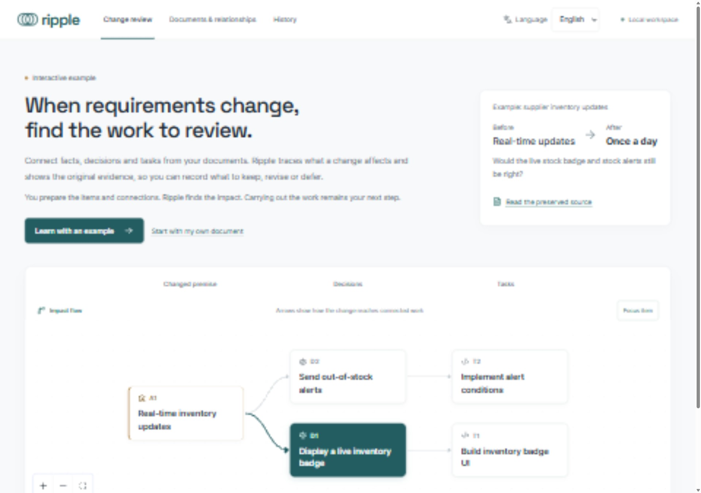
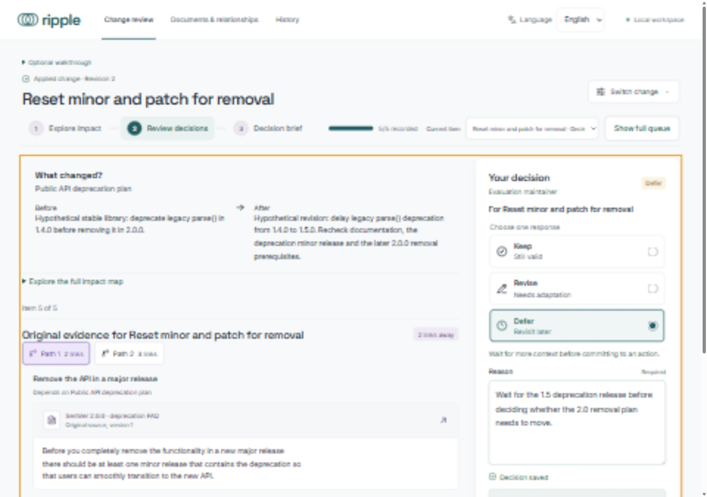
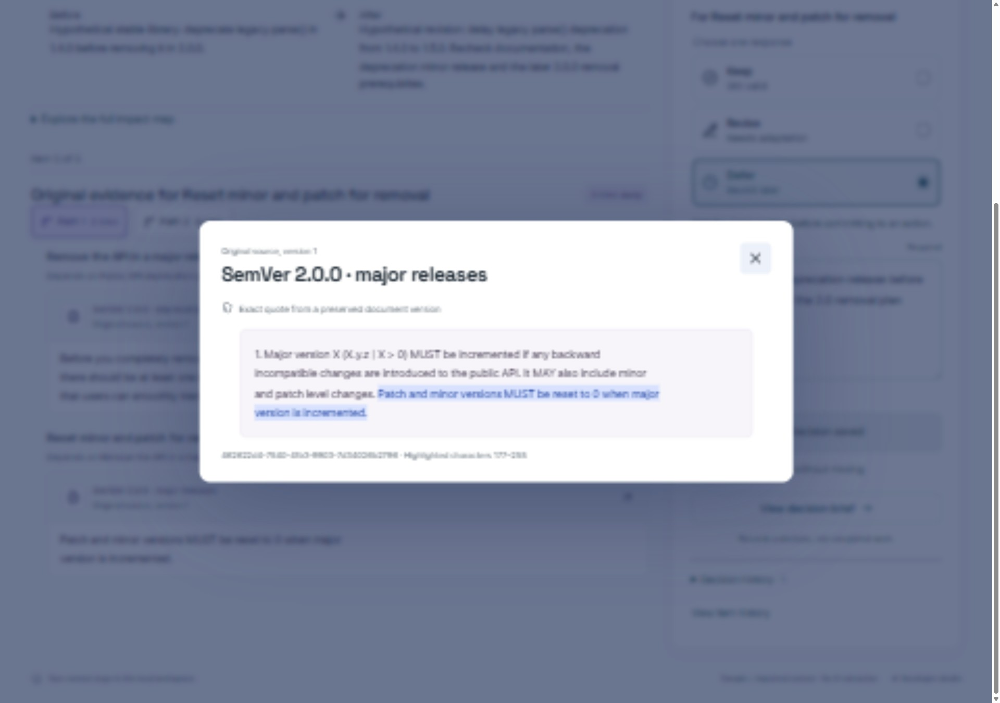
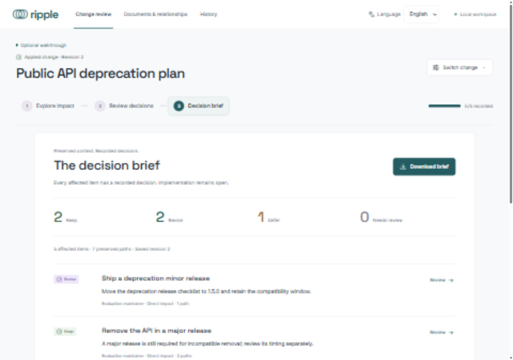
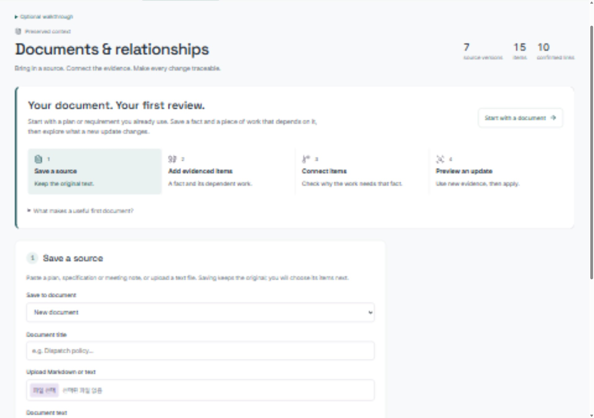
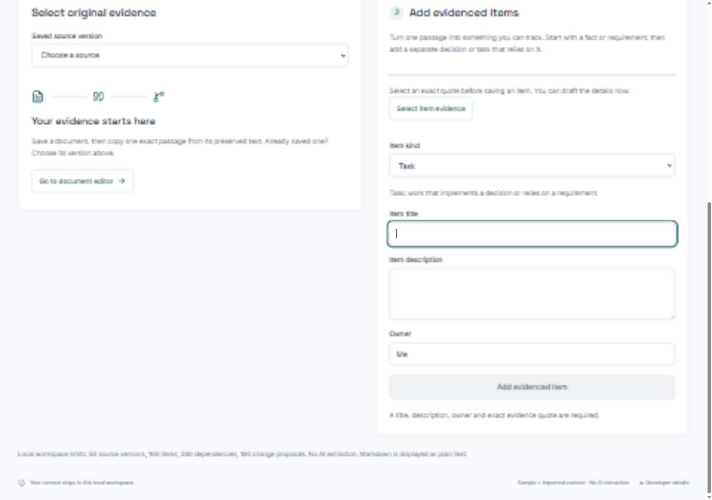
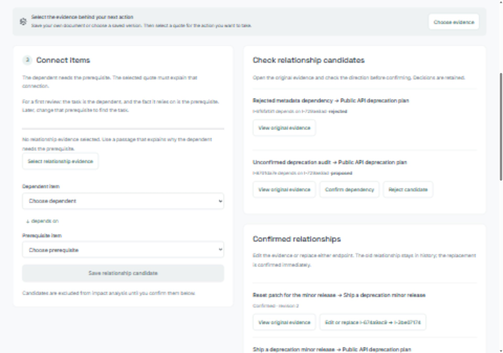
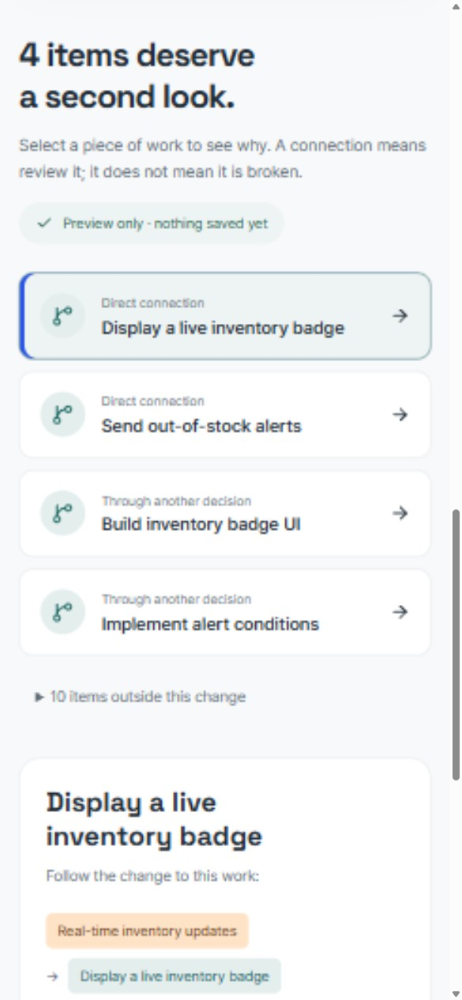
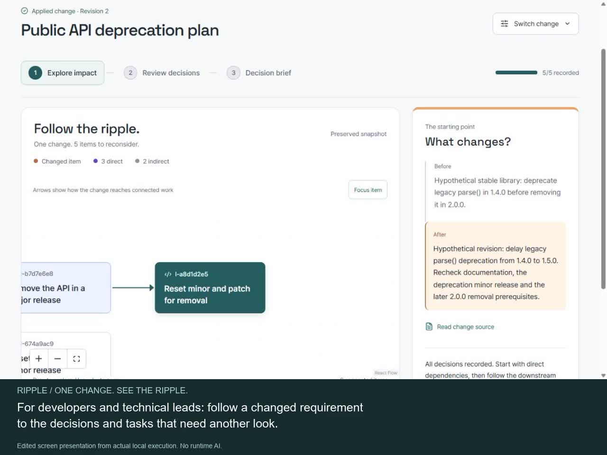

# 개선 후 수상 충분성 재검토

후속: 사용자 요청에 따라 R5/R6 수정, 실제 Ripple 사례, 새 110초 영상과 일치하는 로컬 전달물을 준비했다. [개선 결과와 남은 항목](HACKATHON_IMPROVEMENTS_2026-11-26.md)을 현재 상태로 읽고, 아래 관측은 개선 전의 역사적 근거로 보존한다.

확인일: **2026-11-26 KST**. [앞선 준비 평가](HACKATHON_READINESS_2026-11-26.md) 이후의 비판적 후속 검토다. 제품 코드와 기존 ZIP·영상은 변경하지 않았다. 공개 규정·유사 출품작, 현재 브라우저 화면, 실제 다운로드, native Relate API 진단, 현재 코드와 검증된 묶음의 일치 여부를 확인했다.

**판정: 출품할 만한 기술적 MVP는 갖췄지만, 현재 증거로 수상에 충분하다고 평가하지 않는다.** 공개 제출은 미완료이며, 이를 해결한 뒤에도 준비 비용을 감수할 이유와 유사 출품작 대비 선택할 이유가 약하다. “경쟁력 있는 MVP”라는 이전 표현은 작동성과 재현성에 관한 판단으로 좁혀야 한다. 상위권이 입증됐다는 뜻으로 읽히면 과도하다.

공식 선정은 상위 **3개 출품작**이다. 갤러리는 확인 시 **86개**를 표시했다. 이것이 86개 모두의 자격·완성도를 검증했다는 뜻은 아니며, 3/86을 승률로 계산하지 않는다. 전체 경쟁작을 실행하거나 심사 점수를 확보하지 않았으므로 예상 순위·수상 확률은 제시하지 않는다. [Rules §5](https://relate.devpost.com/rules) · [현재 갤러리](https://relate.devpost.com/project-gallery)

## 심사 기준별 판단

배점은 공식 값이며 아래 수준은 자체 정성 평가다. 전체 테스트 숫자를 심사 점수로 환산하지 않는다. [공식 기준](https://relate.devpost.com/rules)

| 기준                 | 배점 | 현재 판단                              | 판단을 제한하는 근거                                                                                                                                                       |
| -------------------- | ---: | -------------------------------------- | -------------------------------------------------------------------------------------------------------------------------------------------------------------------------- |
| Relate와 연결된 맥락 |   30 | 강점                                   | 실제 native 탐색, 다중 경로, 정확한 원문과 변경 전 경로 보존, 원자적 저장·재시작이 중심 기능이다. 다만 같은 기술 특성을 내세우는 다른 출품작도 있다.                       |
| 기능과 완성도        |   25 | 핵심 흐름은 높음, 운영 신뢰에는 보완점 | 진입·원문·검토·요약·다운로드가 이어진다. 오래된 검토 요청이 최신 판단을 덮어쓰는 동작을 이번에 재현했다. 문서 갱신 후 관계 유효성은 사용자가 관리해야 한다.                |
| 유용성               |   20 | 가장 약한 영역                         | 누가 준비·유지 비용을 지불하고 어떤 누락을 줄이는지 관측하지 않았다. SemVer 사례는 그래프의 작동을 설명하지만 실제 업무 손실을 막는 장면이 약하다.                         |
| 문서와 재현성        |   15 | 로컬은 높음, 공개 전달은 미완료        | ZIP의 코드 108개 파일이 현재 구현과 일치한다. 공개 main은 11월 14일 `e7d28a7`이다. 최신 화면·자료를 심사자가 같은 버전으로 받지 못한다.                                    |
| 창의성               |   10 | 차별화 입증이 부족                     | “로컬 그래프 + 영향 경로 + 근거 + 검토 결과” 조합만으로는 독창성을 설득하기 어렵다. 변경 시점의 원문·경로·인간 판단을 함께 재현하는 차이를 업무 사례로 보여줄 필요가 있다. |

실사용자 수나 시간 절감 수치는 공식 필수 제출 항목이 아니다. 독립 사용자 0명이라는 이유만으로 실격이라고 판단하지 않는다. 다만 수상을 목표로 할 때 유용성 주장을 강화할 수 있는 중요한 증거가 빠져 있다. AI 추출·MCP·벡터 검색·3D·협업을 추가해야 한다는 조건도 확인되지 않았다.

## 새로 확인한 경쟁 맥락

비교 대상은 문제와 전달 방식이 겹치는 공개 제출물이다. 타인의 소개·README를 실행 성공이나 고객 성과로 바꾸어 쓰지 않았다. 경쟁 코드를 내려받아 실행하지 않았고 해당 프로젝트의 최종 자격도 판정하지 않았다.

| 비교 대상                                                                                    | 공개 자료에서 확인한 내용                                                                                                                                                                                                                                                                                                                                                  | Ripple에 주는 질문                                                                                                                                                  |
| -------------------------------------------------------------------------------------------- | -------------------------------------------------------------------------------------------------------------------------------------------------------------------------------------------------------------------------------------------------------------------------------------------------------------------------------------------------------------------------- | ------------------------------------------------------------------------------------------------------------------------------------------------------------------- |
| [Data Impact Graph](https://devpost.com/software/data-impact-graph)                          | 데이터 변경의 downstream 경로와 검토용 Markdown을 설명한다. [README](https://github.com/mhatipog/data-impact-graph/blob/main/README.md)와 [OpenLineage 안내](https://github.com/mhatipog/data-impact-graph/blob/main/OPENLINEAGE.md)는 기존 이벤트에서 관계를 가져오는 입력 경로를 제공하며, 공개 `core.py`에는 실제 Relate 경로 쿼리가 있다. 이번에 실행 검증하지 않았다. | Ripple 사용자가 관계를 직접 준비하는 비용을 감수해야 할 추가 가치가 무엇인가? 다른 도메인의 자동 수집을 그대로 베낄 필요는 없지만, 입력 부담의 비교는 피할 수 없다. |
| [Kept](https://devpost.com/software/kept-zkpbc3)                                             | 출품 설명은 메모에서 검토 후보를 만들고, 수락한 약속·의존 관계·변경 원문을 따라가는 흐름을 제시한다. 모델 제안·브라우저 저장·검사 수치는 제출자 설명이며 직접 검증하지 않았다.                                                                                                                                                                                             | “메모를 넣으면 검토 가능한 초안이 나온다”와 비교해 Ripple의 수동 방식이 언제 더 신뢰할 만하고 덜 번거로운지 설명할 수 있는가?                                       |
| [Deadline Trace](https://devpost.com/software/deadline-trace-evidence-behind-every-deadline) | 출품 설명에 원문 줄, 검토 타임라인, 영구 Relate store와 read-only 검사 명령이 있다. 직접 실행하지 않았다.                                                                                                                                                                                                                                                                  | 영구 저장·원문·검사 가능한 DB는 좋은 기본기지만 그것만으로 고유성이 충분한가?                                                                                       |

Data Impact Graph 역시 변경 문장의 의미로 실제 고장을 예측한다고 주장하지 않는다. 따라서 Ripple만 의미 추론이 없다는 이유로 불공정하게 감점하지 않는다. 비교에서 더 중요한 차이는 **입력 획득, 업무 결과의 구체성, 기존 작업에 돌려주는 방식**이다. 테스트 개수·노드 수·화려한 그래프는 이 비교의 순위 기준으로 사용하지 않았다.

## 우선순위가 높은 발견

### R1 · P0 · 최신 구현과 심사자가 받는 버전이 다름

GitHub 연결에서 공개 main을 다시 확인했으며 `e7d28a70028ff87a2934fbdf14d9cef21ba9ee5e`다. 이번 로컬 UI·진입 링크·judge 명령·영상과 같은 제출 버전은 아직 공개되지 않았다. 로컬에서 정상 작동하는 ZIP을 만들었다는 사실은 로그인 없는 공개 접근이나 Devpost 접수의 증거가 아니다.

**필요한 완료 기준:** 공개 커밋 하나를 정하고 그 버전의 설치·실행을 확인한다. 영상·소스·DB 자료가 그 버전과 일치해야 한다. 로그인 없는 영상 재생/자료 접근과 실제 접수를 확인한다. CI는 프로젝트의 내부 검증 기준이며 대회가 CI 자체를 요구하는 것은 아니다. 마감은 **12월 12일 11:00 KST**다. 개인 자격·팀·원본 착수/재사용 사실은 참가자 확인이 필요하다. [공식 제출 요건](https://relate.devpost.com/rules)

메인은 영구 store를 저장소에 포함하거나 데모에서 보여주도록 안내한다. 활성 사용자 DB를 Git에 넣을 필요는 없다. 영상은 발표 형식도 허용되므로 정지화면 편집이라는 이유만으로 요건 미달로 분류하지 않는다. [메인 체크리스트](https://relate.devpost.com/)

### R2 · P1 · 준비 비용을 이길 효용이 관측되지 않음

현재 자기 문서 흐름에는 문서 저장, 원문 인용 선택, 항목 종류·제목·설명·담당자 작성, 의존 방향 선택, 관계 후보 생성·확인, 변경 준비가 필요하다. 이 구조는 명시적 근거와 사람이 확인한 관계를 만드는 장점이 있다. 그러나 이미 알고 있던 관계를 사용자가 입력한 뒤 다시 보여주는 작업이 될 위험도 있다. 이번 캡처 05–07에서 과업을 확인했지만 실제 준비 시간은 측정하지 않았다.

고정 SemVer 사례는 원문 4개, 항목 9개, 관계 8개 중 확정 6개다. 실행 명령은 이 준비를 자동으로 해준다. 따라서 데모의 빠른 결과를 자기 자료로 시작하는 사용자의 속도로 해석할 수 없다. AI가 만든 그래프와 예상 경로를 같은 평가기가 재현하는 검사는 구현 계약을 검증하지만, 그래프의 업무적 완전성·독립 정답·수요를 입증하지 않는다.

**필요한 완료 기준:** 공개 가능한 실제 변경 사례 하나에서 현재 방식으로 찾은 대상·놓친 작업·준비 비용을 먼저 기록하고 Ripple로 비교한다. 낯선 대상 사용자 2–3명 관찰을 권하지만, 이 수는 통계적 합격선이나 공식 요건이 아니다. 관계 만들기·교육·수정 시간을 포함하고 절감이 없다면 그대로 기록한다. 자동 추출을 바로 붙이기보다 어떤 입력 단계가 비용을 만드는지 확인한다.

### R3 · P1 · 영향 후보 탐색을 의미 분석 성과로 과대평가하면 안 됨

격리 native DB/API에서 아래 두 변경을 각각 적용했다. 결과는 모두 **동일한 5개 항목·7개 경로**였다.

| 변경                                                                        | 관측                                        |
| --------------------------------------------------------------------------- | ------------------------------------------- |
| `Hypothetical stable library`를 `Illustrative stable library`로 표현만 변경 | CORE_RESET, DOCS, MAJOR, MINOR, PATCH_RESET |
| deprecated release를 1.4.0에서 1.5.0으로 연기                               | 같은 5개 대상                               |

이는 [`impact(id)`](../server/store.ts)의 설계와 일치한다. 확정된 연결 구조로 검토 후보를 찾고, 실제 수정 여부는 사람이 판단한다. 완전히 동일한 본문은 `NO_CHANGE`로 거부됐다. 따라서 “똑같은 변경도 허용된다”는 결함 주장은 맞지 않는다.

현재 UI의 “연결됐으니 검토할 대상이며 고장을 뜻하지 않는다”는 설명은 올바르다. 남은 문제는 **후보 탐색의 이익이 검토 잡음보다 큰가**다. SemVer에서 minor 일정이 바뀌어도 major가 증가할 때 patch/minor를 0으로 만드는 규칙은 그대로다. 그 항목을 다시 보는 것이 실제로 중요한 업무였는지 독립 판단이 없다. 원문을 정확히 보존했다는 사실과 해당 원문이 특정 일정·관계의 해석을 정당화한다는 사실도 구분해야 한다.

**필요한 완료 기준:** 대표 사례에서 바뀌어야 할 결정, 그대로 둘 결정, 관계가 없어 제외할 작업을 각각 설명한다. 예상치 못한 간접 작업 하나를 원문으로 납득시킨다. 실제 변경 의미까지 자동 판단하는 제품으로 홍보하지 않는다. 근거 없이 모든 연결을 좁히거나 끊는 수정도 하지 않는다.

### R4 · P1 · 영상은 생성됐지만 최종 심사 전달물로는 약함

현재 MP4에서 새로 프레임을 추출해 확인했다. 첫 장면은 이미 5/5 판단이 끝난 상태이고 그래프 왼쪽 노드 일부가 잘려 있다. 다음 장면은 적용 전 상태로 돌아간다. 기술 시연의 시간 순서와 문제를 알아차리는 순간이 약해진다. 첫 판단 장면은 **63초부터**, 최종 10초는 실행 안내다. 자기 문서에서 시작하는 비용은 영상에 없다.

110초 길이, 영어 자막, 출처·AI 고지는 갖췄다. 발표 영상은 공식적으로 허용된다. 무음이나 정지화면 자체를 위반으로 보지 않는다. 다만 실제 선택→원문 열기→판단 저장을 보여주는 짧은 연속 장면보다 상호작용의 증명력이 약하고, 앞부분의 경로·개수 설명에 비해 “그래서 어떤 누락을 막았는가”가 덜 선명하다.

**정정:** 이전 “영상 완성”은 파일 생성·디코딩·일부 대표 프레임 확인까지의 완료다. 모든 장면의 심사 설득력이 충분하다는 판단은 아니며, 이번 검토에서 첫 장면의 잘림과 이야기 순서가 보완점으로 확인됐다.

**필요한 완료 기준:** 첫 10–15초에 사용자·변경·놓칠 작업을 보여준다. 첫 결과는 30초 안에 제시한다. 실시간 조작 구간 하나로 원문→판단→다운로드/복원을 보여주고, 그래프가 잘리지 않게 한다. 마지막은 검토 대상 수보다 실제 다음 행동으로 끝낸다. 이는 내부 편집 목표이며 대회가 정한 시간 배분은 아니다.

### R5 · P1 · 오래된 검토 저장이 최신 판단을 덮어쓸 수 있음

서로 같은 pending 상태를 읽은 두 클라이언트를 native API로 재현했다. A가 Defer를 저장한 뒤, A의 변경을 읽지 않은 B가 Keep을 저장하자 B의 요청이 성공하고 현재 상태가 Keep으로 바뀌었다. 두 이벤트의 이력은 모두 남았다. 데이터가 완전히 소실됐다고 표현하지 않으며, 이번에는 실제 브라우저 두 탭이 아닌 **오래된 클라이언트에 해당하는 API 순서**를 재현했다.

[`reviewInput`](../server/app.ts)에는 상태·이유만 있고 [`saveReview`](../server/store.ts)는 읽었던 검토 버전을 비교하지 않는다. 쓰기 직렬화는 요청 간 실행 충돌을 막지만, 오래된 사람이 본 상태를 기준으로 한 저장을 거부하지는 않는다. 단일 사용자라도 두 탭·오래 열린 화면에서 발생할 수 있는 신뢰 문제다.

**필요한 완료 기준:** 검토 저장에 예상 revision/버전 토큰을 포함한다. 오래된 저장은 명시적 충돌로 반환하고 입력을 유지하며 최신 판단과 비교한 뒤 다시 저장하게 한다. 정상 저장, 중복 요청, 오래된 요청, 이력 보존을 실제 DB로 검증한다. 이번 재검토에서는 코드를 수정하지 않았다.

### R6 · P2 · 원문 보존과 현재 관계의 유효성이 분리되어 있음

같은 문서의 v2를 저장한 뒤에도 기존 관계는 v1 근거를 사용했고 영향 결과의 경고는 비어 있었다. 이는 과거 원문을 보존하는 계약에 맞으며 v1을 덮어써서는 안 된다. 다만 문서를 계속 사용하는 사람은 어떤 항목·관계를 새 문서에 비추어 재검토해야 하는지 스스로 관리해야 한다.

**필요한 완료 기준:** “이 근거 이후 새 문서 버전이 있음” 같은 재검토 신호와 수동 확인 경로를 제공하는 방안을 검토한다. 새 버전이 존재한다는 사실만으로 모든 관계를 틀렸다고 판단하지 않는다. 여러 번 갱신하는 실제 사례에서 혼란이 관측되면 우선순위를 높인다.

## 이번 화면 감사의 단계와 증거

현재 앱을 in-app browser에서 읽고 탐색했다. 실제 서버 쓰기는 수행하지 않았다. 원문과 기존 저장된 판단은 읽었고, Markdown 다운로드만 새로 생성했다. 별도 API 진단은 사용자 DB와 무관한 in-memory native Relate를 사용했다.

| 단계 | 사용자 과업           | 상태와 관측                                                                                                                                                                                                                          |
| ---- | --------------------- | ------------------------------------------------------------------------------------------------------------------------------------------------------------------------------------------------------------------------------------ |
| 1    | 예제로 시작           | 양호. 목적·수동 준비·실제 구현은 별도라는 경계가 보이고, 재고 사례의 변화가 구체적이다. SemVer 심사 영상과 첫 사례가 달라지는 설명 비용은 남는다.                                                                                    |
| 2    | 저장된 대상 검토      | 양호. URL로 선택·5/5·이유가 복원되고 before/after와 판단을 함께 읽을 수 있다.                                                                                                                                                        |
| 3    | 원문 확인             | 양호. 원문 버전과 UTF-16 [177,255)가 보인다. 정확한 인용 보존은 의미적 타당성의 자동 보증이 아니다.                                                                                                                                  |
| 4    | 요약·다음 행동        | 양호. 2 Keep / 2 Revise / 1 Defer를 구분하고 구현 완료가 아니라고 알린다. **이번에는 8,275-byte Markdown 다운로드를 실제로 받아 내용까지 확인했다.** 이전 다운로드 미확인 범위를 이 조합에서 해소했다. 실제 이슈/업무 반영은 별도다. |
| 5    | 자기 문서 준비        | 주의. 4개 작업 단계는 명확하지만 원문·두 항목·인용·관계 방향·확인을 사람이 준비한다. 새 문서 생성부터 완료까지 다시 실행한 것은 아니다.                                                                                              |
| 6    | 좁은 화면의 영향 선택 | 양호. 390×844 CSS px에서 선택과 설명이 보이고 client/scroll 폭은 모두 380px. 실제 기기·추가 스크린리더·전체 접근성 준수는 평가하지 않았다.                                                                                           |

아래는 모두 이번 실행에서 저장한 화면이다. desktop은 실제 1280×900 CSS px, 캡처는 1920×1350이다. in-app browser의 확대/캡처에서 글자 윤곽이 부드럽게 보이므로 원래 앱의 폰트 품질 결함으로 계산하지 않는다. 기본 캡처의 334px/853px 상태와 그래프 로딩 중 화면은 최종 증거에서 교체했다.

| 1 · 첫 화면                                                        | 2 · 저장된 검토                                                         |
| ------------------------------------------------------------------ | ----------------------------------------------------------------------- |
|  |  |

| 3 · 원문                                                              | 4 · 판단 요약                                                           |
| --------------------------------------------------------------------- | ----------------------------------------------------------------------- |
|  |  |

| 5a · 문서 입력                                                                | 5b · 항목 작성                                                            |
| ----------------------------------------------------------------------------- | ------------------------------------------------------------------------- |
|  |  |

| 5c · 관계 작성·확인                                                               | 6 · 좁은 화면 영향 선택                                                |
| --------------------------------------------------------------------------------- | ---------------------------------------------------------------------- |
|  |  |

영상 첫 장면의 실제 프레임. 왼쪽 그래프가 잘렸고 이미 5/5인 상태에서 시작한다. 이 이미지는 현재 영상에서 새로 추출한 것이며 이번 브라우저 캡처와 구분한다.

## 실제 확인 범위와 다음 판단 기준

- 기존 ZIP·MP4의 SHA-256은 전달 manifest와 일치했다. ZIP의 runtime/검사/fixture/빌드 입력 **108개 파일**이 현재 작업 트리와 일치했다. 따라서 이전 **84/84·새 설치·native 복원** 증거를 같은 코드에 대한 역사적 결과로 유지한다. 이번에 전체 gate를 새로 실행했다고 하지 않는다.
- 새 진단은 `.runtime/critical-review-probe.ts`와 `.runtime/critical-review-probe.json`, 파일 일치는 `.runtime/critical-review-integrity.json`에 있다. 임시 helper는 제품 코드나 자동 회귀 테스트에 추가하지 않았다.
- 실제 새 다운로드는 in-app browser에서 수행했고 내용에 5/5, 세 판단, before/after, 저장된 이유와 원문 정보가 있음을 읽었다. 과거 Chrome 이벤트 대기 실패를 소급 성공으로 바꾸지 않는다.
- 공식 웹 자료와 GitHub 공개 HEAD를 다시 읽었다. 경쟁작은 공개 설명·문서, Data Impact Graph의 일부 source까지만 읽었고 설치·전체 품질·고객 효용은 확인하지 않았다. Kept 페이지의 한 open 요청은 실패했으나 같은 공개 페이지의 find 결과에서 본문을 확인했다.
- 첫 browser 호출은 inactivity reset으로 실행되지 않아 다시 초기화했다. 캡처 크기는 실측 후 보정하고 마지막에 원복했다. 파일 검사 후 덧붙인 fixture 개수 출력에서 기본 cp949 디코딩이 실패했으며, UTF-8을 지정해 다시 확인했다. 이를 앱 실패로 분류하지 않는다. 마지막 브라우저 warning/error 로그는 비어 있었고 임시 탭은 닫았다.
- 독립 참가자 **0명**, 시간 절감·실제 누락 감소·최종 제출·수상 결과는 미측정/미확인이다. 제품 코드·기존 후보 ZIP·영상·공개 저장소는 변경하지 않았다.

권장 순서는 **공개 전달 준비 → 대표 사례의 효용 확인 → 그 사례 중심 데모 재편집 → 오래된 검토 저장 보호**다. 공개 준비와 실제 사용자 관찰은 병행할 수 있다. 전체 UI 재설계나 기능 종류 확대는 현재 우선순위가 아니다. 수상 목표로 다음 개발을 고른다면, 관계 입력 비용을 포함해도 놓칠 작업을 찾는 대표 사례 한 건을 먼저 완성하는 것이 가장 큰 판단 공백을 줄인다.
