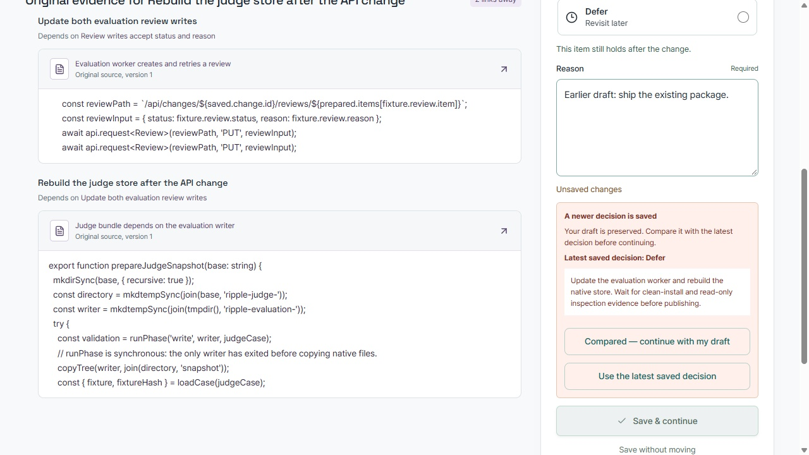
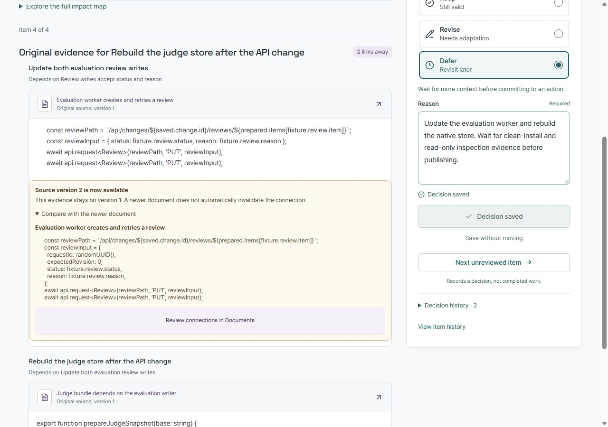
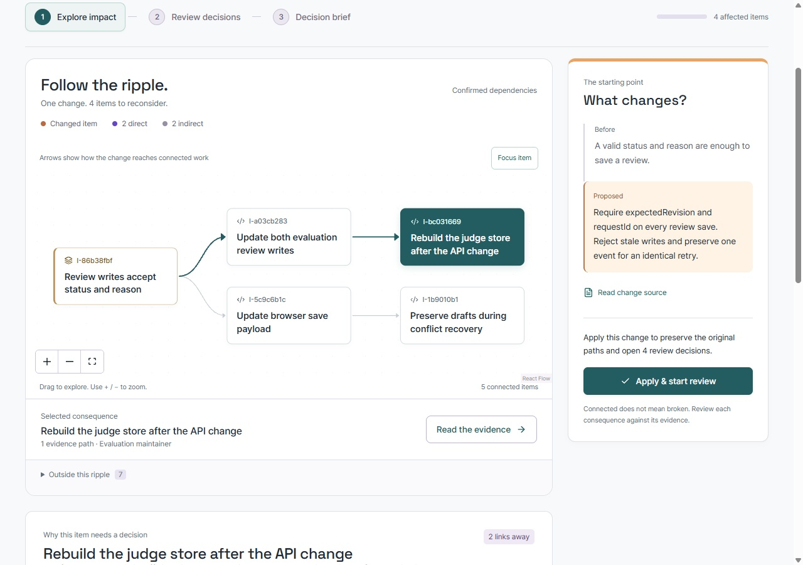
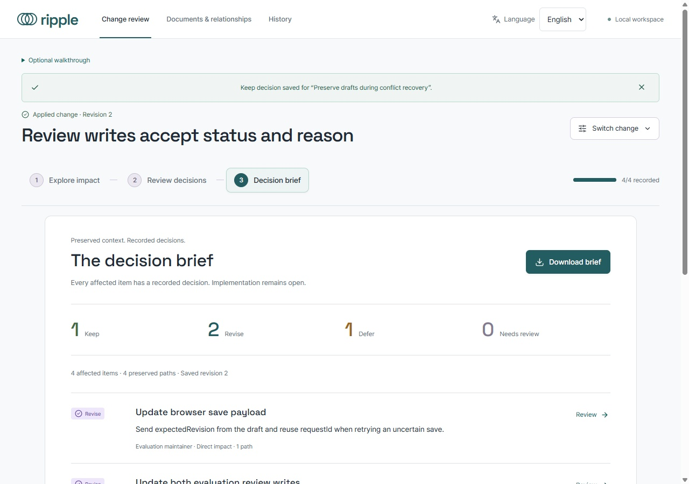

# 비판적 검토 후 개선 결과

2026-11-26 KST. 사용자는 개선을 요청하고 효용 사례로 Ripple 자체 변경을 선택했다. [앞선 비판적 검토](HACKATHON_CRITICAL_REVIEW_2026-11-26.md)의 관측을 보존하고 이번 수정·재검증을 연결한다. **저장 안전성과 원문 갱신 안내를 고쳤고, 실제 변경 사례와 새 전달물을 준비했다. 수상 충분성이나 사용자 효용은 아직 입증되지 않았다.**

## 지적별 조치

| 지적                           | 이번 조치                                                                                   | 현재 판정                                                                            |
| ------------------------------ | ------------------------------------------------------------------------------------------- | ------------------------------------------------------------------------------------ |
| R1 최신 공개본과 로컬본 불일치 | 현재 소스와 Ripple 사례 native DB를 같은 묶음으로 생성; 정확한 파일 hash와 미커밋 상태 표시 | 로컬 준비 완료. 공개 main은 여전히 `e7d28a7`; 게시·접근·최신 커밋 CI 미완료          |
| R2 준비 비용 대비 효용 미관측  | 실제 API 변경→worker→심사 DB 경로 구성, 원문 6/항목 6/관계 4/준비 쓰기 21회 공개            | 부분 개선. 수동 작성 시간과 독립 사용자 효과는 미측정                                |
| R3 후보 탐색과 의미 분석 혼동  | 구체적인 Revise 2/Keep 1/Defer 1과 후속 행동을 시연; 후보와 실패 예측을 구분                | 주장 범위 정정. 의미 영향 추론기는 구현하지 않음                                     |
| R4 약한 영상 전달              | 첫 장면에 전체 그래프·실제 후속 작업, 16초 시점에 저장된 판단, 110초 새 영상                | 로컬 영상·전체 decode·장면별 시각 검사 완료. 공개 재생과 낯선 시청자의 이해도 미확인 |
| R5 오래된 리뷰 덮어쓰기        | revision 검사·요청 ID·원자적 event/receipt, 초안 보존·최신 판단 비교·명시적 충돌 해소       | 구현 및 실제 두 탭 검증 완료                                                         |
| R6 새 원문 표시 부재           | 보존 인용과 최신 문서를 함께 비교, Documents에서 연결 재검토                                | 구현 및 실제 v2 저장/비교 완료. 연결 자동 무효화나 자동 재확인 아님                  |

## 저장 안전성

리뷰 쓰기는 `expectedRevision`과 `requestId`를 필수로 받는다. 새 판단·immutable 이력·중복 요청 영수증을 하나의 Relate transaction으로 기록한다. 같은 요청을 다시 보내면 이미 수행한 판단을 재적용하지 않고 현재 상태를 반환한다. 다른 내용으로 ID를 재사용하면 거절한다. 구버전 리뷰는 보존된 event 수로 revision을 읽으므로 이력을 다시 쓰는 migration이 필요 없다.

두 실제 브라우저 탭이 같은 pending을 읽은 뒤 한쪽에서 Defer를 저장했다. 다른 탭의 Keep은 409로 막혔고 초안과 새 Defer 이유가 동시에 보였다. Save는 충돌을 비교할 때까지 비활성이다. **Compared — continue with my draft**는 새 revision을 명시적으로 기준으로 잡고, **Use the latest saved decision**은 최신 판단을 채택한다. 두 선택, 재저장·reload, 네트워크 실패 후 재시도를 확인했다. 재시도 영수증의 별도 프로세스 복원도 검사했다.

## 보존 원문과 최신 원문

원문 v2를 저장해도 기존 v1 인용과 변경 snapshot은 바뀌지 않는다. 원문·근거 화면에서 새 버전 안내와 펼칠 수 있는 비교를 제공한다. 숫자 버전은 10을 2보다 최신으로 비교하며 이름이 붙은 샘플 버전은 임의 정렬하지 않는다. 새 문서가 있다는 사실만으로 연결을 invalid로 간주하지 않는다. 기존 문서에 새 버전을 추가할 때 빈 제목을 자동 채워 주되 작성한 제목은 보존한다.

## 실제 사례와 데모

[자체 변경 사례 상세](RIPPLE_CHANGE_CASE.md). API 저장 계약을 강화하면 브라우저와 평가 worker가 실제로 새 필드를 보내야 하고, worker를 실행하는 심사용 DB 생성도 함께 확인해야 한다. 실제 변경 전 코드 6개를 hash와 UTF-16 범위로 동결했다. 원문은 미커밋 작업 트리였으므로 commit을 null로 명시한다. 네 관계와 판단은 AI 지원으로 수동 작성했다. 자동 추출·새로 발견한 누락·독립 사람의 성공 사례로 포장하지 않는다.

새 영상은 `.runtime/improvements-delivery/ripple-demo-improved-110s.mp4`다. **110.0초, 1280×1080, 24fps H.264**, 영문 자막, 무음이다. 실제 화면 편집에 **원래 속도 8.19초의 연속 Apply→원문 열기→Defer 저장**을 넣었다. 첫 판단 저장은 약 15.6초이며 16초 추출 프레임에서 확인했다. 나머지는 실제 캡처와 실제 native 검사 결과로 생성한 표시 카드다. 녹화 전체가 연속 시연이라고 주장하지 않는다. 원본 영상은 별도로 유지했다.

전체 MP4를 디코딩하고 10개 장면 각각의 추출 프레임과 16초 프레임을 시각적으로 확인했다. 첫 지도 노드는 모두 보이며 자막이 겹치지 않는다. 수동 준비 비용, 후보 탐색의 한계, 독립 사용자 결과 부재, 공개 전 로컬 후보라는 상태를 끝부분과 설명문에 명시했다. 시연 저장소에는 판단 4개, 심사 fixture에는 Defer 1개가 있다.

## 검증 근거와 한계

- 최종 앱 `npm run verify`: **91/91**, 포맷·strict type·skill integrity·공식 Relate context·native 테스트·production build 통과. `npm run doctor`: separate-process persistence 통과.
- 서버/DB: stale/ABA, 요청 ID 재사용, idempotent retry, receipt 직전 실패 rollback, legacy 이력, 원문 snapshot 불변성, 새 실제 사례의 별도 프로세스 write/reopen 및 기존 두 사례 회귀.
- 실제 브라우저: desktop 1280×900, narrow 390×844, 두 탭 충돌의 양방향 해결, 실패/재시도, 영향 선택·원문·Apply·세 판단·4/4·다운로드. 최종 narrow client/scroll 폭은 375/375였다. 새 스크린리더 또는 실제 모바일 기기 검사는 하지 않았다.
- 패키지: 새 디렉터리 `npm ci`, 복사 소스의 **91/91 verify**, doctor와 read-only native inspection이 통과했다. 실제 패키지 실행 화면에서 BUNDLE Defer와 worker 원문 [0,329)을 확인했다. 이후 갱신은 문서/화면 증거뿐이며 앱·테스트·fixture·빌드 입력의 hash 일치를 검사한다. 상세는 [STATUS](STATUS.md), [QA](QA.md).
- GitHub plugin으로 공개 main을 재확인했다. `npm run ci:status`의 초록 결과는 **기존 `e7d28a7`만** 검증하며 미커밋 개선을 포함하지 않는다.
- 네트워크 실패는 의도적으로 주입한 검사다. 초기 locator/뷰포트·helper 실패와 최종 대체 근거는 [QA](QA.md)에 구분했다. 통과한 것으로 바꾸지 않았다.

캡처 01–06은 중간 진단 자료다. 최종 근거는 07–13이며, [390px 충돌](evidence/improvements-2026-11-26/09-final-mobile-conflict.jpg), [프로세스 재시작](evidence/improvements-2026-11-26/12-after-process-restart.jpg), [새 설치 패키지 원문](evidence/improvements-2026-11-26/13-clean-package-source.jpg)을 구분했다. 추가 agent나 모델 API를 호출하지 않았다. 최종 ZIP은 소스 513개와 닫힌 native DB·시연 자료를 담고 전체 532개 entry의 무결성을 검사했다. 정확한 hash는 `.runtime/improvements-delivery/DELIVERY_MANIFEST.json`에 있다.

## 남은 작업

최신 코드·영상·DB 자료의 공개 전달, 해당 커밋 CI와 로그인 없는 접근, 참가자 자격·팀 정보·최종 Devpost 제출이 남아 있다. 독립 사용자가 준비 시간을 포함해 이득을 얻는지도 별도 관찰해야 한다. 이 개발 확인만으로 창의성 우위, 심사 점수 또는 수상 확률을 산정하지 않는다.
