# Ripple — 처음 쓰는 사람의 이해·사용성 종합 검토

검토일: **2026-11-25 KST**. 사용자 요청: 시스템을 전혀 모르는 사람이 목적을 이해하고 사용법을 쉽게 익힐 수 있는지 검토한다.

## 판단

**기능을 수행할 수 있는 상태와, 사전 지식 없이 배울 수 있는 상태 사이에 간격이 있다.** 샘플과 직접 작성한 한국어 문서에서 실제 영향 조회·원문 확인·판단 저장·새 탭 복원은 동작했다. 그러나 첫 화면의 설명, 여러 단계 체계, 수동 준비 과정, 안내와 실제 화면의 불일치 때문에 초보자가 스스로 성공할 것이라고 판단할 근거는 부족하다. 문서 초안의 새로고침 손실은 이번 실행에서 재현했다.

이 문서는 **AI 에이전트의 화면·행동·코드 감사**다. 독립 신규 사용자 참여는 0명이며, 이해도·성공률·소요 시간·만족도를 측정한 사용자 연구가 아니다. 아래 혼동 가능성은 관찰된 UI에 근거한 가설이다. [X06/X07](learning/EXPERIMENTS.md)의 사람 관찰을 대신하지 않는다.

## 범위와 방법

- 현재 작업 트리로 `npm run build` 실행: TypeScript 검사와 production build 성공. 기존 HEAD는 `e7d28a7`이며 다수의 미커밋 변경을 포함한다. 원격 CI 또는 과거 72개 테스트 결과를 이번 감사의 새로운 통과로 세지 않았다.
- production API와 실제 Relate를 사용했다. 감사용 저장소 두 개를 LocalAppData 아래에 새로 만들었고, 각각 포트 4360/4361의 단일 서버가 소유했다. 기존 사용자 저장소를 열거나 초기화하지 않았다.
- 데스크톱 1280×720, 모바일 에뮬레이션 390×844. 영어 기본 진입과 한국어 전환, 샘플의 직접·간접 영향, 원문, 적용, 세 판단, 실패/재시도, 4/4 요약, 안내 7단계 재생, 개인 문서 첫 검토, 이력과 새 탭 복원을 확인했다.
- 모든 근거 이미지는 이번 실행에서 캡처·저장한 파일을 다시 읽어 확인했다. 과거 스크린샷을 현행 감사 증거로 재사용하지 않았다.
- 접근성은 키보드 일부 경로, 포커스, 실제 라벨, 상태/오류 전달, 좁은 화면을 확인했다. [Web Interface Guidelines](https://raw.githubusercontent.com/vercel-labs/web-interface-guidelines/main/command.md)의 라벨·초점·오류 복구·미저장 보호 항목도 참고했다. 전체 WCAG 준수 판정은 아니다.
- 앱 코드·DB 스키마·의존성은 수정하지 않았다. 변경 사항은 감사 문서, 계획/학습 기록, 스크린샷이다.

## 단계별 결과

| 단계 | 수행한 일                          | 상태                      | 핵심 관찰                                                                                                       | 화면 근거      |
| ---- | ---------------------------------- | ------------------------- | --------------------------------------------------------------------------------------------------------------- | -------------- |
| 1    | 처음 열고 목적·첫 행동 파악        | 설명 보완 필요            | 주요 버튼과 언어 선택은 명확하다. 어떤 입력을 넣고 무엇을 얻는지, 관계를 누가 만드는지 첫 화면에 없다.          | 01, 02, 21     |
| 2    | 영향 선택 → 간접 연결 → 원문       | 대체로 양호               | 4개 영향, 직접/간접 구분, 원문 인용과 번역 구분이 보인다. 지도와 목록이 반복된다.                               | 03, 04, 22     |
| 3    | 적용 → 판단 → 실패 복구            | 기능 양호, 판단 설계 보완 | 적용/저장은 명시적이다. 실패에도 이유가 남고 재시도된다. 첫 판단은 이미 ‘수정’이 선택되어 있다.                 | 05, 06, 07     |
| 4    | 샘플 판단 완료 → 다음 작업         | 연결 보완 필요            | 4/4와 구현 미완료 설명은 명확하다. 빠른 체험 완료 뒤 ‘예제 안내 시작’이 다시 나타난다.                          | 08             |
| 5    | 자세한 7단계 안내 따라가기         | 우선 수정 필요            | 과업 이동·원문별 다음 버튼은 좋다. 관계 단계의 불필요한 입력 폼, 영어 명칭, 반대 방향 설명이 학습을 방해한다.   | 09b, 10, 11    |
| 6    | 내 문서 → 사실·작업 → 관계         | 기능 양호, 학습 부담 큼   | 저장 후 다음 행동 안내는 있다. 4단계 안내와 5단계 양식이 다르고, 복사·제목·설명·유형·관계 방향을 수동 준비한다. | 13, 14, 15     |
| 7    | 새 문서 버전 → 첫 변경/판단 → 복원 | 저장 양호, 초안 보호 결함 | 연결한 작업 한 개가 조회됐고 v1 근거와 판단이 보존됐다. 미저장 문서 제목/본문은 새로고침으로 사라졌다.          | 16, 17, 19, 20 |
| 8    | 이력에서 기록 찾기                 | 보완 필요                 | 샘플과 개인 사례 총 7건이 조회된다. 화면의 한국어 샘플 제목을 검색하면 0건이다.                                 | 18             |

### 1. 첫 화면

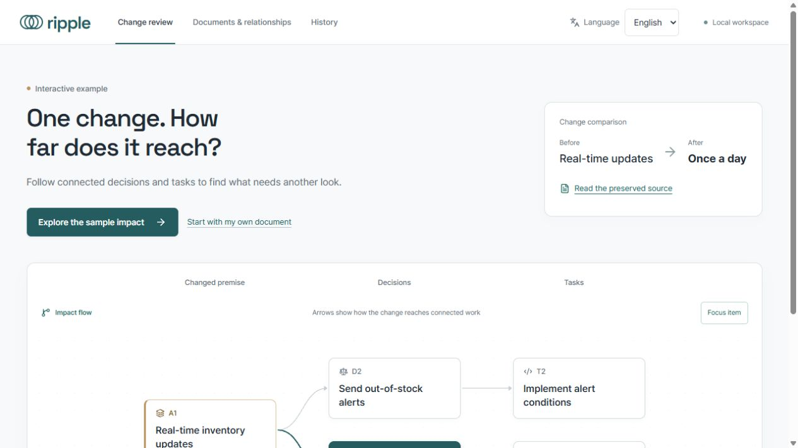

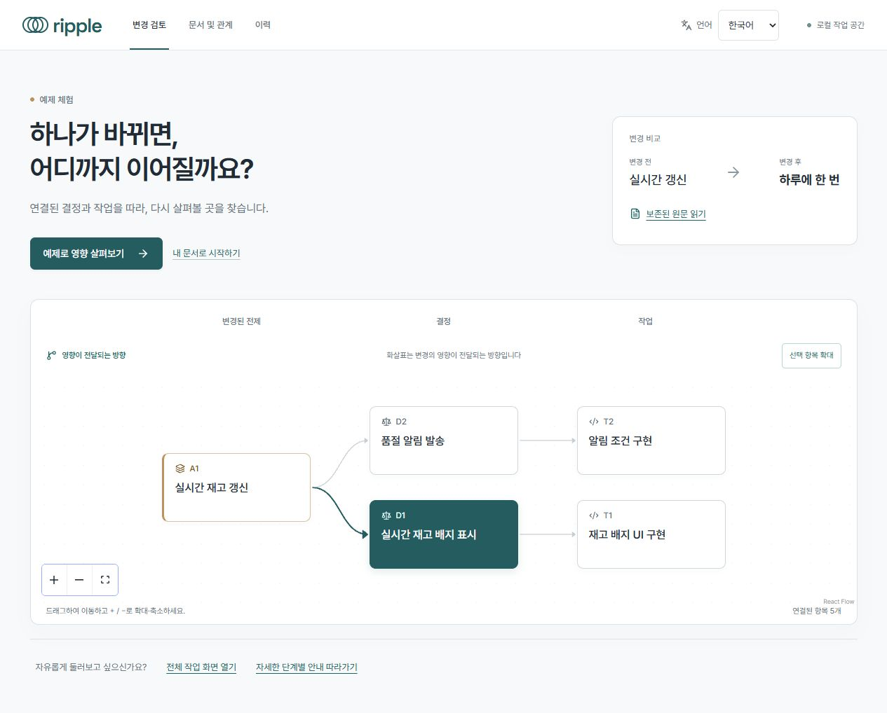

강점은 한 개의 주 행동, 실제 데이터를 사용하는 지도, 찾기 쉬운 언어 선택이다. 모바일에서도 주 버튼이 지도보다 먼저 나온다. 다만 “하나가 바뀌면…”과 “연결된 결정과 작업…”은 제품을 이미 아는 사람에게 더 잘 통하는 표현이다. ‘실시간 → 하루 한 번’ 비교도 무엇의 변경인지 카드 자체에는 표시되지 않는다. 사용자는 재고 관리 제품인지, 문서 분석 제품인지, 업무 관리 제품인지 추가로 해석해야 한다.

### 2. 영향과 근거

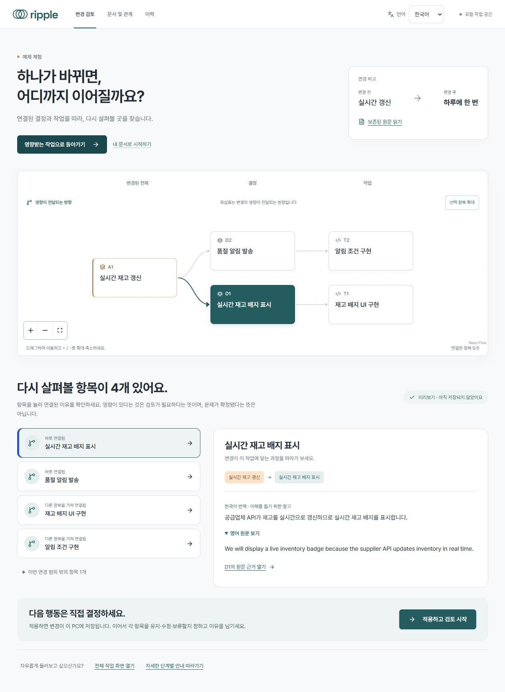

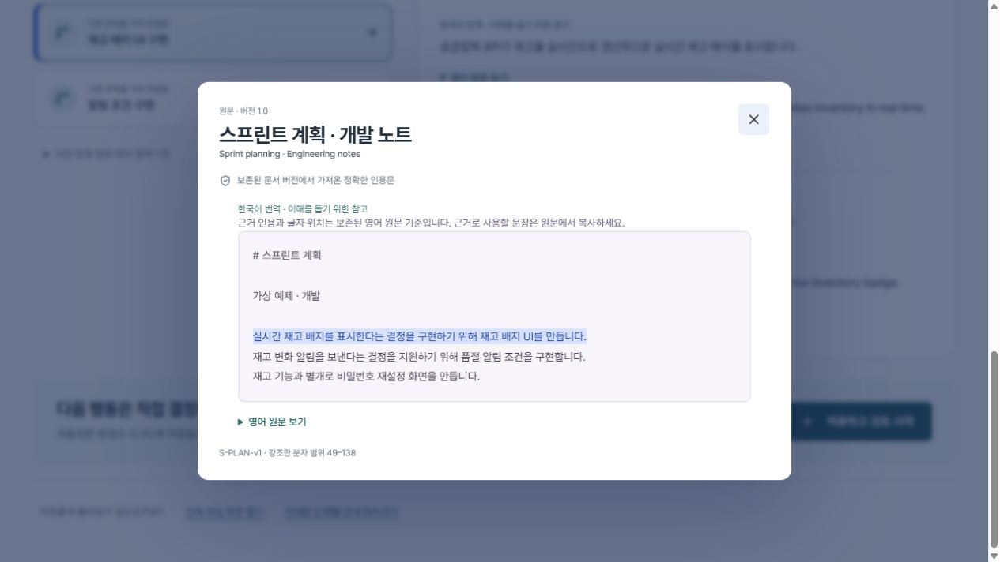

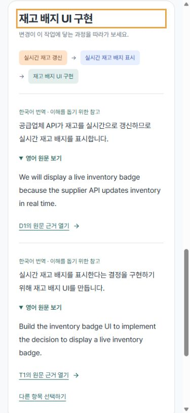

네 항목과 제외 항목을 구분하고, ‘영향 = 재검토 필요’라는 설명을 명시한다. T1은 두 연결의 인용문을 모두 볼 수 있었다. 영어 원문 공개와 Escape 닫기가 동작했고 초점은 T1의 원문 버튼으로 돌아왔다. 모바일에서 Enter로 간접 항목을 선택하면 해당 근거 제목으로 초점이 이동했다.

지도에는 변경 원인을 포함한 ‘연결된 항목 5개’, 목록에는 검토할 ‘4개’가 나온다. 수학적 오류는 아니지만 초보자에게 두 숫자의 차이를 한 번 설명하면 좋다. 관계 방향과 영향 방향을 동시에 가르칠 필요는 없다.

### 3. 판단과 실패 복구

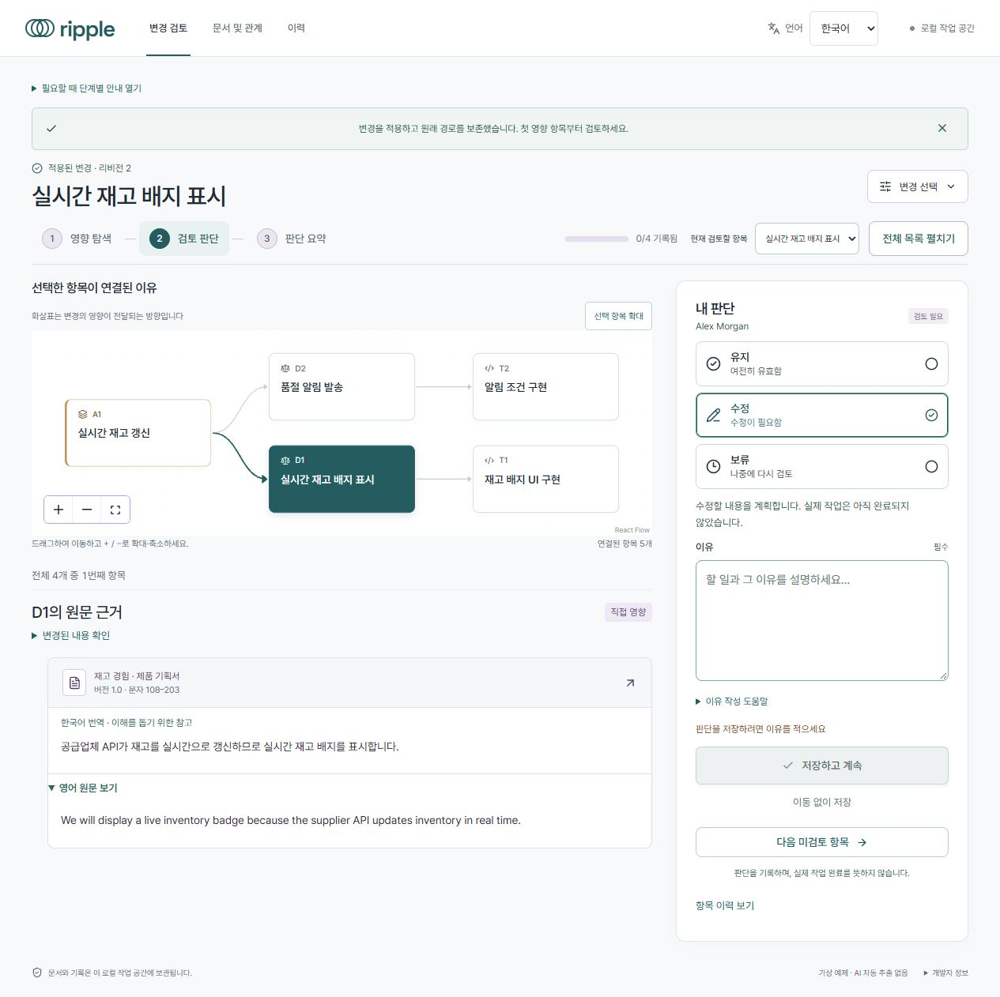

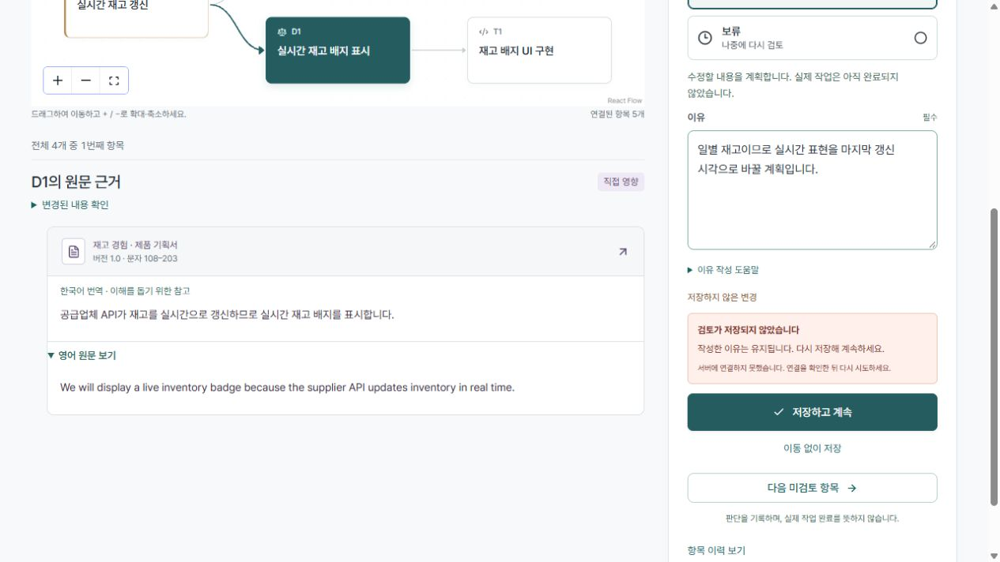

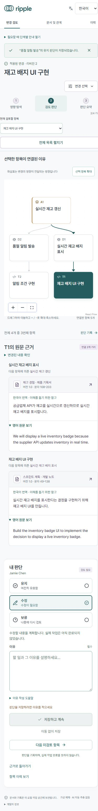

‘유지/수정/보류’에 각각 설명이 붙고, 저장은 실제 구현 완료가 아니라는 점을 반복해서 알려 준다. 저장 요청을 의도적으로 차단했을 때 0/4 상태와 이유가 유지됐고, 차단을 해제한 후 같은 버튼으로 저장되어 다음 항목으로 이동했다. 이후 세 판단 유형을 모두 사용해 4/4를 기록했다.

반면 선택 전부터 ‘수정’이 활성화되어 있다. 시스템 추천 또는 이미 내려진 판단처럼 보일 수 있다. T1을 읽다가 적용하면 D1부터 다시 시작한다. 검토 화면은 변경 전후 내용을 접고 지도를 근거보다 앞에 둔다. 모바일의 두 연결 근거는 영문까지 펼쳐져 판단까지의 이동이 길다. ‘판단 기록’ 이동 버튼이 있다는 점은 유지해야 한다.

07은 현재 실행의 실제 내용·순서를 보여주는 정성 근거로만 사용한다. 리사이즈 중 client width 관측이 바뀌어 픽셀 잘림이나 정확한 스크롤 길이의 증거로 사용하지 않는다. 모바일 폭 검증의 기준은 안정된 새 탭의 21/22다.

### 4. 빠른 체험 완료

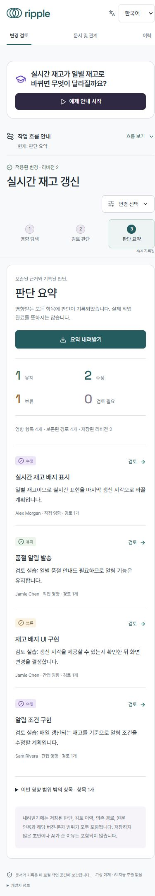

유지 1/수정 2/보류 1과 판단 내용을 읽을 수 있다. 그러나 빠른 체험을 끝냈는데 화면 위쪽에 다시 ‘예제 안내 시작’이 나타나며, 이 경로에서는 내 문서로 연결하는 완료 행동이 없다. 7단계 안내를 마쳤을 때에는 그 행동이 나타난다. 같은 성취를 한 사용자에게 완료 후 경험이 달라진다. 빠른 체험 완료를 7단계 학습 완료로 자동 간주할 필요는 없지만, 다음 작업을 안내하는 문구는 있어야 한다.

### 5. 자세한 안내

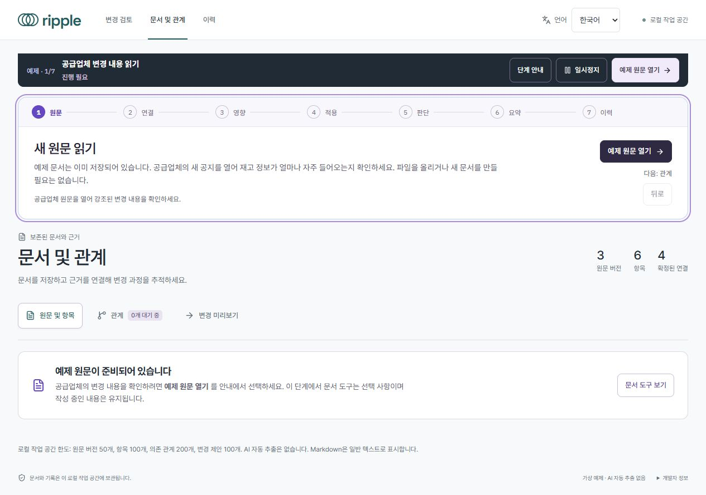

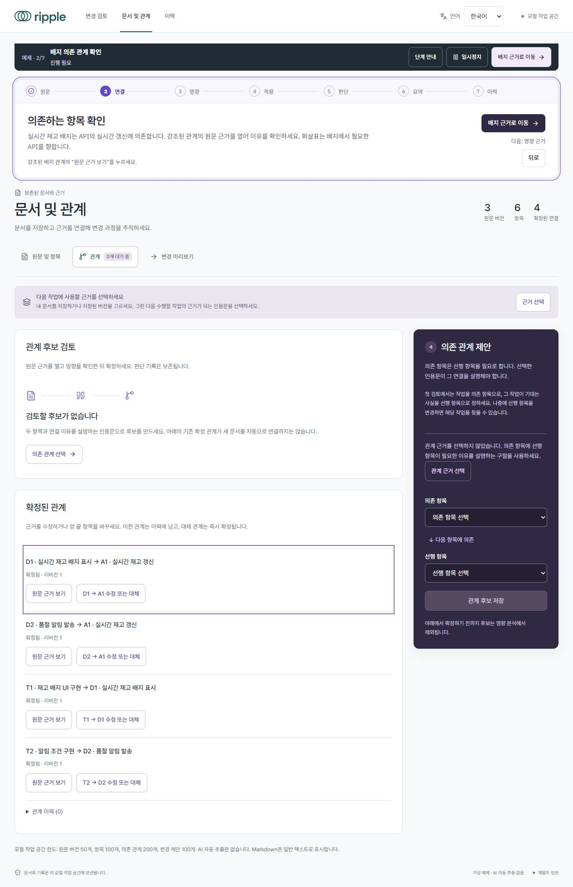

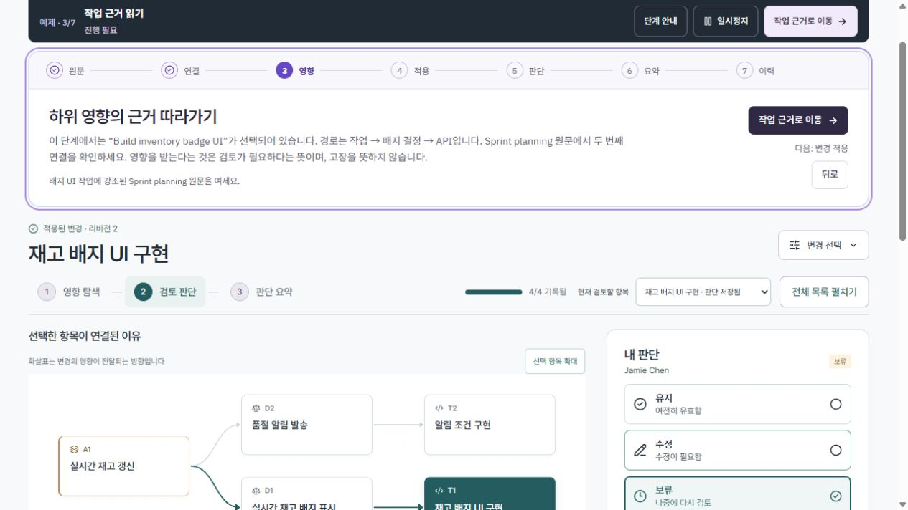

첫 과업은 ‘공급업체 새 공지에서 갱신 주기 확인’이라는 구체적인 목적을 제공한다. 문서 도구를 접는 방식도 좋다. 그러나 2단계에서는 기존 관계를 읽기만 하면 되는데 ‘근거를 선택하세요’, 빈 후보 목록, 관계 생성 폼이 먼저 보인다. 실제 확인할 관계는 그 아래다.

3단계 한국어 안내는 ‘Build inventory badge UI’와 ‘Sprint planning’을 찾도록 한다. 실제 제목은 ‘재고 배지 UI 구현’, ‘스프린트 계획 · 개발 노트’다. 안내의 ‘작업 → 배지 결정 → API’와 바로 아래 지도의 ‘API → 결정 → 작업’은 서로 다른 관점을 표현하지만 그 차이를 설명하지 않는다. 처음 배우는 사람에게는 규칙이 바뀐 것으로 보일 수 있다.

이번에는 이미 저장한 샘플을 재생하여 1~7단계를 확인했다. 적용/판단 단계는 기존 저장 결과를 인식했고 변경을 다시 만들지 않았다. 이 동작 검증은 ‘내용을 이해했다’는 검증이 아니다.

### 6. 내 문서 준비

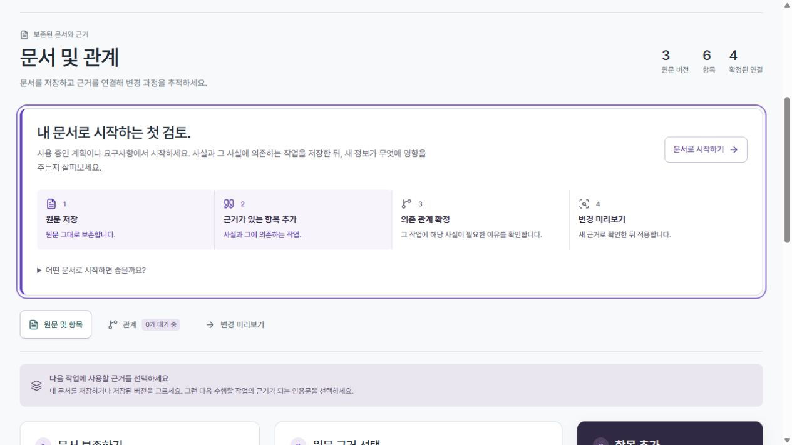

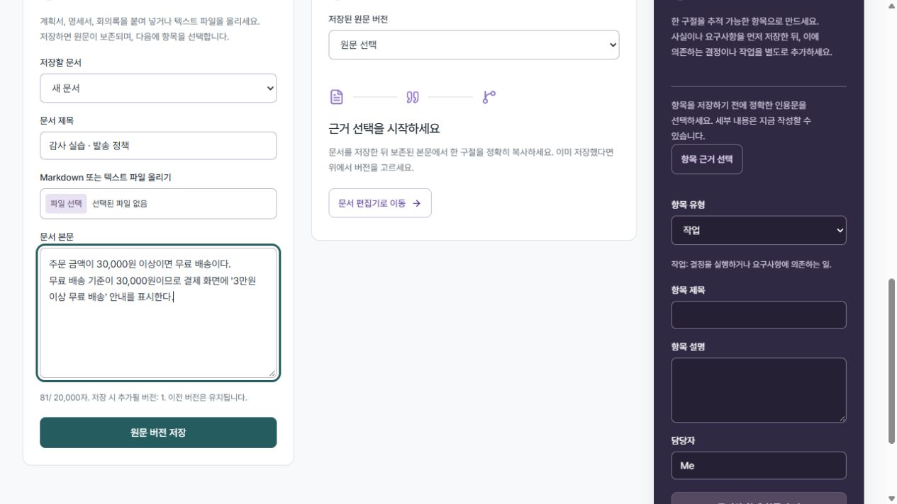

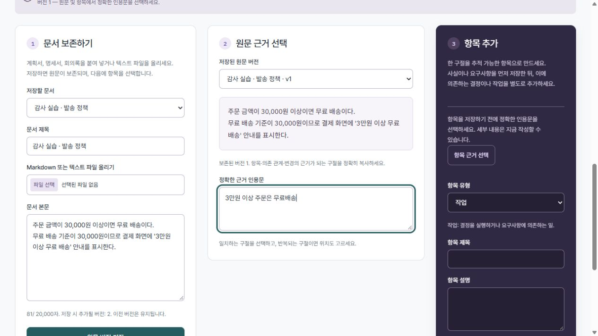

‘무료 배송 기준 3만원 → 5만원, 결제 화면 문구 검토’라는 짧은 한국어 문서를 감사용으로 직접 작성했다. 원문 저장, 전제/작업 각각 생성, 작업→전제 관계 후보 저장과 확정, 새 문서 버전 저장, 새 근거 선택, 변경 제안과 적용, 판단까지 수행할 수 있었다. 저장 영수증이 다음 행동으로 연결해 주는 점은 유용하다.

상단의 4단계는 ‘2 항목 추가 / 3 관계 확정 / 4 변경 미리보기’인데, 양식은 ‘2 원문 근거 선택 / 3 항목 추가 / 4 관계 제안 / 5 변경 미리보기’다. 펼친 전체 흐름은 또 6단계다. 번호가 현재 할 일을 식별하는 역할을 하지 못한다.

문서를 붙여 넣는 것 외에도 정확한 인용, 항목 유형/제목/설명/담당자, 관계 방향과 별도 확정이 필요하다. 이 준비 자체를 제거할 수는 없지만, 첫 사용자에게 한 번에 노출할 필요도 없다. 이 사례에서는 변경 적용 전 준비에 **7회의 저장성 동작**(원문 2회, 항목 2회, 관계 후보/확정 각 1회, 변경 제안 1회), 이어 적용과 판단 저장 각 1회가 필요했다. 이 수치는 이 사례의 명시적 동작 수이며 시간이나 모든 사용 사례의 비용 추정이 아니다.

인용문을 ‘3만원 이상 주문은 무료배송’으로 바꿔 쓰면 다음 행동이 비활성화된다. 정확한 원문을 요구하는 것은 맞다. 다만 현재 메시지는 ‘일치하는 구절을 선택하고, 반복되는 구절이면 위치도 고르세요’여서 0개 일치와 여러 개 일치를 구분하지 않는다.

### 7. 개인 결과와 초안 보호

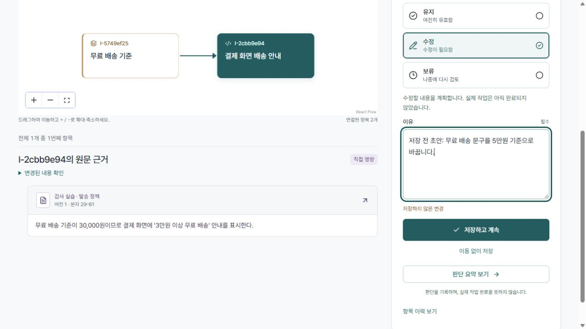

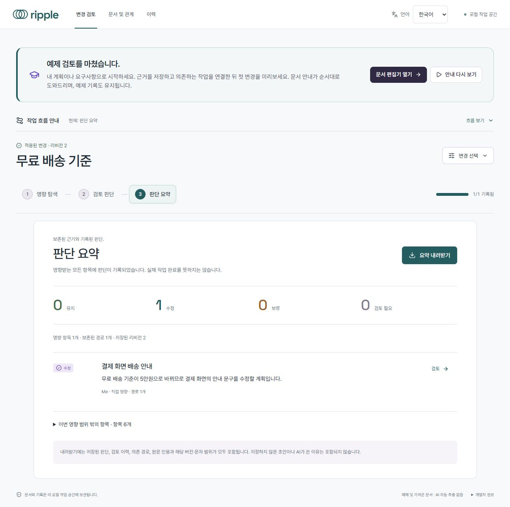

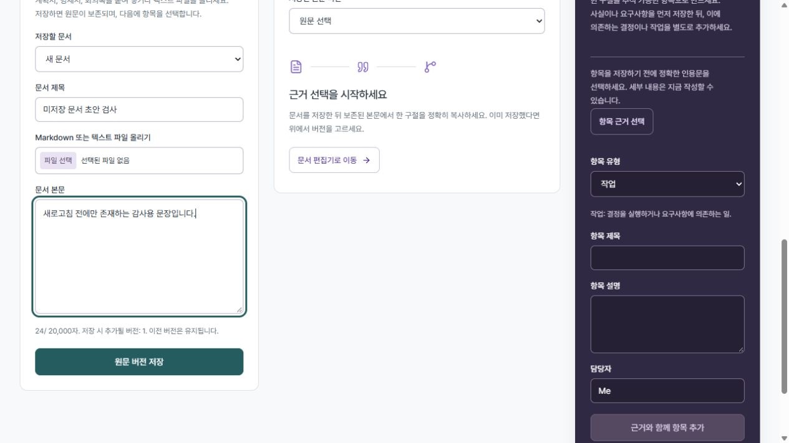

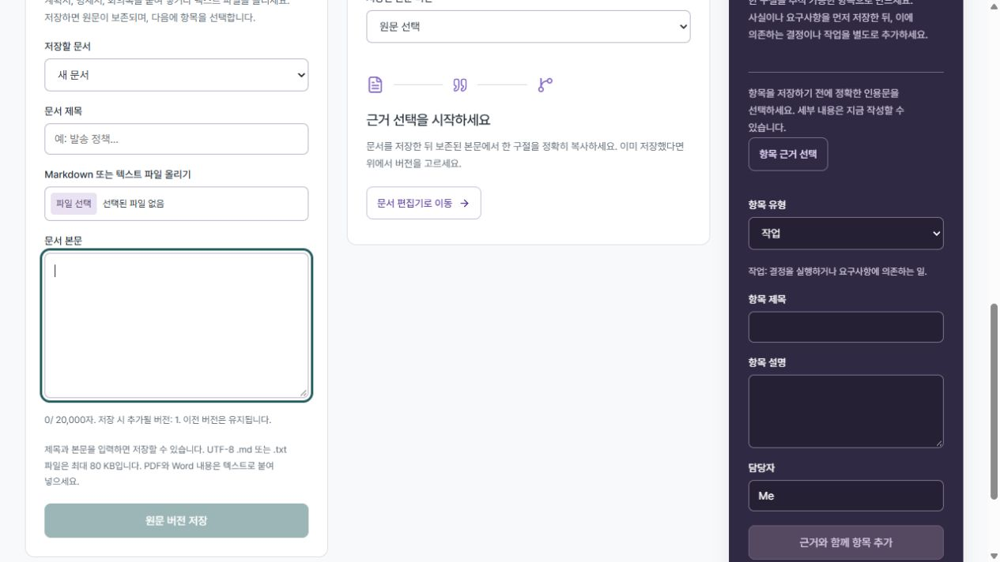

무료 배송 기준을 변경하자 연결한 ‘결제 화면 배송 안내’ 한 개가 조회됐다. 관계 근거는 v1의 29–81 구간을 유지했고, 변경 근거는 v2였다. 이유를 저장한 뒤 새 탭에서도 1/1과 동일한 한국어 이유를 확인했다. 원문·사용자 문구 보존은 강점이다.

별도 새 탭에서 미저장 문서 제목과 본문을 넣고 새로고침했다. 경고 대화상자 없이 페이지가 다시 로드되고, 문서 화면으로 돌아오자 두 입력이 비었다. **문서 입력의 손실은 확인된 결함이다.** 저장한 문서/판단은 손상되지 않았다.

검토 이유의 초안은 다르게 처리된다. 화면 이동 시 유지됐고, `App.tsx`에는 검토 초안의 `beforeunload` 방지가 있다. 앞선 검토 초안 상태의 reload 시도는 화면을 떠나지 않았으며 브라우저 대화상자를 확인하지 못했다. 그 시도를 ‘검토 초안 소실’ 또는 ‘경고 대화상자 통과’로 기록하지 않는다.

### 8. 이력과 재방문

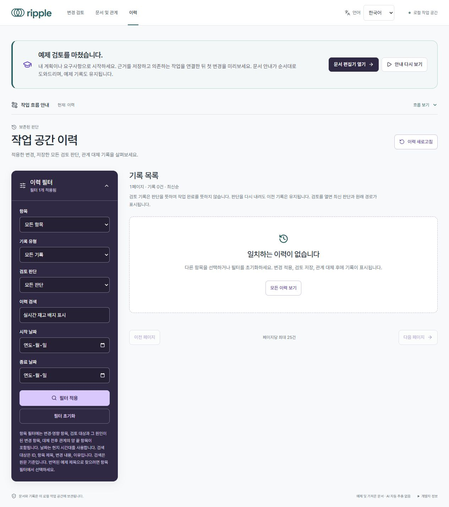

이력은 샘플 변경 1+판단 4, 개인 변경 1+판단 1의 총 7건을 반환했다. 관계 확정은 관계 대체 이벤트가 아니므로 이 수치에 포함하지 않는다. 한국어 샘플 제목 ‘실시간 재고 배지 표시’를 검색하자 0건이었다. 원문 기반 검색이라는 설명과 항목 필터 우회가 존재하므로 데이터 누락은 아니다. 하지만 눈에 보이는 제목으로 찾는 자연스러운 행동은 실패한다.

## 개선 우선순위와 수용 기준

P1은 다음 초보자 관찰 전에 고칠 항목, P2는 다음 흐름 개선에 포함할 항목이다. 장애 심각도나 수상 가능성 점수가 아니다.

| ID  | 우선순위 | 개선할 문제                                   | 구체적인 변경 제안                                                                                                                       | 확인할 수용 기준                                                                                        |
| --- | -------- | --------------------------------------------- | ---------------------------------------------------------------------------------------------------------------------------------------- | ------------------------------------------------------------------------------------------------------- |
| F01 | P1       | 미저장 문서 입력 소실                         | 문서/항목/관계/변경 초안의 dirty 상태를 상위 이탈 보호와 연결한다. 복원 저장을 추가한다면 원문 버전 저장과 명확히 구분한다.              | 문서 제목/본문 입력 후 새로고침·닫기에서 경고 또는 복원. 저장은 여전히 명시적이며 기존 원문은 불변.     |
| F02 | P1       | 첫 화면에서 제품 종류·입출력이 불명확         | 대상 상황, 입력, 결과를 구체적인 한 문장과 짧은 예로 설명한다. 수동 준비와 자동 영향 탐색의 경계를 첫 시작 전에 알린다.                  | 신규 사용자가 무엇을 넣는지, 무엇을 얻는지, 자동으로 하지 않는 일을 자기 말로 설명한다.                 |
| F03 | P1       | 안내의 영어 이름·화살표 관점 불일치           | 화면과 같은 번역된 항목/문서명을 사용한다. 초보 흐름은 변경→영향 순서로 설명하고 관계 편집 시에만 ‘A가 B를 필요로 함’을 설명한다.        | 한국어/영어 안내 대상과 실제 라벨 일치. 원문·저장된 DEPENDS_ON 방향은 그대로 유지.                      |
| F04 | P1       | 개인 문서의 여러 단계 체계·동시 입력          | 한 가지 준비 흐름으로 통일하고 지금 할 입력만 앞에 둔다. 먼저 문서, 다음 사실/작업, 다음 연결, 다음 새 변경을 준비한다.                  | 상단 안내와 양식의 단계 명칭·번호 일치. 각 단계에 다음 행동 하나와 완료 근거가 보인다.                  |
| F05 | P1       | 읽기 안내 중 불필요한 생성 폼 노출            | 샘플 관계 읽기 단계에서는 실제 관계와 원문 버튼을 우선하고 후보 생성 도구는 접는다.                                                      | 2단계에서 어떤 빈 양식도 채우지 않고 대상 원문에 도달한다. 기존 입력 초안은 숨김 전후 유지.             |
| F06 | P1       | 판단 전 ‘수정’ 기본 선택                      | 새 판단은 미선택으로 시작하고 사용자의 선택 후 이유 작성을 안내한다.                                                                     | 새 항목에 사전 선택 없음. 명시적인 판단+이유 없이는 저장되지 않음. 이전 저장 판단은 정상 복원.          |
| F07 | P1       | 빠른 체험과 상세 안내의 완료 후 경로 차이     | 빠른 체험의 저장 결과에도 ‘내 문서로 첫 검토’ 연결을 제공한다. 개인 작업에서는 예제 배너를 작게 접는다.                                  | 4/4 뒤 주 행동이 다음 실제 과업을 가리킴. 7단계 학습 완료를 거짓으로 기록하거나 강제 재실행하지 않음.   |
| F08 | P2       | 판단 시 변경 맥락이 접히고 지도/근거가 길어짐 | 변경 전→후를 한 줄로 유지하고 선택 경로·핵심 근거를 우선한다. 전체 지도/원문은 펼칠 수 있게 한다. 적용 전 읽던 항목의 연속성도 유지한다. | 판단 화면에서 무엇이 바뀌었는지 별도 탐색 없이 확인. 모바일 근거↔판단 이동과 모든 간접 근거 접근 유지.  |
| F09 | P2       | 보이는 한국어 예제 제목 검색 실패             | 번역된 예제 제목을 항목 ID 선택으로 연결하는 제안/별칭 검색을 제공한다. 원문과 사용자 입력은 바꾸지 않는다.                              | 화면의 샘플 제목으로 검색하거나 제안을 고르면 해당 이력에 도달. 원문 검색과 필터 의미는 유지.           |
| F10 | P2       | 인용 불일치 이유가 모호함                     | 0개 일치와 여러 개 일치를 별도 안내하고 정확한 원문 선택/복사를 돕는다. 오류를 해당 필드에 연결한다.                                     | 바꿔 쓴 문장에는 ‘원문에서 찾을 수 없음’, 중복에는 위치 선택을 표시. UTF-16 범위·정확한 인용 계약 유지. |
| F11 | P2       | 화면마다 강조 체계와 정보 밀도 차이           | 청록/보라 주요 버튼의 역할을 통일한다. 10px 상태/12px 보조 문구를 실제 읽기 크기로 재검토하고 ID·문자 범위는 상세정보로 내린다.          | 첫 화면→문서→판단에서 주 행동의 시각적 규칙 일치. 제목은 사용자 항목명 우선. 확대/좁은 화면에서 재검증. |

### 구현 위치

아래는 수정 제안의 위치이며 이번 감사에서 코드를 고쳤다는 뜻이 아니다.

- `src/Documents.tsx:79` — 문서/항목 등 초안이 컴포넌트 상태에만 존재한다. `src/App.tsx:249`의 이탈 보호는 검토 초안만 본다. F01.
- `src/FirstLook.tsx:82` — 첫 제목·소개. 같은 파일의 비교 카드에 대상 상황을 추가할 수 있다. F02.
- `src/locales/ko-guidance.json:155`, `src/locales/ko-guidance.json:184`, `src/sample-walkthrough.ts:157` — 영어 라벨과 역방향 안내. 번역 문구와 원본 안내를 함께 고쳐야 한다. F03.
- `src/DocumentGuidance.tsx:52`, `src/Documents.tsx:470`, `src/Documents.tsx:701` — 4단계 안내와 5단계 양식의 불일치. F04.
- `src/Documents.tsx:47`, `src/Documents.tsx:272` — 도구 접기는 원문 읽기 0단계에만 적용된다. 관계 읽기 단계의 분리가 필요하다. F05.
- `src/App.tsx:233` — 새 검토의 기본값이 `revise`. F06.
- `src/SampleWalkthrough.tsx:124`, `src/SampleWalkthrough.tsx:566`, `src/SampleWalkthrough.tsx:612` — 빠른 체험 dismissed/안내 complete 분기와 개인 문서 연결. F07.
- `src/ReviewStudio.tsx:575`, `src/EvidenceTrail.tsx:80`, `src/App.tsx:289` — 지도 우선, 접힌 변경 맥락, 적용 후 첫 미검토 선택. F08.
- `src/History.tsx:362` — 원문 기반 검색의 현재 안내. F09.
- `src/Documents.tsx:503`, `src/Documents.tsx:537` — 인용 필드와 0개/복수 일치의 공통 메시지. F10.
- `src/EvidenceTrail.tsx:42` — 컴팩트 근거 제목이 사용자 제목 대신 ID를 쓴다. `src/ripple-map.css`, `src/workspace.css`, `src/onboarding.css`의 강조 체계도 함께 점검한다. F11.

## 권장하는 초보자 흐름

**제품 이해 → 짧은 예제로 원리 체험 → 내 문서의 작은 성공 → 필요할 때 상세 도구** 순서가 적합하다. 새 장식이나 더 긴 설명문보다, 지금 할 일의 수를 줄이는 방향을 제안한다. 아래는 아직 구현·사용자 검증되지 않은 제안이다.

첫 화면 문구 예시:

> 요구사항이 바뀌었을 때, 다시 검토할 결정과 작업을 찾아보세요.
>
> 문서에서 중요한 사실과 작업을 직접 연결해 두면, Ripple이 변경의 영향과 그 근거를 보여줍니다. 각 항목을 유지·수정·보류할지 기록할 수 있습니다.
>
> 예: 무료 배송 기준이 3만원에서 5만원으로 바뀌면, 결제 화면의 안내도 다시 살펴봐야 합니다.

주 행동은 ‘예제로 사용법 익히기’, 보조 행동은 ‘내 문서로 시작하기’로 둔다. ‘문서·관계는 직접 준비 / 영향 경로는 자동 조회 / 실제 수정 작업은 별도’라는 범위를 짧게 표시한다. 현재 재고 샘플을 유지할 경우에도 같은 수준의 구체적인 상황 설명을 붙일 수 있다. 샘플 교체 자체를 전제하지 않는다.

첫 체험은 ‘무엇이 바뀌었나요 → 왜 이 작업을 다시 봐야 하나요 → 어떻게 대응할까요’의 세 질문에 답하도록 구성한다. 7단계 전체 도구 학습은 선택 사항으로 유지한다. 근거를 여는 행동을 이해도 점수로 바꾸지 않는다.

내 문서 준비는 ① 짧은 문서 ② 바뀔 수 있는 사실과 관련 작업 ③ 두 항목의 연결 이유 ④ 새 정보로 영향 확인의 네 과업으로 연결한다. 필요한 데이터와 확인 동작을 없애거나 자동 확정하지 않는다. 이전 과업의 입력을 다시 보면서 지금 과업 하나를 수행하도록 보여 주는 방식을 바꾼다.

## 실제 사람에게 확인할 프로토콜

기존 X06/X07에 연결하는 **실행 전 제안**이다. 모집·연락·실험은 이번에 수행하지 않았다. 참가자는 Ripple을 본 적 없고 개발에 참여하지 않은 3명으로 시작한다. 각자의 업무 문서는 익숙해도 괜찮으며 시스템 사전 설명은 하지 않는다. 선호 언어와 데스크톱/모바일 조건을 기록한다. 같은 사람에게 수정 전후를 반복하면 학습 효과를 따로 표시한다.

| 순서 | 진행자가 줄 과제                                                                  | 관찰할 내용                                                                                     |
| ---- | --------------------------------------------------------------------------------- | ----------------------------------------------------------------------------------------------- |
| A    | 첫 화면을 30초 살핀 뒤 이 도구가 어떤 일을 하는지 설명해 주세요.                  | 입력, 결과, 자동/수동 범위를 스스로 설명하는가. 30초는 제안된 노출 조건이며 관측 성능이 아니다. |
| B    | 예제로 어떤 작업을 다시 살펴봐야 하는지 찾아 주세요.                              | 첫 클릭, 잘못 들어간 화면, 도움 요청, 직접/간접 영향의 구분.                                    |
| C    | 연결이 두 개 떨어진 작업 하나의 이유와 제외된 작업 하나의 이유를 설명해 주세요.   | 원문을 단순히 열었는지와 관계를 이해했는지 분리.                                                |
| D    | 한 항목에 자신의 판단과 이유를 저장해 주세요.                                     | 시스템이 이미 답을 정했다고 오인하는가. 판단 저장을 실제 구현 완료로 오인하는가.                |
| E    | 짧은 익숙한 문서로 사실 1개와 작업 1개를 연결하고, 새 사실로 첫 검토를 해 주세요. | 문서/인용/항목/관계/새 버전별 준비 시간과 막힌 이유. 도움 없이 완료하는가.                      |
| F    | 저장 실패에서 복구한 뒤 나중에 기록을 다시 찾아 주세요.                           | 입력 보호, 오류 이해, 재시도, 이력 탐색, 언어별 검색.                                           |

진행자는 ‘그 버튼입니다’ 같은 힌트를 주지 않는다. 막히면 필요한 도움을 제공하되 그 순간부터 무도움 성공으로 세지 않는다. 발언은 실제 말과 진행자의 해석을 분리한다. 원문에 관계가 없는 자료를 억지로 연결하게 하지 않는다.

잠정 통과 기준은 기존 X06의 3명 중 2명 이상이 핵심 과업을 도움 없이 수행하고 직접/간접 영향과 제외 이유를 설명하는 것이다. **‘자동 추출된다’, ‘저장하면 실제 작업도 완료된다’라는 핵심 오해는 별도 중대 실패로 기록한다.** 개인 문서 준비 시간은 기준값을 모으기 전 절감률을 약속하지 않는다. 실패한 첫 지점부터 수정하고 새로운 참가자로 다시 확인한다. 작은 표본을 전체 사용자 성공률로 일반화하지 않는다.

기록할 항목: 익명 참가자 ID, 시스템 경험 여부, 언어/기기, 과업 시작·종료 시각, 도움의 시점·내용, 오류와 복구, 실제 발언, 준비 비용, 개념 설명의 근거. 완료 시간과 클릭 수만으로 이해도를 판정하지 않는다.

## 접근성·시각 검토의 확인 범위

| 항목        | 이번 관찰                                                                                                            | 남은 확인                                                                                      |
| ----------- | -------------------------------------------------------------------------------------------------------------------- | ---------------------------------------------------------------------------------------------- |
| 키보드/초점 | Skip 링크 Enter로 `main-content`에 도달. 모바일 선택 Enter로 근거 제목 초점 이동. 원문 Escape 후 호출 버튼으로 복귀. | 전체 입력·후보 편집·이력 필터의 키보드 단독 종단 흐름, 스크린리더.                             |
| 입력 라벨   | 확인한 History의 보이는 입력은 모두 라벨이 있었다. 문서/판단 입력은 이름으로 조작할 수 있었다.                       | 인용 오류와 필드의 설명 연결, 실제 오류 낭독.                                                  |
| 상태/오류   | 저장 실패는 `alert`, 진행 상태는 `status`, 판단은 색+텍스트+아이콘으로 표시.                                         | 스크린리더의 중복/누락 안내와 전체 읽기 순서.                                                  |
| 글자/대비   | 실제 계산 스타일: 판단 설명 13px, 저장 상태 12px, 판단 상태 배지 10px. 포커스 윤곽을 관찰했다.                       | 작은 글자 가독성, 모든 색 조합의 대비, 200%/400% 확대. 크기만으로 WCAG 실패를 선언하지 않는다. |
| 모바일      | 새 탭 390×844에서 첫 버튼/선택/근거 사용 가능, client/scroll width 375/375.                                          | 실제 기기·가상 키보드·터치 목표 간격·다른 브라우저.                                            |
| 동작 줄이기 | 코드에 reduced-motion 처리가 존재함을 확인.                                                                          | OS 설정을 바꾼 실제 화면 관찰은 미실행.                                                        |
| 초안 보호   | 검토 초안은 화면 이동에서 유지. 문서 초안의 새로고침 손실 재현.                                                      | 다른 문서·항목·관계 초안의 개별 이탈 시나리오와 복원 정책.                                     |

## 증거 한계와 실패한 시도

- 7단계 안내는 이번에 이미 저장된 샘플을 재생한 경우다. 신선한 샘플의 전체 안내를 새로 끝냈다고 주장하지 않는다. 신선한 빠른 체험과 실제 적용/판단은 별도로 수행했다.
- 파일 업로드, 전체 Markdown 다운로드, 관계 대체, 제로 영향, 매우 큰 문서/그래프, 저장 프로세스 재시작, 물리 기기, 스크린리더는 이번 범위에서 새로 검증하지 않았다.
- 첫 문서 패치의 잘못된 제목 일치는 적용 전에 실패했다. 정확한 제목으로 다시 적용했다.
- 리사이즈 직후 한 클릭이 의도한 안내 시작 대신 인접한 흐름 펼치기를 수행했다. 화면을 다시 읽고 정상 진입했다. 제품 결함으로 세지 않았다.
- History 전체 캡처 12는 중간 내용이 비어 있어 시각 증거에서 제외했다. toolbar 캡처 07b와 리사이즈 직후 캡처 09도 보고서 근거에서 제외했다. 세 파일과 원시 관찰 메모는 Git에서 제외되는 `.runtime/novice-audit-2026-11-25/`에 보존했다. 재현된 동작과 안정된 다른 캡처만 사용한다.
- 검토 초안 상태에서 reload/`Page.reload`는 화면을 떠나지 않았다. 코드의 이탈 방지와는 일치하지만 경고창 동작을 직접 확인하지 못했다. 미저장 문서 테스트에서는 실제 재로드와 입력 초기화를 확인했다.
- 저장 차단은 검사 후 해제했고 Network 관찰과 viewport override를 정리했다. 마지막 새 탭/모바일 탭의 경고·오류 로그는 비어 있었다. 의도적 저장 실패의 네트워크 오류는 제품의 평상시 오류로 세지 않는다. 감사용 탭과 두 서버를 닫았고 4360/4361 포트가 더 이상 수신하지 않는 것을 확인했다.
- 독립 사람 피드백, 시간 절감, 디자인 만족도, 전면 접근성 준수, 해커톤 결과에 관한 결론은 없다.

## 다음 실행

F01/F03/F05/F06의 구체적인 결함·불일치를 먼저 수정하고, F02/F04/F07을 하나의 첫 사용 흐름으로 구현하는 것이 우선이다. 이후 실제 신규 사용자에게 위 과업을 맡겨 처음 막히는 지점을 관찰한다. 기능 회귀 검증과 사람의 이해도 검증은 각각 기록한다.

관련 기록: [PLAN](PLAN.md), [STATUS](STATUS.md), [D15](learning/DECISIONS.md), [X15 및 X06/X07](learning/EXPERIMENTS.md).
