# First-use onboarding audit

2026-11-15 · Heuristic walkthrough of the real local inventory sample. Current-run screenshots only; native temporary baseline store at port 4340 and refined flows at 4341/4342. Desktop 1440×1000 and mobile 390×844, with 1024px and 320px layout checks. Goal: follow the sample without needing to know Ripple's navigation or data model. This is not a recruited-user study or full accessibility certification.

| Step            | Strength                                                                    | Observed friction / risk                                                                                                 | Change                                                                                                 |
| --------------- | --------------------------------------------------------------------------- | ------------------------------------------------------------------------------------------------------------------------ | ------------------------------------------------------------------------------------------------------ |
| Entry           | Sample start is visible; mutations stay explicit.                           | The introduction does not state the scenario or what the user will learn.                                                | Explain live → daily inventory and the decision record outcome.                                        |
| 1. Source       | Correct preserved quote opens and gates advancement.                        | Three empty, numbered creation forms dominate a task that only asks users to read.                                       | Explain that the sample is ready and fold optional document tools without unmounting drafts.           |
| 2. Relationship | Correct edge is highlighted, direction explained.                           | After the target jump and source close, Continue is off-screen; the sticky bar only says 2/7.                            | Keep a named task and state-dependent action in the bar; offer next step from the exact source dialog. |
| 3. Impact       | Native paths/quotes and original sources are intact.                        | Jump lands at the beginning of T1's trail, where D1 evidence appears first; requested Sprint source is below the fold.   | Target the T1→D1 source button, explain selection, label the next destination.                         |
| 4. Apply        | Existing explicit Apply control is clear.                                   | Fresh success immediately uses “already applied”/replay instructions; workspace mode changes but guide remains at Apply. | Use saved-result language and a visible Next: Review items action.                                     |
| 5. Decide       | Decision meaning and required reason are labelled; saves advance the queue. | No example of how to justify a decision; guide progress is off-screen while writing.                                     | Add non-prefilled sample reasoning prompts and show remaining decisions in the persistent guide.       |
| 6. Brief        | Saved totals, reasons and download are clear.                               | Download is the only prominent visible action; next tutorial destination is off-screen.                                  | Keep Next: History visible, clarify download is optional.                                              |
| 7. History      | Applied change and all four decisions are recorded.                         | Finish is off-screen after jumping to the records.                                                                       | Keep Finish walkthrough available in the tracker after successful matching data load.                  |
| Completion      | Data remains saved.                                                         | Replay is primary; “Use your own context” is vague.                                                                      | Make Open document editor primary, with concrete first task and preserved sample records.              |

Accessibility strengths: native buttons/selects/dialog, labelled progress, exact source identity, source-trigger focus return. Risks addressed in implementation: generic action names, off-screen next controls, and target focus under stacked sticky navigation. Keyboard and responsive verification follows implementation; screenshots alone cannot establish screen-reader compatibility or user comprehension.

## Implemented outcome

The next action stays with the current task, including after a target jump. Source-dialog continuation removes the close → scroll back → continue detour. Optional creation forms remain available without competing with the first reading task. Existing writes, preserved evidence and per-change review records remain authoritative; no new library or backend behavior was needed.

1. **Source — improved and verified:** sample-ready instructions, optional form disclosure and exact source continuation. Form values survive hiding and navigation.
2. **Relationship — improved and verified:** highlighted confirmed dependency, source reading hint and named next destination. The original direction and quote remain visible.
3. **Impact — improved and verified:** jump focuses the requested T1 source rather than the beginning of a long trail. Another source cannot unlock that source-dialog action.
4. **Apply — improved and verified:** fresh success says the change is saved and exposes Next: Review items. Failed Apply does not advance; replay does not apply twice.
5. **Decide — improved and verified:** contextual reason examples, remaining saved-decision count, preserved drafts and explicit saving. Prompts never fill or save decisions.
6. **Brief — improved and verified:** saved reasons remain readable with Next: History available. Download is optional, and saved decisions do not imply completed implementation.
7. **History and completion — improved and verified:** successful event loading unlocks visible Finish. The primary completion action focuses the user's document title; Replay preserves existing records.

Final `npm run verify` passed 60 tests and all format/type/skill/native/build checks. Fresh desktop/mobile runs completed every step. Deliberately failed source, apply, review and History requests held progress and recovered. Pause/reload/resume, off-task return and full replay passed; replay kept revision 2 and five events. Layout inspection found no document overflow at tested widths. Full observations, bundle sizes and unverified cases are in [QA.md](QA.md).

### Refined first task and source continuation

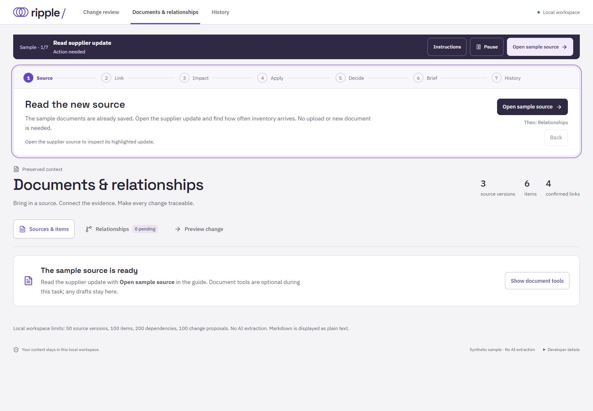
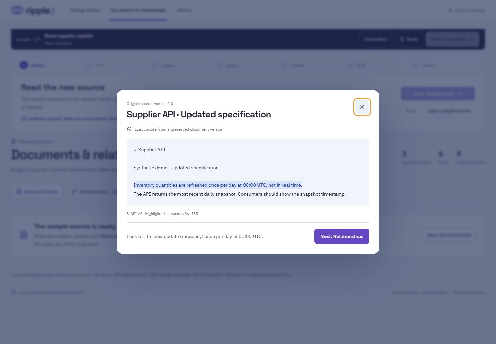

### Refined mobile working states

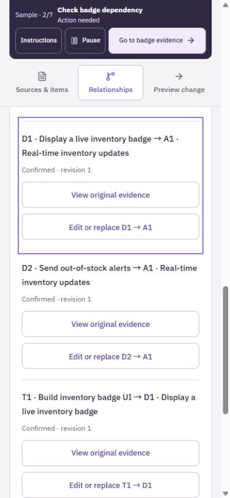
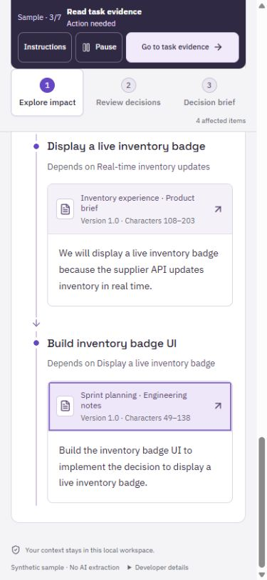
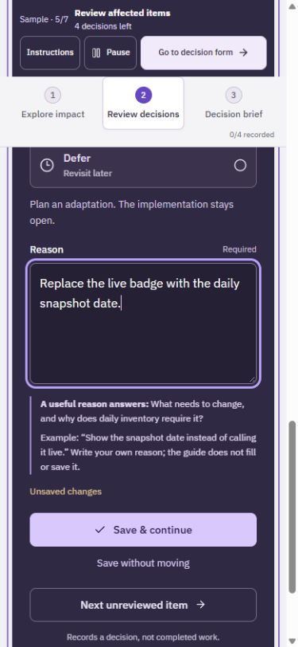
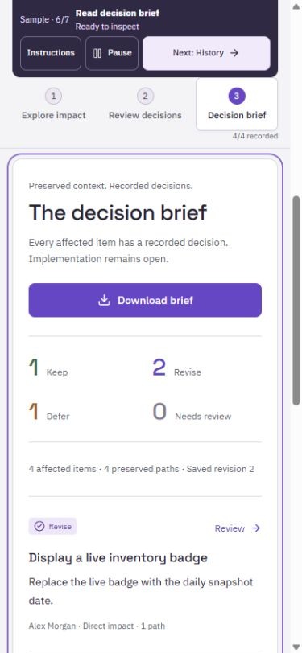
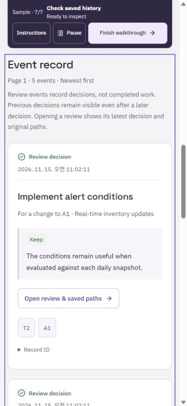
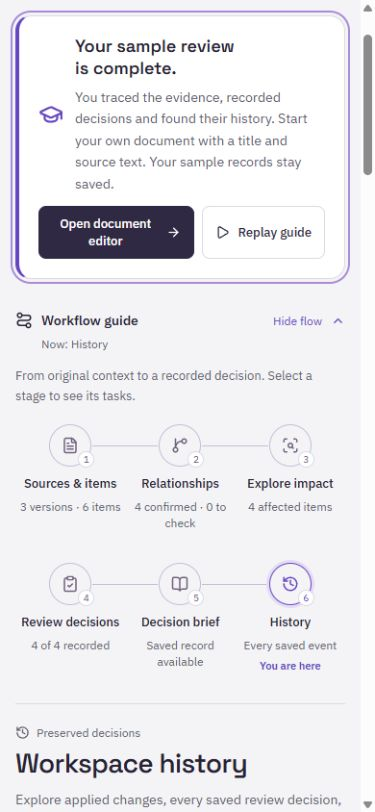

All accepted after images were saved, reopened and inspected. At 320px, the next-action label wraps while its button remains usable. Mobile task/section controls consume vertical space, so the instructions panel remains available rather than floating over content. Physical-device keyboard behavior, cross-engine/screen-reader testing and an unaided novice session remain unverified; no comprehension or conversion improvement is claimed.

## Captured baseline

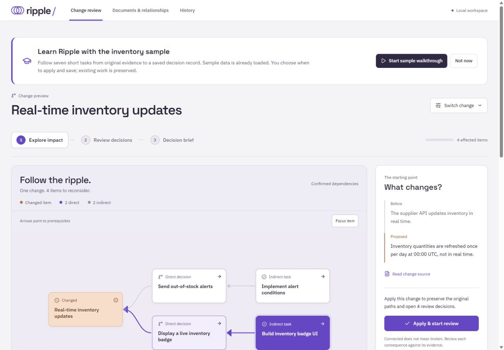
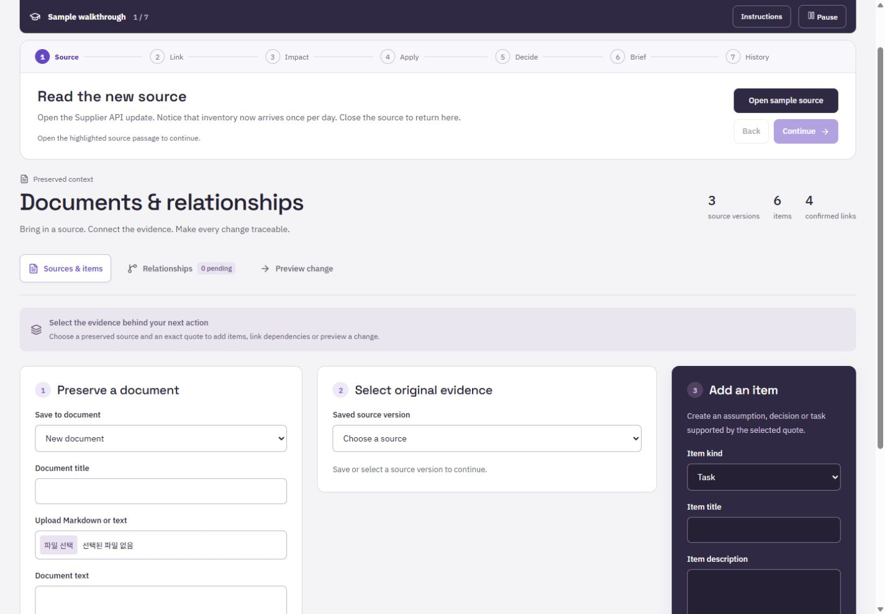
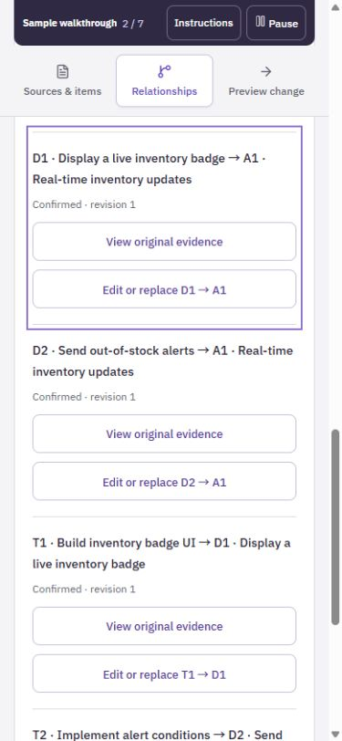
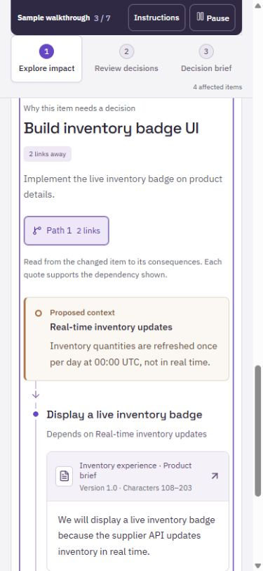
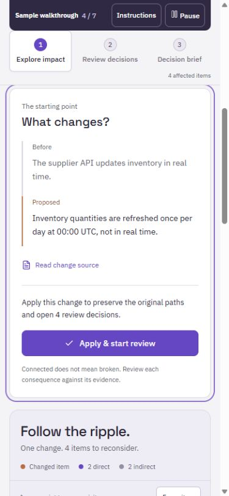
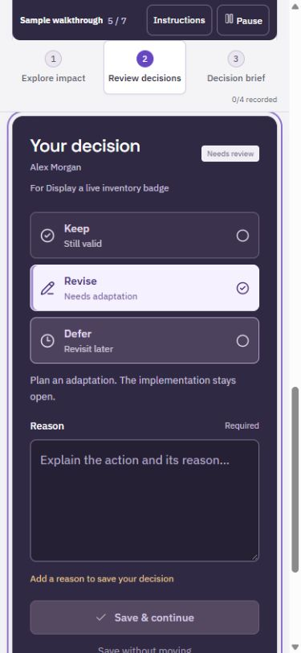
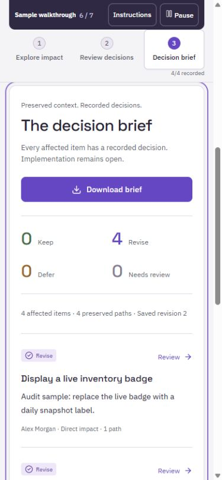
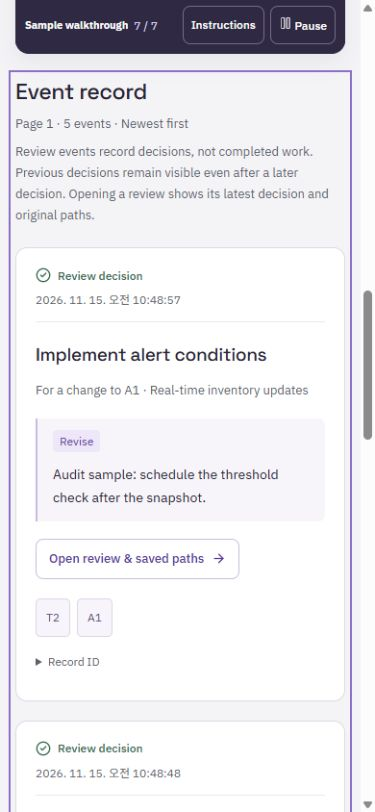
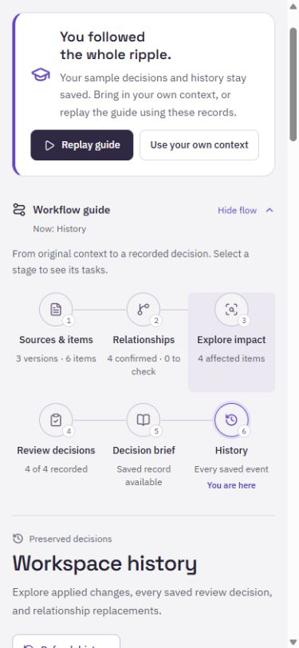

One initial mobile capture during viewport reflow was rejected and replaced after layout settled. Every image above was saved, reopened and inspected in this run. Final verification and accepted after screenshots are recorded in QA.md and STATUS.md.
