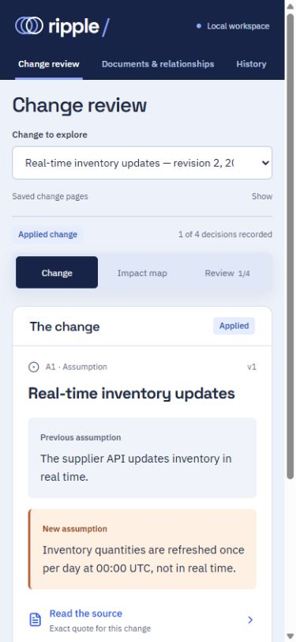
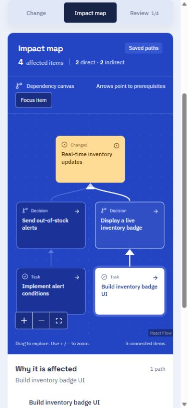
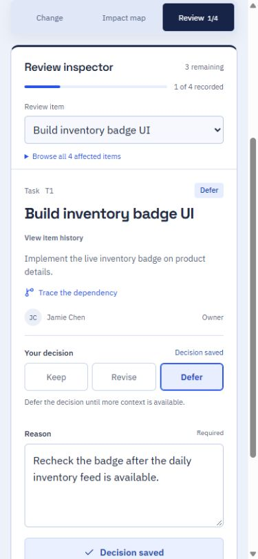

# Product Design follow-through

2026-11-14 KST. Scope: Ripple Change review, from comparing a change to tracing evidence and recording a decision. The user installed Product Design after the canvas redesign. Its audit workflow and saved-context preflight were used; no saved plugin context existed. This is an audit and correction of the existing working app, not a new prototype, remote model review, Figma artifact or human usability study.

The current canvas direction is retained. Three issues were corrected: repeated header content pushed work down; mobile panel buttons changed content without moving focus/scroll; a saved mobile change could show only a collapsed title. Review feedback now also distinguishes persisted decisions from edits that still need saving.

## 1. Compare the change — corrected

Before: the desktop screen repeated the navigation title, slogan and workspace label; the map began around 439px down. On mobile, the selected Change panel showed only a collapsed saved title. See [desktop entry before](evidence/product-audit-01-before.jpg), [desktop comparison before](evidence/product-audit-02-compare-before.jpg) and [mobile before](evidence/product-audit-03-mobile-before.jpg).

After: a compact heading removes the slogan and duplicate label. At 1440×1000 the map starts at approximately 367px. Desktop Compare change still expands the exact previous/new content. Mobile comparison is always open, including saved changes, and retains source access and Explore affected items.

[Desktop comparison after correction](evidence/product-audit-02-compare-after.jpg). A new isolated inventory preview/apply check on port 4332 created revision 2/four reviews; the mobile comparison remained open and Explore affected items led to the saved map. [Applied map](evidence/product-audit-09-applied.jpg).

## 2. Inspect the impact and original evidence — corrected

Before: selecting Impact map left the user at the page header, with only the top of the map visible. [Before](evidence/product-audit-04-map-before.jpg).

After: the same button moves focus to `panel-path` and positions its top at 68px below sticky navigation. All five inventory nodes fit the visible mobile map. T2 mouse selection and T1 keyboard Enter worked. Every evidence connection remains available; the source dialog opened preserved version 1.0 with UTF-16 49–138 and Escape restored focus to its evidence button.

[Original source captured in this audit](evidence/product-audit-06-source.jpg). The directional arrows, highlighted path and title-bearing buttons are strengths. Small overview labels remain a readability limit on denser graphs; Focus item, the inspector and full evidence text remain available. This run did not repeat every SemVer browser path from the preceding canvas verification.

## 3. Record and recover a decision — corrected and verified

Before: selecting Review also left the form below the page header; unchanged saved reviews still showed an active Save review button. [Before](evidence/product-audit-05-review-before.jpg).

After: Review moves focus and scroll to the inspector at approximately 68px. The form shows Decision saved for the persisted status/reason, Unsaved changes for edits, and a reason prompt for a new empty review. Matching surrounding whitespace follows the server's trimming behavior. An unchanged save is disabled; pending reviews are never labeled saved. The decision group keeps the accessible name Your decision independently of the live status.

Blocked only the review-save URL: the edited Defer reason remained visible with an inline error and Unsaved changes. Another item's form had no inherited error; returning restored the draft/error. Unblocking and retry saved successfully; reload restored the exact reason and history count 2. [Failure evidence](evidence/product-audit-07-save-failure.jpg), [initial saved-state layout](evidence/product-audit-05-review-after.jpg). Returning an edited draft to its saved values hides a stale failure notice, so a saved state does not conflict with an obsolete error.

## Evidence and limits

- New captures were taken and reopened from saved files in this audit run. No previous-turn screenshots were substituted as audit evidence. Desktop screenshots include full-page variants; mobile captures are viewport views. The first port-4332 screenshot had incorrect surface scaling, was rejected and replaced after actual 390×844 dimensions were verified.
- Inspected 1440×1000, 1024×900 and 390×844. Document/client widths matched at 1425, 1009 and 375px respectively. [Final desktop](evidence/product-audit-01-after.jpg). No document overflow was observed. The 1024px inspector retains its internal scroll area.
- Keyboard node selection, source dismissal, destination focus, explicit control labels and error recovery were checked. Screenshots and DOM checks do not establish complete screen-reader or WCAG compliance. Physical mobile devices, other browser engines and independent aesthetic preference remain untested.
- Final code gate: 51 tests plus formatting, strict types, skill checks, native Relate context and production build. The new regression covers saved/pending status, changed decision/reason, whitespace and empty reasons. No new dependency or API/schema change in this follow-through.
- One verification run passed all tests but failed build because the local TypeScript 7.0.2 executable was missing. The same-version official npm archive was checked against package-lock's SHA-512 and only the missing executable restored. No version or security setting changed; the final gate passed afterward. The disappearance's cause is unknown.
- Port 4331 remains the working preview. The separate port-4332 QA owner was stopped and its test data retained. Temporary network/device overrides were removed; final browser warning/error logs were empty. Exact-HEAD CI is green for the prior committed SHA and reports a dirty worktree; it does not cover these local edits. The preceding clean-install reproduction is historical evidence, not a new run for this follow-through.

The next useful validation is the user's assessment of the improved mobile transition and saved-state clarity in the running preview.
