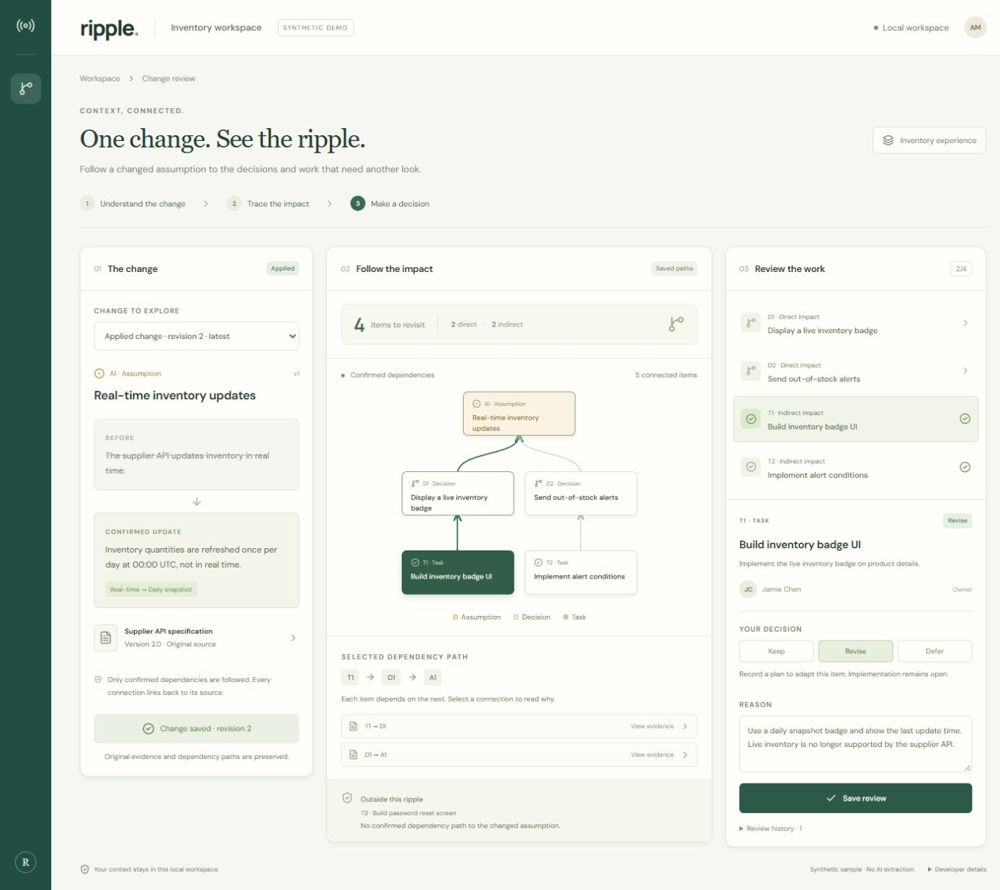
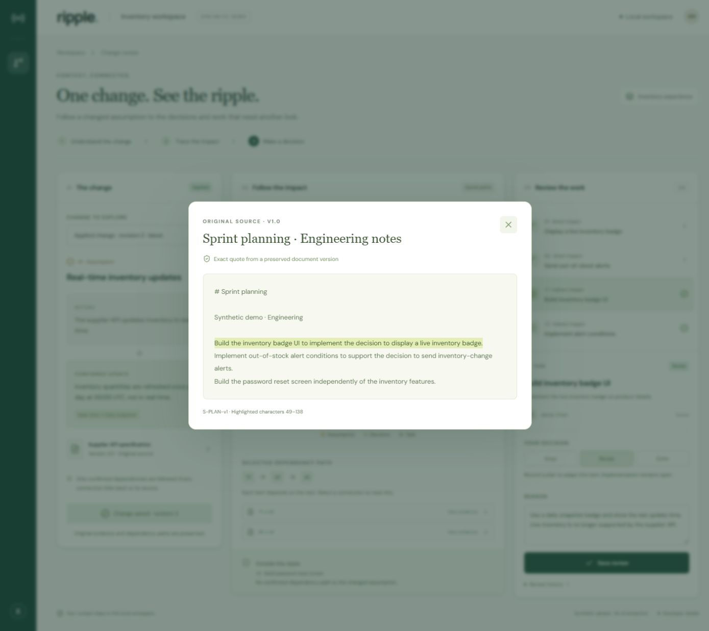

# Verification record

## Approved candidate publication — 2026-11-26 KST

D21/X21. [Draft PR #1](https://github.com/piecemakerz/Ripple/pull/1) is open and draft; main remains `e7d28a7`. Candidate `b577290613ad72f31cac1f16974065c17e773625` passed [Verify Ripple](https://github.com/piecemakerz/Ripple/actions/runs/45768805050). The annotated tag and [public prerelease](https://github.com/piecemakerz/Ripple/releases/tag/v0.1.0-hackathon.20261126) stay on that commit, independently of later publication-documentation commits.

- Approved source and artifact preparation hashes matched before publication. Tagged export correspondence: 502 exact files, five line-ending-only differences, six publication-document edits, one new record, zero unexpected differences. No runtime/test/fixture behavior changed.
- GitHub digest/size checks passed for the ZIP, MP4, release manifest, public video description and checksum file. All five files were downloaded again **without authentication: HTTP 200, exact SHA-256 match**. The video container header is MP4 and the bytes match the previously fully decoded/visually checked 110s video. Hosted playback was not separately measured.
- Actual signed-out browser displayed the release title, Pre-release badge and `b577290`; no login was needed to read the published page. Full hashes, public links and source correspondence are in [the publication record](PUBLICATION_2026-11-26.md). Private API logs/local manifests remain ignored runtime evidence.
- Tool limitations: signed-out UI could not publish; the plugin has no release-write/upload operation. Existing Git Credential Manager authentication with the official REST API completed the authorized release, without printing or storing credentials. Initial staged whitespace check identified trailing whitespace in unchanged upstream `public/fonts/Pretendard-OFL.txt`; preserving original license bytes and checking all other paths passed. Neither attempt is described as an app failure or a successful browser upload.

Existing local and clean-package 91/91/doctor/native/UI/media evidence below applies to the published candidate. No independent-human outcome, main merge or Devpost submission was performed.

Publication follow-up changed 12 Markdown files only. `npm run format:check` and `git diff --check` passed; all 418 local Markdown targets in those documents resolved. The release tag and artifacts stay fixed while the draft PR carries these publication records. Its latest-commit CI is visible in the PR checks and is verified after pushing.

## Review protection, source freshness and real Ripple case — 2026-11-26 KST

Scope: D20/X20 and the user's choice of Ripple's actual change. Native Relate 1.0.1, Windows x64, Node 22.17.1. Isolated stores outside OneDrive; one owner per store. No independent human participants or extra agents. [Report](HACKATHON_IMPROVEMENTS_2026-11-26.md), [case](RIPPLE_CHANGE_CASE.md).

| Check                 | Observed result                                                                                                                                                                                                          |
| --------------------- | ------------------------------------------------------------------------------------------------------------------------------------------------------------------------------------------------------------------------ |
| `npm run verify`      | **91/91 passed**; format, strict types, skill snapshots, installed Relate context, native tests and production build passed                                                                                              |
| `npm run doctor`      | Write/rollback then separate-process reopen passed, including review request retry without an extra event                                                                                                                |
| Review API and DB     | Old unguarded payload 400; stale/ABA 409; identical request idempotent; modified request ID reuse rejected; receipt-stage failure rolls back review/event; legacy revision from history                                  |
| Source version        | Numeric comparison, exact original quote/hash/range, unchanged saved snapshot after v2; current evidence exposes newer source                                                                                            |
| Real case and bundles | Four targets/four paths, LANGUAGE excluded; both evaluation PUT calls share request identity; both Ripple and legacy SemVer bundles read-only inspect correctly                                                          |
| Two actual tabs       | Same pending baseline; one saves Defer; stale Keep blocked with retained draft/latest reason. Continue-with-draft and use-latest branches both exercised; save/reload persisted                                          |
| Failure/retry         | Blocked review network URL deliberately; error shown and draft retained; unblocked retry succeeds; no override left active                                                                                               |
| Source UI             | Actual Documents v2 save, title prefill only when blank, original worker v1 [0,329) retained, v2 comparison and source dialog; English/Korean catalogs maintained                                                        |
| Decisions/export      | 1 Keep / 2 Revise / 1 Defer, 4/4; actual downloads received and contents checked. Final walkthrough export is `decision-brief.md` in the ignored delivery directory                                                      |
| Process restart       | Terminated this task's recording owner; verified no listener before restarting the same DB. Saved URL restores 4/4, BUNDLE Defer/history 2, v1 proof and v2 notice; actual screen 12                                     |
| Layout                | Desktop 1280×900 and 390×844 CSS viewport; final narrow client/scroll 375/375, readable conflict buttons and preserved draft. No new screen-reader or physical-device claim                                              |
| Video                 | 110.0s, 1280×1080, 24fps H.264. Full decode; every scene and 16s first-save frame visually checked. First map fully visible, captions nonoverlapping; 8.19s real interaction explicitly distinguished from edited stills |
| Remote CI             | Plugin confirmed main `e7d28a7`; existing exact-HEAD CI passed. Dirty local improvements are not covered                                                                                                                 |

Accepted final captures: `docs/evidence/improvements-2026-11-26/07-final-case-map.jpg`, `08-final-conflict.jpg`, `09-final-mobile-conflict.jpg`, `10-final-source-comparison.jpg`, `11-final-brief.jpg`, `12-after-process-restart.jpg`. Intermediate 01–06 retain diagnostic value but include earlier DPI/styling/copy. Viewport override and network block were cleared. Fresh local preview stays on 4367.

Tool failures/limits: the installed TypeScript package did not expose the compiler API used by an initial ignored migration helper; no edits from that attempt. A small local scanner and strict types identified/migrated old callers. `npm exec` consumed test flags, so that partial five-test run was not counted as the intended scope; direct Node invocation and final full gate were used. A Windows literal glob, missing implicit-English-catalog file read, stale/inactive CUA session and guessed UI labels failed; fresh DOM and supported controls resolved them. Initial oversized/DPR and narrow captures were replaced; final evidence is identified above. Documentation patch validation rejected duplicate operations, an omitted patch header and one unmatched context before writing; corrected patches succeeded. These are tool attempts, not app passes. No blocker was hidden as a success.

Logs remain ignored under `.runtime/improvements-*`. The 160ms import is one local observation of 21 writes, excluding manual graph preparation; not a benchmark or time saved. Native tests check declared graph semantics only. No claim of automatic dependency discovery, human validation or winning probability follows from these results.

## Critical review and adversarial diagnostics — 2026-11-26 KST

Review-only follow-up, D19/X19. [Report and nine images](HACKATHON_CRITICAL_REVIEW_2026-11-26.md) separate fresh observations from the previous 84-test gate. ZIP/MP4 hashes still match the prior delivery manifest; **108 runtime/test/fixture/build-input files** match the ZIP. No code/schema/fixture/dependency change or full gate rerun.

Fresh in-app browser observations at 1280×900 CSS px: saved SemVer item and 5/5 reason restored; source opened at [177,255); decision brief showed 2 Keep/2 Revise/1 Defer. Download event and returned local file succeeded; inspected **8,275 bytes** containing saved decisions, paths and original quotes. This closes the earlier unavailable download check only for the combination actually exercised. Navigated personal source/item/relationship forms without submitting writes. Sample preview returned D1/D2/T1/T2; 390×844 CSS px measured client/scroll 380/380. No new apply, review mutation, server restart or end-to-end personal creation was claimed in this run.

Native API diagnostic used independent `:memory:` Relate stores and the existing production API (`.runtime/critical-review-probe.ts` → `.runtime/critical-review-probe.json`):

1. An editorial `Hypothetical`→`Illustrative` change and a 1.4.0→1.5.0 schedule change both returned five targets/seven paths. Exact unchanged text was rejected with `NO_CHANGE`. The former is the intended topology contract, not evidence of semantic failure prediction.
2. Two clients read the same pending review. A saved Defer; stale B saved Keep successfully. Current status became Keep while both history events remained. This reproduces an API stale-write risk; an actual two-browser-tab interaction was not run.
3. Added source v2 through the API; existing relation evidence still referenced v1, five impacts remained and warnings were empty. Preservation works; automatic freshness/revalidation is not provided.

Video audit extracted current frames at 1s, 64s and 94s. Opening showed a clipped graph and already-completed 5/5; the scene manifest places first decision at 63s. Presentation format is permitted by the official main page. The candidate video is unchanged; this is a quality finding, not a claimed format disqualification.

Tool limits: an inactivity reset prevented the first browser call, so initialization was repeated. Default 334px and initial 853px metrics were corrected to actual 1280px before accepting desktop captures; 150% device/capture scaling produces 1920px image files. A loading graph capture was replaced after visible loading disappeared. Soft screenshot text is treated as a capture limitation, not a font defect. A fixture-count helper failed under default cp949 after the integrity check had passed; UTF-8 retry returned 4 sources, 9 items, 8 relations/6 confirmed. Last browser warning/error log was empty; viewport reset and temporary tab closed. Existing Chrome result and its single owner were untouched. No additional assistive-technology session, human feedback or public submission.

Documentation handoff: targeted Prettier check and `git diff --check` passed; **364 local Markdown targets** resolved and all **nine JPEG envelopes/dimensions** were valid. The first optional image-validation script could not import Pillow in the available Python environment; a standard-library JPEG check replaced it without installing dependencies. This structural check supplements the earlier visual inspection and is not a new full image-decode test.

## Hackathon reproduction and direct case entry — 2026-11-26 KST

Native gate **84/84**, 0 failures/skips, strict types/format/skills/Relate context/build passed. New checks cover actual native-fixture direct entry without mutations, paged saved IDs and malformed links, immutable-store reopening with native paths/exact quotes/saved reviews, and rejection of altered/extra files. Clean install/doctor also passed; the later actual source/store package passed its own install, full gate and inspection. Logs are `.runtime/hackathon-verify-final.log`, `.runtime/hackathon-reproduce.log` and `.runtime/hackathon-package-clean.log`. [Assessment](HACKATHON_READINESS_2026-11-26.md) separates these results from product-value evidence.

| Check                         | Observed result                                                                                                                                                                                                                                                                                                                                                 |
| ----------------------------- | --------------------------------------------------------------------------------------------------------------------------------------------------------------------------------------------------------------------------------------------------------------------------------------------------------------------------------------------------------------- |
| Direct SemVer entry           | Printed proposal/item URL opened the correct case and reset task. Five unique targets; seven saved paths; selected task had paths of two and three links. No link-triggered writes.                                                                                                                                                                             |
| Preserved evidence/exclusions | Opened exact original major-release quote at UTF-16 [177,255). Outside-impact view retained metadata and proposed/rejected controls. Explicit Apply retained selection and replaced the URL with saved change/item IDs.                                                                                                                                         |
| Reviews and failure           | A deliberately blocked review request showed “Review not saved”, retained its reason and left the count at 1/5. Clearing the block and retrying succeeded. Final decisions: two Keep, two Revise, one Defer; summary 5/5, seven paths. Decisions remain plans, not implementation completion.                                                                   |
| Reload and separate process   | Actual reload restored the selected removal-reset task, its literal reason and 5/5. Stopped only the isolated QA owner and restarted that same store with the final build; the same link restored them again. History contained six change/review events.                                                                                                       |
| Sample and invalid link       | Sample still had exactly D1/D2/T1/T2. Direct T1 selection, switching to T2, URL update and reload/reveal selected T2 passed after removing FirstLook's independent selection state. A missing proposal showed the Korean amber fallback warning.                                                                                                                |
| Narrow viewport               | Final Korean decision and original English source at **390×844 CSS px**, measured client/scroll widths both 376px. Browser zoom was 110%; CDP dimensions were adjusted to achieve the measured CSS viewport. This is browser emulation, not a physical device.                                                                                                  |
| Package execution             | Created fresh fixture, stopped writer, inspected native readOnly copy and checked unchanged digests. From a clean installed package, launched a separate working copy on 4366; browser showed the selected task and one saved Defer. The five-decision walkthrough and one-decision fixture are separate stores.                                                |
| Media                         | Produced a 110.0s H.264/24fps 1280×960 silent captioned presentation from actual captures and the generated native inspection report. Full decoding passed. Initial multiline captions overlapped; rendered single lines at explicit positions and rechecked representative frames. This is an edited presentation, not continuous footage or human validation. |

The final application code is covered by the package's clean gate. A final allowlist correction includes the public `.env.example`; the full gate passed again in `.runtime/hackathon-delivery-verify.log`. Final source/documentation/media inventories and archive integrity checks identify delivery bytes. No private environment file, live store, dependency directory or generated build is included in the source payload. Windows x64/Node 22.17.1/native Relate 1.0.1 is the tested environment; other systems remain untested.

Evidence in `docs/evidence/hackathon-2026-11-26/`: 01 entry, 02/03 alternate paths, 04 original source, 05 exclusions, 06 applied, 07 actual save error, 08 saved decision, 09 brief, 10 restored link, 12/13 **390px** decision/source, 14 invalid link, 16 history, 17 process restart, 18 final sample selection, 20 packaged launch and 21 full saved map. **11 is a 355px diagnostic**, not 390px evidence; **15 predates the selection-state fix** and is superseded by 18. **19 is a generated visualization of actual inspection JSON**, not an app screen. Of 21 files, 18 are current behavior captures, two are diagnostics and one is that generated report.

Limits/failures: waiting for the browser's Markdown-download event timed out; no newly downloaded file was located, so this run does not prove browser download completion. Existing formatter/native brief tests passed. One excluded-item locator missed its count-suffixed label; current DOM resolved it. An immediate failure-state read was too early, so a separate blocked save was observed and captured. Initial raw mobile metrics produced 355 CSS px before correction. A controlled-selection refactor left one old setter and failed typecheck; it was fixed and the full gate rerun. These failed attempts are not passing evidence. No physical device, additional screen-reader session, independent user study, general extraction accuracy or new timing measurement was performed.

Temporary request blocking and network/device overrides were cleared; extra tabs and disposable inspection/package servers were closed. The final 4365 review tab and its one QA owner remain for inspection. No user's live store was opened by another process. Public CI was checked only for committed HEAD with dirty=true; no commit/push/public upload/submission occurred.

## Actual zoom and screen-reader follow-up — 2026-11-25 KST

User accepted completion and explicitly ended further screen-reader testing. [Detailed report](ACCESSIBILITY_FOLLOWUP.md) contains the step matrix, four fixes, 21 accepted app screenshots, actual Narrator speech transcripts and tool failures. Final `npm run verify` passed **81/81** and all gates; ignored log `.runtime/accessibility-verify-final.log`.

- Actual Chrome native zoom label 200%, DPR 2, effective 539×430 CSS px; separate 390×844 CSS px check. Key text, controls and task progression remained usable in the observed screens.
- Narrator: first H1 and example action, impact heading/selection, source dialog and actual original lines, radio role/selection/position/hint, required reason, saved status, connection failure and retry instruction. Radio arrows were tested with scan mode off; this is not an acoustic or whole-WCAG audit.
- Native sample 4/4, all three choices, personal shipping case v1→v2, two items/task→fact/one impact, preserved original quote, server stop/failure/input retention/restart/retry, 8 history events after reload and English/Korean original-text preservation.
- New radio semantic tests cover no inferred choice, one group, labels/descriptions and saved/busy state. Actual keyboard/focus and announcements use browser/Narrator evidence.
- Dialog regression: focus the fresh first screen's source button, press Enter, dismiss using close-button Enter or Escape, verify the original source button is active. English and Korean paths were exercised. Closing order alone first failed because loading had already disabled the invoker; the final implementation retains it before the request. Final History/document/guide focus combinations were not all rerun after that fix; user accepted the current scope.
- Native Narrator capture export omitted the body even when the tool displayed its speech recap correctly; rejected exports and profile-bearing captures were kept out of public evidence. No screen-reader pass is inferred solely from AX text. Previous connection failure and launch/capture/selector failures are preserved in the report.
- Final committed-HEAD CI passed with dirty=true. Zoom restored to original 110%, viewport reset, Narrator stopped, isolated 4364 stopped, latest fresh 4363 preview retained. No commit or publication.

## First-use improvements — 2026-11-25 KST

Current uncommitted implementation on HEAD `e7d28a7`. Final `npm run verify` passed **79/79**, formatting, strict types, skills/native context and production build; ignored log `.runtime/first-use-verify-final.log`. The earlier 78-test gate is not the final result. [Implementation/evidence report](FIRST_USE_IMPROVEMENTS.md) maps F01–F11 and links 23 current-run screenshots. Independent participants: **0**.

| Check                     | Observed result                                                                                                                                                                                                                                                                                      |
| ------------------------- | ---------------------------------------------------------------------------------------------------------------------------------------------------------------------------------------------------------------------------------------------------------------------------------------------------- |
| Sample                    | D1/D2/T1/T2, T3 excluded. T1 original quote 49–138, explicit apply revision 2 kept T1 selected. New choices unselected; reason alone did not enable save.                                                                                                                                            |
| Save failure and recovery | Blocked review requests preserved reason and 0/4. Unblocked retry advanced, all three choices saved, 4/4. A literal Korean/English/emoji reason remained intact.                                                                                                                                     |
| Personal documents        | v1 shipping policy 30,000 won, two evidenced items, task→fact candidate checked and confirmed using original 29–79. v2 50,000 won quote 0–35 changed fact, exactly one affected task, original v1 dependency retained. Saved Revise reason restored on reload and in a fresh tab.                    |
| Unload guards             | Actual beforeunload events for source title/body and a relationship replacement reason; browser cancellation result false and input remained. After source save, reload navigated without the warning. This proves the exercised warning/cancel path, not durable draft recovery.                    |
| Quote failures            | Paraphrase returned specific no-match message, `aria-invalid=true` and `aria-describedby` to the status. Repeated `30,000원` returned positions 7–14/39–46; selected exact occurrence accepted.                                                                                                      |
| History                   | Exact Korean D1 title resolved to item filter and two records. Partial ‘배지’ suggested D1/T1; T1 selection returned its records. Original text and other filters kept their contract; conflicting item filters are not silently replaced by exact-title resolution.                                 |
| Guide                     | All seven steps replayed existing saved sample. Reading tasks hid creation/edit tools. Correct Korean source/task labels and propagation explanation. Both completion routes exposed personal-document CTA. Final build also checked own-document tools→guide reset and pause→expanded resume/focus. |
| Contextual evidence       | Step 4→quote selection hid item form; return kept change task. Mobile new-source save→Select a quote also returned to change evidence. No source/version writes occur solely on section/language navigation.                                                                                         |
| Layout and keyboard       | Accepted screenshots: 1280×720, 390×844, 640×900. Narrow document widths 375/625 within viewports 390/640. Inspected entry, indirect proof, source modal, change context, decision input, four document tasks and update evidence. Escape restored source-trigger focus.                             |
| Logs/cleanup              | Final QA/mobile/preview warning/error queries empty. Intentional blocking cleared earlier. QA 4362 and its tabs closed, preview 4363 fresh/unapplied retained at verified 1280×720. No live store opened by an extra owner.                                                                          |

Browser tooling limits: native AX exposes details summaries as buttons while the DOM locator sees a generic summary, causing a selector miss; a duplicate-text locator and fast batches during asynchronous content/focus movement also failed. Retargeting current DOM and waiting for the visible dialog resolved them. A source-reading replay initially retained optional document tools from personal navigation; code now resets reading visibility and the final build was rechecked. A collapsed completion invitation was caught and fixed; the full guide was replayed again and the visible handoff confirmed. A quick decision/reason sequence revealed a stale-merge risk; functional updates now merge against current queued state, with a focused regression test and successful rapid personal review entry.

Several full-page screenshots timed out; viewport captures succeeded. An old helper captured its original tab, and a raw metrics override produced an incorrectly scaled image; both were excluded/replaced after checking the exact tab and DOM size. A receipt capture showed the page top before scheduled focus and was moved to ignored runtime evidence. A `Page.disable` call was unsupported; the observing QA tab was subsequently closed. A viewport reset was requested before closing test tabs, and the newly opened final preview measured 1280×720. Keyboard zoom did not change measured width/DPR, so actual 200% zoom remains **unverified**; 640px is only a reflow check. Physical devices, complete keyboard/screen-reader audit and X06/X07 human comprehension remain unexecuted.

`npm run ci:status` returned passed for committed HEAD with dirty=true; it does not cover the new code. Final artifact checks passed: seven formatted Markdown files, 331 local link targets, 23 valid JPEG envelopes, 11 finding rows and `git diff --check`. No additional agents, paid API calls, public publication, commit or push occurred.

## Novice comprehension and practical-use audit — 2026-11-25 KST

This was a current-screen audit, not a code fix or human usability study. `npm run build` passed on the existing dirty worktree. Full verify and remote CI were not rerun. [The comprehensive report](NOVICE_UX_AUDIT.md) provides the 21 accepted screenshots, exact findings, code references and proposed human tasks.

| Check                       | Observed result                                                                                                                                                                                                                                                          |
| --------------------------- | ------------------------------------------------------------------------------------------------------------------------------------------------------------------------------------------------------------------------------------------------------------------------ |
| Fresh English/Korean sample | Four affected items, direct/indirect selection and T1's two original quotes. Explicit Apply created revision 2.                                                                                                                                                          |
| Save failure/recovery       | Blocking review requests kept the reason and 0/4 count. Unblocking/retrying advanced to the next item. Revise/Keep/Defer/Revise reached 4/4.                                                                                                                             |
| Detailed guide              | All seven steps replayed the already-applied sample and recognized existing decisions. This was not a fresh seven-step run or a comprehension test.                                                                                                                      |
| New personal case           | Authored Korean shipping-policy v1/v2, assumption/task and confirmed task→assumption dependency. A 30,000→50,000-won threshold change returned exactly the related checkout task. The relationship retained its v1 quote at UTF-16 [29,81); the change used v2 evidence. |
| Persistence/history         | A new tab restored 1/1 and the exact saved Korean reason. History showed seven change/review events. Searching the visible Korean sample title returned zero under original-text search.                                                                                 |
| Draft safety                | Review reason survived in-app navigation. Its reload attempt did not leave the page, and no exposed warning dialog was observed. In a separate tab without a review draft, actual reload silently cleared an unsaved document title/body: F01.                           |
| Keyboard/mobile             | Skip link reached main; Enter selection focused the corresponding proof; source-dialog Escape restored its invoking button. Stable fresh-tab 390×844 entry/proof had client/scroll widths 375/375. Desktop 1280×720 inspected.                                           |

Review decisions initially preselect Revise; applying after reading T1 switches to D1. The detailed guide mixes English target names with Korean UI and dependency-direction prose with a propagation-direction map. Personal setup uses a four-stage guide above five-stage forms. These observations underpin recommendations; their effect on unfamiliar people is still a hypothesis.

The fresh desktop/mobile tabs had no warning/error console entries at the end; deliberate blocked-request errors were expected. Request blocks/Network and viewport overrides were removed, tabs closed and both audit servers stopped. Rejected captures 07b/09/12 and raw notes remain ignored runtime material. Capture 07 is qualitative only because resize-time width measurements were unstable; stable mobile geometry is supported by 21/22.

Not freshly checked: file upload, full Markdown download, replacement dependencies, zero-impact path, large data, backend restart, actual devices, screen readers, full keyboard-only journey, all contrast pairs or 200%/400% zoom. Independent users: **0**. Neither prior functional passes nor this audit establish novice comprehension or design acceptance.

## Refinement after visual rejection — 2026-11-15 KST

Final `npm run verify` passed **72/72**, formatting/types/skill integrity/native context/build; `.runtime/refinement-verify.log` preserves the output. This slice changes presentation and the position of the existing entry action, not backend or graph semantics. No implementation-mirroring tests were added. Final local font load was confirmed in the browser. [Audit, before/after evidence and scope](VISUAL_REFINEMENT.md).

On a fresh isolated native store at **4354**, selected T1 showed A1→D1→T1 and both exact English quotes with Korean reading aids. The source dialog retained [49,138); D1 remained [108,203). Explicit Apply opened revision 2 with 0/4. Blocking `/api/changes/*/reviews/*` preserved D1's reason and displayed failure; clearing the block and retrying advanced to D2. D1 Revise, D2 Keep, T1 Defer and T2 Revise reached 4/4 (1/2/1). Reload restored the saved brief and literal `갱신 시각 제공 여부를 확인합니다. Keep {0} 🧭`. That draft also survived English/Korean switching before saving. No current-run claim is made for item switching, history amendment, full walkthrough replay or personal-document creation; their earlier evidence remains attributed to earlier slices.

Accepted CSS viewports: 1440×1000 desktop, 1024×900 tablet and 390×844 mobile. Document client/scroll widths matched (1425, 1009 and 375px respectively). Desktop shows graph/evidence beside the decision form; tablet stacks them with a decision jump; mobile entry CTA is above the graph and T1 selection focuses `first-look-proof-title`. Mobile choices, reason, focus indicator and save controls remain unobscured. English/Korean entry and English original proof were inspected. Final fresh 4353 warning/error log was empty; intentional blocked requests were confined to the disposable QA origin and cleared.

Inspection limits/failures: the retained old preview tab reported a different device scale and produced scaled/cropped JPEGs under viewport overrides. Those captures are not 1:1 measurements. Fresh tabs gave verified CSS sizes; the final PNG uses the documented CDP screenshot command at 1440×1000/DPR 1. The before-entry PNG is a valid visible state at 960×667/DPR 1.5, so comparisons are qualitative and normalized by content rather than pixel distances. FontFaceSet iteration was unavailable in the read-only browser scope; `document.fonts.check` and computed heading family succeeded instead. A heading-level locator option was unsupported and a reload read reached mounted background headings; exact observed headings/visible readiness resolved them without repeating writes. An invalid Windows `rg` path glob was rerun as a directory search. The web reader could not render font CSS; an ordinary read-only download retrieved the pinned official stylesheet and asset. No passing claim is based on those failed attempts.

Full numeric contrast audit, physical devices, screen readers, untouched Documents/History layouts and independent user aesthetic/novice acceptance remain unverified. Temporary requests/metrics/viewport changes were removed, temporary QA tabs closed and fresh preview retained. Remote CI remains historical; final documentation formatting and `git diff --check` passed. No deployment or Git publication.

## Selected Ripple Map — 2026-11-15 KST

Final `npm run verify` passed **72 tests, 0 failures**, formatting, strict types, skill integrity, native context and production build. The new graph test verifies propagation display endpoints, retained evidence IDs, the original dependency direction, empty input and unchanged input objects. Initial JS **429.75 kB / 129.60 kB gzip**, lazy canvas **235.34 / 77.25**, CSS **124.40 / 23.18**. Log: `.runtime/ripple-map-final-verify.log` (ignored). Final documentation formatting and `git diff --check` passed.

Production browser testing used isolated, single-owner native stores outside OneDrive: **4352** for mutations and **4353** for a fresh entry. All reasons are synthetic QA data. Existing stores were not reset or opened by another backend. [Selected-source visual comparison and iteration history](../design-qa.md).

| Check                       | Observed result                                                                                                                                                                                                                                                                                         |
| --------------------------- | ------------------------------------------------------------------------------------------------------------------------------------------------------------------------------------------------------------------------------------------------------------------------------------------------------- |
| Native graph and preview    | Five nodes A1/D1/D2/T1/T2; display arrows A1→D1→T1 and A1→D2→T2. T3 appears in the excluded list. Selecting T1 reveals both preserved links/quotes; preview, source reading and selection do not apply the change.                                                                                      |
| Source proof                | The original dialog shows English alongside Korean assistance. D1 keeps [108,203), T1 [49,138), using the original UTF-16 ranges. Mobile English disclosure opens and Escape closes the source dialog.                                                                                                  |
| Apply failure               | Blocked `/api/changes` leaves selected T1 and a visible error. Clearing the block and retrying explicitly applies once, opening revision 2 with 0/4 decisions.                                                                                                                                          |
| Review failure              | Blocked review requests retain the reason and current item with visible failure feedback. Unblocked Save & continue persists and advances. Mobile Save without moving likewise retains the literal draft on failure and saves on retry.                                                                 |
| Saved review                | D1 Revise, D2 Keep, T1 Defer and T2 Revise produce 4/4, with 1 Keep / 2 Revise / 1 Defer in the brief. Reload restores the original reasons and language. History shows the applied change and review events.                                                                                           |
| Draft and history retention | Mobile T1 amendment `모바일 검토: 갱신 시각 제공 여부를 확인합니다. Keep {0} 🧭` survives English/Korean switching and T1→D1→T1. Saving and reloading preserves it; T1 history retains both old and amended decisions.                                                                                  |
| Guidance and handoff        | Optional walkthrough disclosure opens; starting reuses the saved change, and pausing leaves step 1 available to resume. No full seven-step rerun is claimed. Fresh personal-document handoff focuses `document-start`; returning to the interactive example does not apply a change.                    |
| Responsive and focus        | Desktop 1440×1024 and mobile 390×844 visually inspected. Mobile document client/scroll widths both 375px. Entry CTA precedes the vertical graph. Selected T1 focuses `first-look-proof-title`; decision shortcut focuses the form. Removing the sticky navigation prevents the toolbar covering inputs. |
| Languages and console       | Korean desktop and mobile, English mobile inspected. Original English remains exact and initially expanded in compact proof. Final fresh 4353 warning/error log is empty; deliberately blocked QA requests are expected errors on 4352.                                                                 |

Resolved implementation/inspection attempts: a combined delete/add patch for one file was rejected before mutation and replaced by a normal update; a Windows glob search was retried with explicit paths; PIL was unavailable so PNG dimensions were read with Python's standard library. An unscoped original-text locator matched background disclosures, resolved by the active dialog's observed control. Some captures immediately after actions retained the previous scroll/paint; fresh DOM and screenshots supplied accepted evidence. Browser viewport changes did not consistently target the intended tab. The extra 1024px attempt reported 1024px DOM metrics but cropped/reflowed screenshots, including a raw metrics attempt; it was cleared and **tablet verification is not claimed for this slice**. The inconsistent screenshot was discarded. Earlier slices' tablet results are historical.

After visual iteration, the final selected-source comparison passed for desktop and mobile with documented data/accessibility differences; no open P1/P2 issue was found in those inspected states. Request blocking was cleared, Network disabled, temporary device metrics cleared and viewport reset requested. Temporary QA tabs closed; fresh 4353 retained. Physical devices, screen readers, exhaustive contrast measurement and unaided novice comprehension remain untested. This is development verification, not a user study. Remote CI passes only the earlier committed HEAD; no public deployment, commit or push occurred.

Evidence: [desktop entry](evidence/ripple-map-entry-desktop.jpg), [desktop review, full page](evidence/ripple-map-review-desktop-full.jpg), [mobile entry](evidence/ripple-map-entry-mobile.jpg), [mobile proof](evidence/ripple-map-proof-mobile.jpg), [mobile original](evidence/ripple-map-source-mobile.jpg), [mobile decision](evidence/ripple-map-review-mobile.jpg), [English mobile](evidence/ripple-map-entry-en.jpg), [failed desktop save](evidence/ripple-map-review-failure.jpg), [failed mobile save before toolbar correction](evidence/ripple-map-mobile-failure.jpg).

## Interactive first encounter and focused review — 2026-11-15 KST

Final `npm run verify` passed **71 tests, 0 failures**, formatting, types, skill integrity, native context and production build. Two new native-store tests protect first-encounter eligibility and shared apply guards, actual D1/D2/T1/T2 impacts, T3 exclusion, immutable evidence/snapshot, already-applied/stale/mismatched/missing/incomplete cases and valid zero-impact handling. Initial JS **427.47 kB / 128.86 kB gzip**, lazy canvas **234.64 / 77.01**, CSS **111.65 / 20.98**. Log: `.runtime/first-look-verify.log` (ignored).

Browser work used production builds and two isolated one-owner native stores outside OneDrive: **4350** for saved review QA and **4351** for the fresh entry/handoff. No existing store was reset or opened from a second process. All written reasons were synthetic QA text.

| Check                | Actual observation                                                                                                                                                                                                                                                                                        |
| -------------------- | --------------------------------------------------------------------------------------------------------------------------------------------------------------------------------------------------------------------------------------------------------------------------------------------------------- |
| Fresh entry          | Only the narrative source encounter is shown initially. Find affected work reveals the native four results; selecting T1 shows A1 → D1 → T1 with both exact evidence quotes. Expanded exclusion contains T3. No apply occurs during reveal, selection or source reading.                                  |
| Original source      | Supplier source retains [56,135); T1 source retains [49,138). Korean/English disclosure works in the native dialog. Keyboard Enter opens the original, Escape closes, and the trigger remains available.                                                                                                  |
| Source/Apply failure | Blocked evidence request shows a visible error before reveal; clearing the block and retrying opens the source. Blocked `/api/changes` leaves the selected preview and error in place. Retry applies once and opens the real review queue at revision 2.                                                  |
| Review failure       | Blocking `/api/changes/*/reviews/*` preserves the literal reason `실시간 대신 일별 스냅샷 시각을 표시합니다. Keep {0} 🧭`, stays on the same item and displays Review not saved. Unblocked retry saves and advances.                                                                                      |
| Decisions/reload     | D1 Revise, D2 Keep, T1 Defer and T2 Revise reach 4/4. Reload restores language and original reasons; the brief shows 1 Keep / 2 Revise / 1 Defer. History visibly contains the applied change and four reviews. Mobile later amends T1; its per-item history shows two retained decisions.                |
| Switching drafts     | English/Korean and focused/full-queue toggles retain D1's draft. On mobile, T1 → D1 → T1 retains the unsaved T1 amendment, which Save without moving successfully persists.                                                                                                                               |
| Personal handoff     | Start with my own document focuses `document-start`. A title draft survives reopening the interactive example and returning to Documents. The synthetic title draft was cleared without saving; 4351 remains a fresh example.                                                                             |
| Existing guide       | Starting the detailed guide reuses the existing applied change. Supplier source continuation reaches step 2; pause/reload offers step 2 resume, which returns to the relationship task. No full seven-step rerun was claimed for this slice; existing native regression tests cover its completion gates. |
| Responsive           | Visually inspected 1440×1000, 1024×900, 390×844. Fresh-entry client/scroll widths match at 1440/1024/375px; mobile review also matches at 375px. Mobile selected proof receives focus with a return-to-choices control. Final mint review-history text is legible after fixing its inherited pale color.  |

Resolved inspection attempts: a heading was not focusable for an initial Control+Home check; the entry was inspected through the actual fresh preview instead. Native disclosure elements appeared as buttons in AX but generic summaries in the DOM, and unscoped original/next locators matched background content; exact text or dialog-scoped locators succeeded. One guessed translated heading returned zero matches; the actual coach text verified step 2. Resizing a previously selected tab did not resize its screenshot as expected; a raw device-metrics attempt produced a scaled thumbnail, was cleared, and a fresh QA tab supplied the correctly sized screenshot and DOM width. A combined preview-start/read command was automatically rejected with only “blocked by policy”; isolated preview startup succeeded, and record counts were verified in the UI rather than the rejected read.

Request blocks were cleared, Network disabled, the raw metrics override cleared, temporary viewport reset requested, and temporary QA tabs closed. The retained **4351** fresh Korean preview has no warning/error console entries. The intentional blocked requests on 4350 are expected failure evidence, not a clean-console claim for that tab. Physical devices, screen readers, independent novice comprehension and aesthetic acceptance are untested. Existing personal-document creation remains manual. `npm run ci:status` reports green only for committed HEAD `e7d28a70028ff87a2934fbdf14d9cef21ba9ee5e` with a dirty worktree; the local gate validates these edits. No publish, commit or push.

Evidence: [Korean entry](evidence/first-look-ko-desktop.jpg), [English entry](evidence/first-look-en-desktop.jpg), [tablet entry](evidence/first-look-ko-tablet.jpg), [mobile entry](evidence/first-look-ko-mobile.jpg), [selected impact](evidence/first-look-impact-desktop.jpg), [mobile proof](evidence/first-look-impact-mobile.jpg), [mobile original](evidence/first-look-source-mobile.jpg), [focused review](evidence/first-look-review-desktop.jpg), [mobile review](evidence/first-look-review-mobile.jpg), [failed save](evidence/first-look-review-failure.jpg).

## Korean sample content reading aids — 2026-11-15 KST

Final `npm run verify`: **69 passed, 0 failed**, plus formatting/types/skill integrity/native context/build. Three added tests protect the authored catalog against seed drift, mismatched identity/content/offsets and copied documents, and compare bilingual exports with the same unchanged native source versions, immutable snapshot and saved reasons. Final initial JS **413.93 kB / 125.53 kB gzip**, lazy canvas **234.64 / 77.01**, CSS **100.98 / 18.83**. `git diff --check` passed.

Full acceptance ran at **4346** on a fresh one-owner native store outside the repository; all decisions are synthetic QA data. The final built assets were also served in production mode at **4347** on another fresh store, with Korean source comparison and clean warning/error logs. The prior **4345** workspace supplied a custom-document fallback check without changing its records.

| Check             | Observed result                                                                                                                                                                                                                                   |
| ----------------- | ------------------------------------------------------------------------------------------------------------------------------------------------------------------------------------------------------------------------------------------------- |
| Content           | All three sources have complete authored Korean text. Six sample titles appear in selectors, map, review and History. Korean source dialogs also show the original title. English selection restores original content.                            |
| Original evidence | Keyboard Enter opens the English-original disclosure. Supplier source keeps the exact original quote at [56,135); T1 evidence keeps [49,138). Both languages highlight the authored corresponding sentence. Escape restores source-trigger focus. |
| Evidence input    | Pasting the Korean rendering of the assumption failed the exact-match check. Pasting `The supplier API updates inventory in real time.` matched the original [59,107). No translated text was saved as source evidence.                           |
| Review            | Preview showed exactly D1/D2/T1/T2, with T3 outside. Explicit Apply produced revision 2. One Keep, two Revise, one Defer yielded 4/4. A draft with Korean, `Keep {0}` and an emoji survived English/Korean switching.                             |
| Failure/reload    | Correctly blocked review PUT retained reason and showed failure without advancing. Unblocked retry saved; History retained both T2 decisions (six total events). Reload restored all four decisions, language and exact reasons.                  |
| Export            | Actual downloaded Markdown inspected: Korean sample titles with original titles, original and labelled translated quote/body blocks, unchanged ranges/hashes/paths and literal user reason.                                                       |
| Custom content    | Existing source History retained its Korean/English/emoji text and no sample translation panel. Native tests additionally cover same-title copied source and same-title new item identities.                                                      |
| Layout            | Desktop 1440×1000, tablet 1024×900 and mobile 390×844 inspected. Client/scroll widths matched 1425/1009/375px. Mobile source comparison scrolls vertically; both original and Korean sentences remain readable.                                   |

Resolved attempts: a multi-file replacement stopped before Relationships because its existing locale destructuring differed; the remaining files were edited with the correct pattern. Initial gates found nested JSX, an unsupported native `close()` call in a test, and formatting; all were corrected before the passing final gate. Relate 1.0.1 exposes no public close method, so the in-memory test follows the existing process-lifetime pattern. A broad network block missed the review endpoint and allowed a successful save; the correctly scoped block then exercised a real failure and retry. A wrapped-label locator failed; the observed combobox role succeeded. Some screenshots/viewport reads reflected the previous frame or another selected tab; explicit target selection and later visual/DOM checks supplied the reported evidence.

The development server reported port 24678 already in use for its Vite WebSocket; this does not validate HMR, which is disabled by this app. API operations and manual reload passed. Production mode at 4347 avoided the dev socket and had no warning/error logs. Request blocks were cleared and Network disabled; viewport reset was requested before handoff. No production deployment was made.

Screenshots: [production comparison](evidence/sample-ko-source-production.jpg), [source comparison](evidence/sample-ko-source-desktop.jpg), [English source](evidence/sample-en-source-desktop.jpg), [mobile original/translation](evidence/sample-ko-source-mobile.jpg), [mobile document](evidence/sample-ko-document-mobile.jpg), [brief](evidence/sample-ko-brief-desktop.jpg), [tablet brief](evidence/sample-ko-brief-tablet.jpg). The two late files labelled desktop from the review workspace were captured at its retained 1024px viewport; the production comparison is the verified 1440px capture.

Limits: authored content translations cover the bundled inventory example only. Unknown/modified text, imported documents and separate evaluation examples remain original. History text search stays original-based, with an explanatory note and translated item filter. No physical-device, screen-reader, independent translator or unaided novice session was performed. Local verification covers dirty changes; historical CI does not.

## English / Korean language selection — 2026-11-15 KST

Final `npm run verify`: **66 passed, 0 failed**, plus format/types/skill integrity/native context/build. Four added tests cover preference default/invalid/denied storage, placeholders and literal interpolation, explicit message/walkthrough coverage and canonical option values/stable keys, and bilingual briefs over the same native Relate snapshot and saved history. Initial JS **403.21 kB / 122.72 kB gzip**, lazy canvas **234.62 / 77.00**, CSS **100.21 / 18.66**.

Acceptance used a fresh one-owner native store at **4345**, outside the repository. All new text/reasons are synthetic QA data. Earlier previews/data were preserved.

| Check                    | Observed result                                                                                                                                                                                                                                                                                           |
| ------------------------ | --------------------------------------------------------------------------------------------------------------------------------------------------------------------------------------------------------------------------------------------------------------------------------------------------------- |
| Preference               | Fresh origin started in English; selecting Korean translated the UI. Reload retained Korean and `html.lang=ko`. Keyboard Home/End selected English/Korean without changing saved reasons.                                                                                                                 |
| Walkthrough              | All seven tasks completed in Korean: supplier source [56,135), D1→A1 evidence [108,203), T1→D1 evidence [49,138), explicit Apply, four decisions, brief, five History events and completion. Switching at step 2 preserved observations and location.                                                     |
| Draft and failure        | Mixed Korean/English review reason containing literal `{0}` survived language switches. Blocked review requests retained input and 0/4 with Korean recovery guidance; retry saved successfully. No automatic advance on failure.                                                                          |
| Persistence and brief    | One Keep, two Revise and one Defer yielded 4/4. Reload and mobile T1 selection restored Defer/reason/history. Downloaded Markdown was read from disk: Korean headings/counts, original English quotes, hashes/ranges and literal Korean reasons. Native tests protect all paths in both languages.        |
| Korean source/item       | At 390px, a source named `History` with Korean/English/emoji text survived language switches and saved. Its quote `주문 마감은 16시입니다. 🧭` matched [0,17). Korean option 전제 saved canonical Assumption, title `Keep`, unchanged quote/body and Korean owner. Receipts retained the original titles. |
| Responsive/accessibility | Inspected 1440×1000, 1024×900 and 390×844; client/scroll widths 1425/1009/375px matched. Narrow source dialog and brief were readable. The select retains its accessible name with its visual label hidden. Escape restored the evidence trigger. Selector contrast/focus checked.                        |

Resolved attempts: the export codemod initially encountered a non-AST object and exited before writing; a guarded retry succeeded. The first full gate stopped at a test parser-options type error, corrected before passing. Review caught a translated item-kind option with an implicit wire value; an explicit value, regression assertion and actual Korean item-save now cover it. Browser inspection corrected low label contrast, the narrow selector's accessible name, a loading fallback and a noun/verb ambiguity for change evidence. Body keyboard scrolling and a stale AX scroll target failed during capture; a screenshot-grounded scroll succeeded. A documentation patch matched the wrong QA heading and made no edits; the corrected patch was applied. These failures are not reported as passes.

Accepted screenshots: [Korean desktop](evidence/language-ko-desktop.jpg), [English desktop](evidence/language-en-desktop.jpg), [1024px](evidence/language-ko-tablet.jpg), [mobile brief](evidence/language-ko-mobile-brief.jpg), [mobile source](evidence/language-ko-mobile-source.jpg). Final warning/error logs empty after reload; blocked URLs cleared, Network disabled, viewport reset and preview retained.

Limits: original sample documents remain English; unknown diagnostics retain their original text. Preference is per browser/origin, with no live cross-tab synchronization. Denied storage is unit-tested, not forced in the actual browser. Physical devices, other engines, screen readers and unaided Korean usability remain unverified. Historical CI does not cover the dirty worktree; the final local gate does.

## Personal document to first review — 2026-11-15 KST

Final `npm run verify`: **62 passed, 0 failed**, format/types, skill integrity, native Relate context and production build. Initial JS **336.42 kB / 101.11 kB gzip**, lazy canvas **234.39 / 76.88**, CSS **99.12 / 18.40**. Fresh temporary native owners at **4343** (desktop) and **4344** (mobile), outside the repository. The completed-sample handoff used **4342** without changing its records. All new source text and reasons were synthetic QA content.

| Check                    | Observed result                                                                                                                                                                                                                                                                                                                           |
| ------------------------ | ----------------------------------------------------------------------------------------------------------------------------------------------------------------------------------------------------------------------------------------------------------------------------------------------------------------------------------------- |
| Sample handoff           | Open document editor focused the personal preparation route on desktop/mobile. Sample completion explanation contracted; Replay remained. The general workflow guide opened and closed with keyboard/native controls. No personal completion was inferred from sample counts.                                                             |
| Desktop registration     | Saved Dispatch policy v1, followed Select a quote, added Dispatch cutoff (Assumption) and Dispatch promise (Task), then followed Choose a dependency. Saved candidate was explicitly confirmed after reading its v1 source [23,77). New items appeared in the first selector group.                                                       |
| Update evidence          | Saved the same document as v2, selected its updated cutoff quote and opened Preview. It showed the chosen update evidence and missing fields. An unchanged description disabled preview with an exact reason. The updated target showed one confirmed direct dependent.                                                                   |
| First desktop review     | Native preview found only Dispatch promise, excluding the six unrelated sample items. Apply created revision 2 and one review. A deliberately blocked review save retained the exact reason; retry saved Revise. Reload restored 1/1 and the reason.                                                                                      |
| Mobile source failure    | Blocked source save retained title/text. Successful retry saved v1 with a next-action receipt. After the final recovery-control change, a separate blocked write verified Return to save form focused the save button at about 400px in the 844px viewport with text intact; this throwaway draft was discarded on reload without saving. |
| Mobile personal flow     | Saved Mobile release plan v1, Release date and Release announcement. Item description survived a trip to History and back. Saved a dependency candidate, then v2/new evidence. Original candidate evidence still opened v1 [31,101).                                                                                                      |
| Zero-impact recovery     | Before confirmation, preparation showed zero confirmed and one proposed dependent. The native preview returned zero impacts and explained the missing confirmed path. Check relationships returned to the candidate. Confirmation, return to Preview and the same retained update found exactly Release announcement.                     |
| Mobile saved record      | Apply and Save & continue produced Revise/reason, revision 2 and 1/1. Reload retained the brief. History showed exactly one applied change and one review event. Confirming an already prepared relationship did not reset the update draft.                                                                                              |
| Responsive/accessibility | Inspected 1440×1000, 1024×900 and 390×844; scroll/client widths matched 1425/1009/375px. Mobile route uses two columns, actions remain reachable under section navigation and save receipts stay beside their form. Keyboard Enter opened original evidence; Escape closed it. Error/receipt focus and required-field hints checked.      |

Two new native-store tests cover selected-target readiness, unknown targets, missing quote/description, no-op normalization, proposed/confirmed incoming counts, unrelated sample records and valid zero-impact readiness. The native import→change snapshot also preserves original source/quote alongside the new source version. Existing upload/version/relationship replacement, idempotency and rollback tests still pass; browser upload/replacement and the full seven-step sample were not repeated in this slice. A label-based browser selector failed for the item-kind select; its observed combobox role worked, with no product defect inferred.

Final warning/error logs were empty after reload. Removed blocked URLs, disabled Network observation, reset the viewport and retained the 4343 tab. No new backend/schema/fixture/dependency edits. Physical device/virtual keyboard, cross-engine, screen-reader and independent novice testing remain unverified. In-session receipts and recent-item grouping reset on reload; saved documents/items/changes/reviews remain available. The app normally includes seeded records; the browser checks covered no selected source, missing update evidence, no candidates, and zero impact, not a manually erased database.

Screenshots: [desktop handoff](evidence/personal-review-desktop-start.jpg), [source receipt](evidence/personal-review-desktop-saved-source.jpg), [desktop brief](evidence/personal-review-desktop-brief.jpg), [mobile handoff](evidence/personal-review-mobile-start.jpg), [mobile empty update](evidence/personal-review-mobile-empty.jpg), [mobile source receipt](evidence/personal-review-mobile-saved.jpg), [mobile zero-impact state](evidence/personal-review-mobile-no-impact.jpg), [mobile brief](evidence/personal-review-mobile-brief.jpg), [1024px](evidence/personal-review-tablet.jpg).

## First-use onboarding audit and refinements — 2026-11-15 KST

Final `npm run verify`: **60 passed, 0 failed**, formatting, strict types, skill integrity, native context and production build. Initial JS **323.25 kB / 97.62 kB gzip**, lazy canvas **234.39 / 76.88**, CSS **94.96 / 17.68**. Browser stores: baseline 4340, fresh desktop 4341, fresh mobile 4342. Each has a separate native owner and runtime directory outside the repository. Existing owners/data remained untouched. No backend/schema/fixture/dependency edits in this slice.

| Check                      | Observed result                                                                                                                                                                                                                                                                                                                                  |
| -------------------------- | ------------------------------------------------------------------------------------------------------------------------------------------------------------------------------------------------------------------------------------------------------------------------------------------------------------------------------------------------ |
| First-use source           | Scenario/outcome explained. Optional creation tools initially folded. Show/Hide document tools retained an entered title. Exact supplier source [56,135) displayed a reading hint and Next: Relationships. Keyboard Enter activated continuation.                                                                                                |
| Relationships and impact   | Relationship jump focused D1→A1 and original quote [108,203). Next: Impact evidence selected T1; Go to task evidence focused the actual Sprint source [49,138), with visible inset outline. Opening D1's quote during the T1 task offered no continuation footer.                                                                                |
| Apply and decision state   | Explicit Apply wrote revision 2 and four pending reviews. Tracker offered Next: Review items despite the workspace's existing automatic mode change. Revise/Defer/Keep saved through existing controls; the last save's automatic brief transition still exposed Next: Decision brief. Reason prompts never prefilled a value.                   |
| Failure recovery           | Desktop blocked evidence read showed retry guidance; blocked change save did not complete Apply. Blocked review save preserved the typed reason and four pending decisions; retry saved exactly one. Blocked History withheld Finish and retained Retry history; successful retry loaded five events. All blocking was removed after each check. |
| Navigation and drafts      | Pause after 1/4, reload and Resume restored the correct task/pending item. Leaving for History during an unsaved review switched the tracker to Return to sample task; returning preserved the reason. Mobile document title survived all seven steps and completion; Open document editor focused that same field with its value intact.        |
| Brief, History, completion | Fresh desktop/mobile completed all seven tasks. Saved brief displayed 1 Keep / 2 Revise / 1 Defer, zero pending; Next: History remained visible while reading. History showed five events and persistent Finish. Completion made Open document editor primary; mobile reload restored completion and 4/4.                                        |
| Replay                     | Full desktop replay opened all three sources, reused saved Apply/decisions, and reached History with exactly five events and revision 2. No duplicate change/review was created. Source observations were reset when replay began.                                                                                                               |
| Responsive and keyboard    | Inspected 1440×1000, 1024×900, 390×844 plus 320×740 brief/History. Client/scroll widths matched at 1440/1024/375/305px. Mobile task focus remained visible below stacked navigation; 44px tracker actions wrapped at 320px without overflow. Native dialog continuation, coach/pause/completion/editor focus were checked.                       |

Final warning/error logs were empty. Cleared blocked URLs, disabled Network observation, reset viewport override and retained the 4341 preview. New regression coverage uses a native temporary store to ensure every step requires its matching context, permits only persisted Apply/review transitions, and rejects unrelated changes. A browser automation lookup initially used radio for a pressed button; DOM inspection corrected the selector, with no application change required. Brief download and full ingestion/editing regression were previously verified and were not repeated in this slice; native tests still pass.

Accepted images were saved and visually inspected: [desktop](evidence/onboarding-refined-01-desktop.jpg), [source dialog](evidence/onboarding-refined-02-source-dialog.jpg), [1024px](evidence/onboarding-refined-tablet.jpg), [mobile start](evidence/onboarding-refined-01-mobile.jpg), [mobile source](evidence/onboarding-refined-02-mobile-source.jpg), [relationship](evidence/onboarding-refined-03-mobile-link.jpg), [impact](evidence/onboarding-refined-04-mobile-impact.jpg), [reason prompt](evidence/onboarding-refined-05-mobile-decision.jpg), [desktop brief](evidence/onboarding-refined-06-brief.jpg), [mobile brief](evidence/onboarding-refined-06-mobile-brief.jpg), [History](evidence/onboarding-refined-07-mobile-history.jpg), [completion](evidence/onboarding-refined-08-mobile-complete.jpg). Baseline findings and per-step comparison are in [ONBOARDING_AUDIT.md](ONBOARDING_AUDIT.md).

Limits: heuristic inspection is not independent novice research. Responsive browser emulation does not verify physical devices, virtual keyboards, other browser engines or full screen-reader accessibility. Opening a source measures interaction, not comprehension. Unsaved form values remain memory-only and reset on reload. Historical CI only covers unchanged committed HEAD; the local gate validates this worktree.

## Guided sample onboarding — 2026-11-15 KST

Final `npm run verify`: **59 passed, 0 failed**, plus formatting, strict types, skill integrity, native context and production build. Initial JS **318.59 kB / 96.00 kB gzip**, lazy canvas **234.39 / 76.88**, CSS **92.26 / 17.29**. Final browser warning/error logs empty; request blocking cleared, Network disabled, viewport reset, desktop preview tab retained. Historical CI is reused only for the unchanged committed HEAD; it does not cover the dirty worktree.

Separate native seed stores outside the repository serve desktop **4338** and mobile **4339**, one owner each. Earlier owners remain untouched. All test reasons are synthetic. No backend, schema, fixture, dependency or lockfile edits in this slice.

| Check                    | Observed result                                                                                                                                                                                                                                                                                                                                                                                                     |
| ------------------------ | ------------------------------------------------------------------------------------------------------------------------------------------------------------------------------------------------------------------------------------------------------------------------------------------------------------------------------------------------------------------------------------------------------------------- |
| Fresh desktop            | All seven tasks completed: Supplier API source [56,135), confirmed D1→A1 source [108,203), T1→D1 source [49,138), explicit Apply, four saved reviews, brief, filtered History. Expected D1/D2/T1/T2 shown; T3 remains outside the ripple.                                                                                                                                                                           |
| Failure gates            | Blocked source, apply, review and History reads/writes independently through browser request blocking. Continue/Finish stayed disabled for failed tasks. Inline retry guidance appeared; review reason and 0/4 count remained intact. Unblocking/retrying succeeded. History required a successful matching page.                                                                                                   |
| Persistence/replay       | Paused after first saved review, reloaded, resumed Step 5 at 1/4 with the next pending item. Finished with Keep 1, Revise 2, Defer 1. Replayed all seven tasks using the same saved change; Apply was absent, revision stayed 2 and History stayed at 5 events (one change, four reviews).                                                                                                                          |
| Fresh mobile             | Completed the whole flow at 390×844, including graph selection, original source, Apply, all four decisions, brief download and History. Download inspected: 4/4, correct reasons, original paths/quotes, saved-only semantics. Reload restored completion and 4/4.                                                                                                                                                  |
| Draft preservation       | Mobile review reason survived leaving for Documents and Return to this step. An unsubmitted Document title survived the remaining review/brief/history tasks and Use your own context. No draft was silently submitted.                                                                                                                                                                                             |
| Navigation/accessibility | Source Enter/Escape restored the source trigger; Back retained observed source completion; Pause focused the replacement panel; Restart cleared guide observations only; Finish focused the completed panel. Native controls, labelled progress and step names remain accessible. Instructions returns to the coach; target jumps position mobile relationships/decisions at about 150px below stacked sticky bars. |
| Layout                   | 1440×1000, 1024×900 and 390×844 visually inspected. Document/client widths match at 1425/1009/375px. Mobile source dialog, relationship outline, apply controls, decision form, progress coach, brief and History inspected.                                                                                                                                                                                        |

Automated coverage adds three tests with native Relate stores for task gates, selected-change isolation, actual saved review counts, successful-history prerequisite, exact saved-sample discovery across cursor pages without writes, bounded/repeated/failed lookup, invalid browser progress and denied storage fallback. Browser denied-storage behavior and modified/missing sample edge cases are not claimed as manual checks. Browser source observations demonstrate opened evidence, not user comprehension.

Screenshots: [desktop source task](evidence/onboarding-desktop-source.jpg), [1024px](evidence/onboarding-tablet.jpg), [mobile source task](evidence/onboarding-mobile-source.jpg), [mobile relationship target](evidence/onboarding-mobile-relationship.jpg), [mobile saved progress](evidence/onboarding-mobile-progress.jpg), [mobile History](evidence/onboarding-mobile-history.jpg).

Resolved during verification: initial typecheck found a nullable change reference in navigation, corrected with an explicit guard; no failed attempt was counted as passing. Browser inspection prompted explicit button styling, mobile sticky offsets, finish/pause focus restoration and omission of unavailable task shortcuts after automatic stage transitions. A text-field lookup initially targeted the hidden Sources panel while Relationships was selected; selecting Sources resolved the automation mismatch. Responsive browser emulation is not physical-device or cross-engine testing. Independent novice comprehension testing remains next.

## Workflow visibility — 2026-11-15 KST

Final gate: `npm run verify` **56 passed, 0 failed**, plus formatting, strict types, skill integrity, native Relate context and production build. Two new tests use temporary native stores to protect saved decisions scoped to each change, Defer as recorded, partial versus available briefs, independent workspace counts and hidden stale progress while loading. Missing results, limited/warning results and zero-impact presentation are covered too. UI adds no library, backend/schema/fixture or lockfile change.

Browser used a new native evaluation owner at **4337**; prior preview owners were not stopped or reused against the same database. New text and review reasons below are synthetic acceptance data.

| Check                      | Observed result                                                                                                                                                                                                                                                                              |
| -------------------------- | -------------------------------------------------------------------------------------------------------------------------------------------------------------------------------------------------------------------------------------------------------------------------------------------- |
| Entire route               | Six connected stages, actual current-location ring/text and separately selected instructions. Review/brief instructions remain inspectable before apply, but their Open buttons are disabled with prerequisite text.                                                                         |
| Destinations               | Open Sources & items, Relationships, Explore impact, Review decisions, Decision brief and History all reached their intended view. Create a change preview reached Documents' Preview change panel and displayed that exact current-location label. Opening a destination collapsed the map. |
| Documents draft and counts | Entered a title/body, navigated Sources → Relationships → Create preview → Sources through the guide, and recovered both exact fields. Saving the source increased the route from 7 to 8 versions without changing 15 items.                                                                 |
| Native impact and evidence | Inventory preview showed D1/D2/T1/T2, with T3 absent from the impact map. Selected T2 then T1. Opened Sprint planning v1.0 [49,138) with Enter, then dismissed with Escape. Apply created revision 2 and four pending reviews.                                                               |
| Unsaved progress           | Entered D1 Revise reason, visited Brief and History via the guide, returned to Review and recovered the reason. Brief disclosed one unsaved item; guide still reported 0 of 4 recorded.                                                                                                      |
| Mobile failure/retry       | Blocked only review-save requests at 390px. Save without moving preserved the exact reason and inline error; guide stayed at 0/4. Unblocked retry saved D1 and changed it to 1/4.                                                                                                            |
| Persistence                | Reload opened the saved change and default-selected T1. Selecting D1 explicitly restored Revise, exact reason “Replace live wording with the daily stock timestamp.” and Decision saved. Selection itself remains session-only.                                                              |
| Visual progress            | Final native progress element had value 1/max 4, matching the textual total and remaining-three message. Partial brief remains available; the guide explicitly excludes unsaved drafts and does not claim implementation completion.                                                         |
| Responsive                 | Inspected 1440×1000, 1024×900, 390×844 with document/client widths matching at 1425/1009/375px. Six desktop stations wrap into two mobile rows; task columns stack; navigation and action controls remain usable. Collapsed guide returns space to the actual review work.                   |
| Keyboard and cleanup       | Enter toggled the guide and inspected a stage with visible focus. Buttons have text names, pressed/current state and controls relationships. Final console warning/error logs empty; deliberate blocking cleared, Network domain disabled, viewport override reset, deliverable retained.    |

Screenshots: [desktop](evidence/workflow-desktop-guide.jpg), [collapsed](evidence/workflow-desktop-collapsed.jpg), [tablet](evidence/workflow-tablet.jpg), [mobile overview](evidence/workflow-mobile-overview.jpg), [mobile tasks and progress](evidence/workflow-mobile-task.jpg). Saved desktop/mobile files were reopened and visually inspected. Relationship wording was corrected to distinguish superseded links from active replacement links; the 1024px capture was replaced after that correction. A direct progress DOM property read was blank in the browser bridge; the actual value/max attributes and visible 1/4 bar confirmed the accepted result.

One intermediate gate passed all 56 tests but failed build when the installed native TypeScript executable disappeared. The first repair attempt could not parse the lockfile's empty property name in PowerShell; no executable was copied. Retried with hashtable parsing, verified the official pinned 7.0.2 package's SHA-512 and restored only its missing executable. The complete final gate passed. No security settings or dependency versions changed; the external removal cause remains undetermined.

Final bundles: initial JS **303.86 kB / 91.59 kB gzip**, lazy canvas **234.39 / 76.88**, CSS **85.86 / 16.16**. Prior committed-HEAD CI evidence is reused and does not validate uncommitted edits. Physical touch devices, other engines, independent comprehension testing and full assistive-technology certification remain unverified. Guide inspection/expansion and current selection reset on reload; persisted decisions do not.

## Documents and History redesign — 2026-11-15 KST

Final `npm run verify`: **54 passed, 0 failed**, plus format, strict types, skill integrity, native Relate context and production build. It was repeated after the History evidence-focus fix and passed. Existing tests cover source immutability, repeated UTF-16 quotes, candidate decisions, replacement generations, rollback, revisions/idempotency, history filters and deterministic multi-page cursors. The new presentation, navigation and focus behavior were checked in the actual browser; no implementation-mirroring tests were added. No server/API/schema/dependency/lockfile/fixture changes in this slice. Standalone doctor and clean-install reproduction were not rerun.

Production UI used a fresh native SemVer evaluation store outside the repository at **4336**, retaining the pre-existing 4335 owner. All newly entered stock-feed documents and decisions are synthetic QA data. Upload used an actual UTF-8 `.md` file via the browser file chooser. One owner per database throughout.

| Check                      | Observed result                                                                                                                                                                                                                                                                                                                                           |
| -------------------------- | --------------------------------------------------------------------------------------------------------------------------------------------------------------------------------------------------------------------------------------------------------------------------------------------------------------------------------------------------------- |
| Source ingestion           | Saved a 196-character source as version 1; added a line and saved version 2. Both remain selectable after reload. Version 1 still contains only the original four lines.                                                                                                                                                                                  |
| Items and exact evidence   | Created Daily stock feed (Assumption) and Availability badge (Task). Repeated dependency quote required choosing an occurrence: [38,93) or [140,195). The latter opened in the original-source dialog exactly. Item title draft survived Sources → Relationships → Sources.                                                                               |
| Candidate decisions        | Saved Availability badge → Daily stock feed, inspected its original evidence and confirmed it. Confirmed count rose from 10 to 11. Rejected the synthetic Unconfirmed deprecation audit candidate on mobile; rejection and evidence stayed visible.                                                                                                       |
| Relationship replacement   | Replaced the confirmed dependency's evidence from [140,195) to [38,93), retaining endpoints and recording a reason. Deliberately blocked the replacement request: exact quote, occurrence and reason survived with an error. Unblocked retry succeeded, keeping 11 confirmed links and adding one replacement-history entry.                              |
| Preview/apply/review       | Selected change evidence [94,139), proposed two daily deliveries, and previewed exactly one impact: Availability badge. Trail used replacement evidence [38,93). Apply saved revision 2 and one pending review. Saved Revise and the exact reason; reload plus History → Open review restored Decision saved, reason and history 1.                       |
| History filters            | Reviews + Revise + phrase returned one event and three applied filters. Item chip matched all three related events. Native keyboard date entry set From 2026-01-01 and kept all November events; adding Through 2026-01-01 excluded them. Clear filters restored results. No-match search and Show all history worked.                                    |
| History content            | Review, change and relationship events displayed original information. Before/after expanded to one versus two snapshots per day. Previous, replacement and change evidence opened version 1 with [140,195), [38,93), [94,139) respectively. Record IDs and per-item filtering remain available.                                                          |
| Errors and retries         | Blocking history reads exposed Retry history; retry restored all three events and the selected item filter. Blocking evidence reads exposed a retry message; the same control recovered after unblocking. No silent empty-result substitute.                                                                                                              |
| Keyboard correction        | Initially, disabling the History evidence trigger during its fetch blurred it; closing the native dialog left focus on the body. Replaced native disabled with aria-disabled plus a request guard. Final Enter → Escape restored Previous evidence with `:focus-visible` and a 3px iris outline, including after failure/retry.                           |
| Responsive and draft state | Inspected 1440×1000, 1024×900 and 390×844. Document/client widths matched at 1425, 1009 and 375px in ordinary viewport captures. Desktop Sources shows three columns; 1024 shows two with item creation below; mobile stacks them. Relationship inputs/source quote, History filter rail/cards, native selects and source dialog were visually inspected. |
| Mobile navigation          | Document section switch focused `document-panel` at about 96px below the sticky navigation. Relationship reason survived switching through Preview and back. History filter disclosure toggled with Enter and retained the item selection; collapsed layout exposes the event list.                                                                       |
| Cleanup                    | Final warning/error logs empty. Deliberate request blocking cleared, Network domain disabled, temporary viewport reset. Owner and deliverable tab at 4336 retained.                                                                                                                                                                                       |

Accepted screenshots: [Documents desktop](evidence/workspace-desktop-documents.jpg), [Relationships desktop](evidence/workspace-desktop-relationships.jpg), [History desktop](evidence/workspace-desktop-history.jpg), [Documents 1024px](evidence/workspace-tablet-documents.jpg), [Documents mobile](evidence/workspace-mobile-documents.jpg), [selected quote mobile](evidence/workspace-mobile-evidence.jpg), [relationship editor mobile](evidence/workspace-mobile-relationship.jpg), [History mobile](evidence/workspace-mobile-history.jpg), [original source mobile](evidence/workspace-mobile-source.jpg). Desktop full-page captures began at the top; saved Documents, History and mobile History images were reopened and inspected. These supersede the older ingestion/history screenshots for appearance.

Resolved automation limits: filling a native date input did not retain its date in this browser bridge; keyboard segment entry did and was used for the accepted date checks. A body-level Control+Home locator timed out; using the visible navigation button worked. No attempted action was counted without its visible result. The focus-loss defect above was an actual UI issue and fixed. Browser pagination did not advance beyond one page in this three-event fixture; existing real-DB cursor tests cover multi-page behavior. M1 D1/D2/T1/T2 and T3 exclusion are covered by the gate and preceding browser evidence, not claimed as a new inventory browser run here.

Final bundles: initial JS **295.23 kB / 89.05 kB gzip**, lazy canvas **234.39 / 76.88**, CSS **80.29 / 15.24**. Historical CI for unchanged committed HEAD `e7d28a70028ff87a2934fbdf14d9cef21ba9ee5e` is reused; the dirty local implementation is validated by the local gate. Responsive emulation is not physical-device/cross-browser testing. Full assistive-technology compliance, large datasets and independent user preference remain unverified.

## UI component finish — 2026-11-15 KST

Final `npm run verify`: **54 passed, 0 failed**, including formatting, strict types, skill integrity, native Relate context and production build. Presentation-only changes in `ReviewStudio`, `EvidenceTrail`, `studio.css` and theme color; existing queue/export/native tests retained. No new dependency, API/schema/fixture changes or standalone doctor/clean-install run.

The prior preview at 4333 returned Failed to fetch because its owner was no longer serving. A fresh SemVer demo owner at **4335** used a distinct store outside the repository. All decisions below are automated QA data, not human validation.

| Check                        | Observed result                                                                                                                                                                                                                                                                                       |
| ---------------------------- | ----------------------------------------------------------------------------------------------------------------------------------------------------------------------------------------------------------------------------------------------------------------------------------------------------- |
| Desktop preview/apply        | Inventory map showed A1 plus D1/D2/T1/T2. Apply created revision 2/four pending decisions and selected direct D1. Source → impact → review behavior stayed intact.                                                                                                                                    |
| Selection/source             | T1 map selection opened its review. Source-header button opened the preserved engineering quote, version 1.0 [49,138); Escape dismissed the dialog.                                                                                                                                                   |
| Failure/retry/persistence    | Blocked only review-save URLs. T1's exact reason and Revise selection remained with an inline failure. At 390px, unblocking and Save & continue advanced to T2. Reload restored T1 Revise, exact reason, Decision saved and history 1.                                                                |
| Mobile apply/alternate paths | SemVer Apply entered review at the intended focused destination. CORE_RESET exposed two- and three-link paths with all source headers/quotes. Keyboard Enter selected Keep; switching to Defer and Save without moving retained the item. Reload restored Defer, reason and history 1.                |
| Keyboard focus               | On the final build, Enter opened SemVer FAQ [373,569); Escape restored its trigger with `:focus-visible`, a 3px iris outline and -3px inset, preventing the rounded source container from clipping it.                                                                                                |
| Responsive                   | 1440×1000, 1024×900 and 390×844; document/client widths 1425/1009/375px. Three-column desktop, selector plus two columns at 1024, stacked mobile all inspected. Mobile decision jump landed at 123.75px, below the 92.59px sticky stage navigation.                                                   |
| Visual states                | Keep/Revise/Defer combine an icon, title, description and selected checkmark. Saved text has a checkmark; error has heading and retry guidance. The active queue row has an inset marker and border; current stage has both a numbered circle and `aria-current=step`. No color-only decision signal. |
| Cleanup                      | Final reloaded browser warning/error logs empty. Expected failed-request logs were from deliberate blocking. All blocked URLs and temporary viewport settings reset; owner/tab at 4335 retained.                                                                                                      |

Screenshots: [desktop](evidence/finish-desktop.jpg), [mobile decision](evidence/finish-mobile-decision.jpg), [mobile evidence](evidence/finish-mobile-evidence.jpg), [mobile failure](evidence/finish-mobile-failure.jpg), [1024px](evidence/finish-tablet.jpg). The first graph screenshot preceded edge initialization; an explicit edge attachment wait on the final build confirmed rendering. A full-page screenshot taken from a scrolled page displaced sticky columns; it was rejected and replaced after Control+Home and matching column-top measurements. Final desktop/mobile images were visually inspected. These are responsive emulation, not physical-device evidence.

Computed token contrast spot checks: body 15.19:1, secondary text on paper 5.78:1, secondary text on the decision panel 8.64:1, unselected decision text 9.06:1, selected Defer text 6.53:1 and input placeholder 7.72:1. This covers selected token pairs, not every rendered state or a WCAG certification. Motion is limited to the switch disclosure chevron and button press, enabled only when reduced motion is not requested.

Connected GitHub tools confirmed success for the historical Windows run 43597641255; dirty local HEAD remains unchanged, so the new local gate is the evidence for this pass. Full shared-view ingestion/export journeys were not rerun because their logic was unchanged. Real-user preference, task timing, other engines and large-graph performance remain unmeasured.

## Consequence-to-decision workspace — 2026-11-15 KST

Final `npm run verify`: **54 passed, 0 failed**, plus format/types/skills/native context/build, after the final export and navigation fixes. Three new tests use a real native in-memory store to verify direct-first progression, missing/recorded/empty reviews, wraparound, saved-only export, native history, exact Unicode/multiline/backtick quotes, source identity/ranges/hashes, alternate paths and limited/missing-evidence disclosure. Existing database/API/rollback/separate-process restart tests passed. No server/schema/fixture/dependency changes in this iteration; clean-install reproduction and standalone doctor were not rerun.

Production UI used a fresh native evaluation store outside the repository at port **4333**. A second, different store on **4334** tested fresh mobile apply after the focus correction and was stopped. One owner per database throughout. All entered decisions are automated QA data; the SemVer source attribution is unchanged.

| Check                 | Observed result                                                                                                                                                                                                                                                                                                                                      |
| --------------------- | ---------------------------------------------------------------------------------------------------------------------------------------------------------------------------------------------------------------------------------------------------------------------------------------------------------------------------------------------------- |
| Preview and apply     | Inventory exactly D1/D2/T1/T2, excluding T3; apply revision 2 with four pending reviews and direct-first D1. SemVer five impacts, three direct/two indirect, seven paths and five pending reviews.                                                                                                                                                   |
| Queue and progression | Owner search and Needs review only filter worked; mobile native selector retained all targets. Save & continue advanced only after the successful response; last inventory save opened the brief. Save without moving retained CORE_RESET.                                                                                                           |
| Drafts and failures   | Blocked D2 save stayed on D2 and retained its reason/error; T1 did not inherit the error; returning restored it. Retry succeeded. Unsaved T1 text survived switching through the brief and was omitted from the incomplete download. Mobile SemVer failed-save retry preserved the exact reason.                                                     |
| Evidence and map      | Inventory version 1.0 [108,203) and SemVer FAQ version 1 [373,569) opened in the source dialog; Escape returned focus. CORE_RESET's two- and three-link trails displayed all original quotes; the longer path highlighted exactly three edges without its shortcut. Focus item, Fit View and keyboard node selection worked.                         |
| Saved decisions       | Inventory one Keep, two Revise, one Defer, zero pending; automatic final brief and reload preserved all reasons. SemVer Defer/reason/history 1 also survived reload. Decisions explicitly leave implementation open.                                                                                                                                 |
| Brief export          | The final SemVer file contained seven paths, six unique edge evidence blocks, exact saved reason, original change evidence and source hash. Blocking only the change evidence request prevented incomplete output and exposed retry; unblocking downloaded successfully. Earlier inventory downloads verified saved-only reasons and 4/4 completion. |
| Responsive layout     | Initial Explore at 1440×1000; final desktop at 1280×720 (document/client 1265px); intermediate 1024×900 (1009px); mobile 390×844 (375px). No document overflow. Desktop queue/evidence/form and narrower native-selector layouts inspected.                                                                                                          |
| Mobile navigation     | Fresh Apply focused `studio-content` about 94px below sticky navigation. Record decision/Return to evidence moved to their targets. View item history focused `main-content` at top 0 after a long review. Documents/History received layout/navigation smoke checks, not every ingestion flow.                                                      |
| Cleanup               | Final clean desktop warning/error logs empty; deliberate network failures cleared. Viewport/device overrides reset. Port 4334 no longer listening; port 4333 and its deliverable tab retained.                                                                                                                                                       |

Accepted screenshots and resolved failed attempts are in [CONSEQUENCE_WORKSPACE.md](CONSEQUENCE_WORKSPACE.md). Final desktop [capture](evidence/studio-03-review.jpg), 1024px [capture](evidence/studio-10-tablet.jpg), and mobile [decision](evidence/studio-05-mobile-decision.jpg), [brief](evidence/studio-06-mobile-brief.jpg), [source](evidence/studio-07-mobile-source.jpg) and [map](evidence/studio-09-mobile-map.jpg). Repeated-tile/stale screenshot attempts were rejected and overwritten; accepted files were visually reopened.

Final bundles: initial JS **289.61 kB / 87.94 kB gzip**, lazy canvas **234.39 / 76.88**, CSS **66.51 / 12.89**. These sizes are not performance or usability benchmarks. Exact-HEAD CI passed the prior committed SHA with a dirty worktree; local verification covers this implementation. Physical devices, other browser engines, full assistive-technology compliance, large-graph performance and independent human usability remain unverified.

## Product Design audit follow-through — 2026-11-14 KST

Final `npm run verify`: **51 passed, 0 failed**, plus format/types/skills/native context/build. The additional test protects saved-state feedback for pending records, changed decisions/reasons, server-trimmed whitespace and empty reasons. No dependencies, server/API, schema or fixtures changed in this pass; preceding reproduce/doctor evidence remains historical rather than a new run.

Fresh audit captures and step-specific findings are in [PRODUCT_DESIGN_AUDIT.md](PRODUCT_DESIGN_AUDIT.md). The review used the installed Product Design 0.1.56 audit framework and user-context preflight (no saved context). No remote design model or uploaded source was used.

- Inspected desktop 1440×1000, intermediate 1024×900 and mobile 390×844; document/client widths matched at 1425/1009/375px. Compact header moved the map to about 367px from its former 439px. Desktop comparison still expands/collapses; mobile saved comparison always exposes exact before/after and the next action.
- Mobile tabs now focus their actual panel and scroll to approximately 68px below the sticky controls. Mouse/keyboard node selection, original source 49–138, Escape dismissal and returned focus passed.
- Saved T1 form displayed Decision saved and disabled save. Surrounding whitespace did not create a false edit. A changed reason displayed Unsaved changes; a blocked save preserved text and an inline error. D1 did not inherit that error. Returning to T1 restored it; unblocking/retry succeeded. Reload restored Defer, exact new reason and history 2. A final regression confirmed reverting a failed edit to saved values hides the old error and restores disabled Decision saved without another write.
- Fresh inventory preview/apply on a separate native store at 4332 created revision 2/four reviews and excluded T3. Mobile comparison stayed open after apply; Explore affected items focused the complete map. The temporary owner was stopped. Port 4331 remains the deliverable; no second handle opened an existing live DB.
- Final main audit browser warning/error logs were empty. The later deliberately blocked regression generated its expected request failure and cleared blocking afterward. All device and viewport overrides were reset. No error from a deliberately blocked request is claimed to be a runtime regression.

Resolved failed attempts: TypeScript's installed native executable disappeared after the first successful gate; a later gate passed tests but failed build, and a demo launch failed too. Restored only the executable from the same-version official npm tarball after verifying lockfile SHA-512. The final full gate then passed. Cause not determined; no security setting was changed. The first new-tab screenshot had a surface-scale mismatch; it was rejected and replaced after viewport/DOM measurements. A live-status label initially extended the decision group's accessible name; the final separate label retains Your decision.

Exact-HEAD CI again passed the prior committed SHA with `workingTreeDirty: true`; local checks cover this pass. Physical touch devices, other engines, full assistive-technology compliance and independent visual preference remain unverified.

## Canvas redesign — 2026-11-14 KST

Final `npm run verify`: **50 passed, 0 failed**, plus formatting, strict TypeScript, skill integrity, native Relate context and production build. Final `npm run reproduce` passed a clean install with zero reported vulnerabilities, the same 50-test/build gate and native transaction/restart doctor. The two new layout tests exercise path deduplication, original prerequisite direction and snapshot immutability, compact top-to-bottom ordering, 16 peers without overlap, finite positions and an empty impact set. Existing native database/API/evaluation tests passed; schema, queries, fixtures and source versions were unchanged.

Production UI ran on port **4331** with `npm run evaluate:semver:demo`, using a fresh `%LOCALAPPDATA%/Ripple/ripple-evaluation-*` store owned by one backend. Earlier live stores were not opened from another process. Browser screenshots contain synthetic inventory data and attributed public SemVer excerpts only.

| Check                           | Observed result                                                                                                                                                                                                                                |
| ------------------------------- | ---------------------------------------------------------------------------------------------------------------------------------------------------------------------------------------------------------------------------------------------- |
| Desktop and intermediate layout | 1440×1000 with document/client 1425px; 1024×900 with 1009px. Comparison/map and inspector remained aligned without document overflow. Full-page desktop screenshot inspected separately.                                                       |
| Mobile layout                   | 390×844 with document/client 375px. One panel at a time, vertical graph, source dialog and review form fit. Overview zoom approximately 0.635; Focus item restored scale 1; Fit View returned to overview.                                     |
| Inventory preview/apply         | Exactly D1/D2/T1/T2 affected; T3 visible outside the ripple. Apply created revision 2/four reviews. Applied comparison collapsed; Compare change restored original/new text and source controls.                                               |
| Canvas interaction              | Desktop T2 mouse click and T1 keyboard Enter selected the corresponding inspector item and path. Drag changed translation from (77.5,55) to (137.5,75); zoom and Fit View worked. Mobile direct node selection and keyboard Enter also worked. |
| SemVer preview/apply            | Five impacts, three direct/two indirect; applied revision 2/five reviews. CORE_RESET selected; its path buttons highlighted exactly two versus three edges and focused/scrolled the canvas.                                                    |
| Original evidence               | Inventory T1→D1 opened version 1.0 at UTF-16 49–138; Escape closed it. SemVer MAJOR→MINOR opened FAQ version 1 at 373–569, with the exact quote highlighted at 390px.                                                                          |
| Failure and retry               | Blocked only review-save URLs. Inline failure preserved Defer/reason; another inventory item had no inherited error, returning restored the draft/error. Unblocking and retry succeeded. Repeated on mobile SemVer.                            |
| Persistence and next item       | Inventory Defer and exact reason/history survived reload; Next unreviewed selected D1 without autosaving. SemVer CORE_RESET Defer/reason/history 1 survived reload, with Review 1 of 5 and required reason semantics intact.                   |
| Shared views                    | History retained the selected item and its change/review events. Documents and History rendered at 390px with document width equal to client width. Layout/navigation smoke checks, not a rerun of all ingestion UI flows.                     |
| Cleanup                         | Final post-reload browser warnings/errors empty. Temporary blocked URLs, raw device metrics and viewport override cleared. Port 4331 owner and a deliverable preview tab retained.                                                             |

Captures: [desktop](evidence/canvas-review-desktop.jpg), [mobile map](evidence/canvas-review-mobile.jpg), [mobile original source](evidence/canvas-review-mobile-source.jpg), [mobile failed-save draft](evidence/canvas-review-mobile-failure.jpg). [SemVer attribution](../THIRD_PARTY.md) remains unchanged.

Resolved attempts, not counted as passes: the first font import referenced a nonexistent `latin.css` entry and was changed to the installed `wght.css`; layout tests caught shared mutable node-size objects producing identical positions, fixed by separate node objects. Actual browser clicks exposed React Flow's read-only wrapper pointer-event behavior; explicit pointer events on custom buttons fixed it, followed by successful mouse/keyboard checks. The first mobile left-to-right overview was too small; vertical layout and Focus item were implemented and inspected. A summary element did not match a button-role locator; its actual text locator succeeded. Oversized raw CDP captures produced compositor repetition; final desktop evidence uses the browser's full-page screenshot API and was visually inspected. Final gates ran after all code fixes.

The canvas is lazy-loaded: initial JS 276.53 kB (84.32 kB gzip), canvas 235.85 kB (77.23 kB gzip), CSS 44.22 kB (9.03 kB gzip). Asset requests use the local origin; React Flow attribution remains visible. This is not a performance benchmark. Physical touch devices, other browser engines, independent human preference and large-graph performance remain untested. Exact-HEAD CI is green for the prior commit with a dirty worktree, not this uncommitted implementation.

## Change review refresh — 2026-11-14 KST

Historical first iteration; current appearance and acceptance evidence are in the canvas section above.

Final `npm run verify`: **48 passed, 0 failed**, plus formatting, strict types, skill integrity, native Relate context and production build. Two additional regressions verify that a chosen longer path excludes a shortcut edge between its nodes, an alternate path highlights its own edges, and another item/missing path safely falls back. Existing native database and HTTP tests passed without server/schema/fixture changes. No new `doctor` or clean-install `reproduce` run is claimed for this presentation slice.

Production browser checks used `npm run evaluate:semver:demo` with port **4330** and a fresh `%LOCALAPPDATA%/Ripple/ripple-evaluation-*` native store. One backend owned it; no second connection opened the user's live database. Screenshots contain only synthetic inventory records and attributed public SemVer excerpts.

| Browser check           | Observed result                                                                                                                                                                                                                                                                                      |
| ----------------------- | ---------------------------------------------------------------------------------------------------------------------------------------------------------------------------------------------------------------------------------------------------------------------------------------------------- |
| Inventory preview/apply | Exactly D1/D2/T1/T2; T3 outside. Applying created revision 2/four reviews. Original T1 → D1 Engineering quote opened at 49–138.                                                                                                                                                                      |
| SemVer preview/apply    | Five impacts, three direct/two indirect; applying revision 2 created five reviews. Metadata, unconfirmed/rejected controls and unrelated inventory items stayed outside.                                                                                                                             |
| Multiple paths          | CORE_RESET has two paths. Path 1 highlighted exactly two arrows; Path 2 highlighted three. Every path's original evidence remained accessible.                                                                                                                                                       |
| Source dialog           | FAQ v1 quote at 373–569 highlighted exactly; mobile text wrapped within the dialog. Close button and Escape dismissal worked.                                                                                                                                                                        |
| Review failure/retry    | Blocked only review PUT URLs. Inline “Review not saved” retained Defer and the reason. Switching away showed neither another item's reason nor its error; returning restored the draft/error. Unblocking and retrying saved successfully.                                                            |
| Persistence/history     | A1/T1 and SemVer/CORE_RESET saved Defer reasons survived browser reload, with one review-history event each. Item-history navigation showed the applied change and saved review. Identical retry did not add a review event.                                                                         |
| Desktop                 | 1440×1000 measured; final client/scroll width 1425px. Three panels, actual graph, source links and saved review inspected; full-page capture retained.                                                                                                                                               |
| Intermediate width      | 1024×900 measured; client/scroll width 1014px. Change/map above, queue and decision form side by side below; actual upper and lower screens inspected.                                                                                                                                               |
| Mobile                  | 390×844 measured; final client/scroll width 375px. All three panel buttons, next actions, decision form and source dialog worked. During zoom-scaled checks client/scroll were both 380px; measurements, not requested emulation sizes, determined acceptance.                                       |
| Graph containment       | A1 canvas 570px at mobile, nodes 152px wide with 190px same-level spacing; no node overlap or document overflow. Wider maps require the disclosed horizontal graph scroll.                                                                                                                           |
| Focus and paging        | Trace action moved focus to `selected-paths`, approximately 20px below the viewport top. Mobile Show/Hide exposed paging, with Refresh enabled and unavailable newer/older pages disabled. Native multi-page API coverage remains in the test gate; a new 55-change browser fixture was not created. |
| Shared views            | Documents/relationships rendered their existing fields and controls at 390px without document overflow. History retained item context and saved decision details. These were layout/navigation smoke checks, not a rerun of every ingestion flow.                                                    |
| Cleanup                 | Final captured browser warnings/errors empty. Temporary blocked URLs and both viewport overrides removed; preview tab and isolated port-4330 backend retained.                                                                                                                                       |

Captures: [desktop](evidence/change-review-desktop.jpg), [390px Change panel](evidence/change-review-mobile.jpg), [390px exact source](evidence/change-review-mobile-source.jpg), [390px preserved failed-save draft](evidence/change-review-mobile-failure.jpg). SemVer attribution remains in [THIRD_PARTY.md](../THIRD_PARTY.md).

Resolved verification attempts: inherited browser zoom initially scaled/cropped captures; actual DOM dimensions were measured, emulation adjusted and final desktop/mobile captures replaced at the correct widths. A heading is not keyboard-focusable, so a failed heading-Home action was replaced with the browser's Control+Home action and the resulting scroll position checked. Neither attempt is counted as passing evidence. The first failed-save run motivated the inline error; the final behavior was then retested.

These are connected-browser checks with responsive emulation, not physical iOS/Android testing, independent human feedback or an automated browser suite. Unsaved review drafts remain memory-only. Exact-HEAD CI still covers the prior committed code with a dirty worktree; the new 48-test local gate covers this implementation.

## Hackathon sample and semantic assessment — 2026-11-14 KST

Preparation only; production UI/API, fixtures, dependencies and schema are unchanged. Applied the documentation-only scope from `ripple-verify` and reran the two-case native evaluator to bind the new materials to actual results.

- `npm run evaluate`: both cases passed all write/read phase scores in disposable native stores. Original human worksheet left untouched.
- Separate semantic records: 18+21 accepted with individual AI-authored reasons; strict CLI checker exit **2** for each, `reviewerKind: automated`, no human attestation. This validates artifact integrity, not independence or human expertise.
- Generated SemVer sample with the existing native worker; checkpointed writer exited before copying. Reopened the copy in another process. Final ZIP extraction matched all 17 declared file hashes; the extracted DB then passed the separate-process read worker, including original v1 sources, revision 2, five review records and a deduplicated review event. This is an actual native directory, not a JSON graph substitute.
- Opened a separate copy at port 4327 in the production UI. Observed five impacts, three direct/two indirect, exclusions, both CORE_RESET paths and the saved Defer reason. Opened the MAJOR → DEPRECATE quote: preserved FAQ v1, offsets 373–569. Full-page screenshot inspected and saved outside Git. No saved human judgment or user-live DB was changed.
- The saved-change selector visibly uses generated item IDs. Corrected the draft archive instructions to select its saved revision-2 entry and verify the panel title; final v2 ZIP was extracted and checked afterward. The first broad README patch did not match its paragraph boundaries; it made no changes and was reapplied with exact lines. npm-exec formatting stripped the write flag; the installed Prettier binary then formatted the intended documents and a separate check passed.
- Documentation: 108 local links resolved across ten changed/new documents; `git diff --check` passed. Exact-HEAD CI passed at `e7d28a7`, but reported a dirty worktree, so that run does not cover the new local documentation. No full implementation gate was rerun for these documentation-only edits.

The archive contains synthetic records and attributed public excerpts only; personal-path/credential-pattern scan passed. The main application screen still needs horizontal graph scrolling to reveal all nodes. This focused check does not replace earlier desktop/mobile and failure/retry evidence. Video timing, recording, public hosting and actual human usability remain unmeasured.

## Semantic review worksheet — 2026-11-14 KST

Final `npm run verify`: **46 passed, 0 failed** plus format/types/skills/native context/build. Clean `npm run reproduce` passed installation (zero reported vulnerabilities), the same 46-test gate/build and native process-restart doctor. Five new tests cover the complete checklist, stale/cross-case hashes, missing/duplicate subjects, unjustified answers, self-reported versus automated provenance, immutable artifact publication, stale saves, corrupt latest records, separate-process checking, HTTP escaping/origin/input bounds and maximum-length Korean reasons. Neither frozen fixture changed.

| Browser check   | Observed result                                                                                                                                         |
| --------------- | ------------------------------------------------------------------------------------------------------------------------------------------------------- |
| Isolation       | Review QA on 4325 with its own local artifact directory; reviewer Automated / QA, attestation unchecked; no Relate handle                               |
| Initial states  | 18 ownership and 21 SemVer subjects all Pending; two inference warnings, exact quotes and full path/exclusion sets                                      |
| Missing reason  | Selected Uncertain without a reason; error preserved reviewer name and judgment; adding a reason saved successfully                                     |
| Versioned saves | Ownership revisions 1, 2, 3 and SemVer revisions 1, 2; saved decisions are QA uncertainties, not semantic acceptance                                    |
| Stale tab       | Submitted revision 2 after another tab saved revision 3; conflict preserved the stale reason and left the saved version unchanged                       |
| Download        | Browser downloaded ownership revision 2; CLI reported automated/incomplete, `humanAttestedAcceptance: false`; its nonzero incomplete status is expected |
| Restart         | Stopped only the identified review QA owner, restarted same directory; browser restored ownership revision 3 and SemVer revision 2 with exact reasons   |
| Desktop         | Measured 1440×1000, document width 1425px; all seven DEPRECATE paths including both CORE_RESET paths visible/readable                                   |
| Mobile          | Measured 390×844, document width 375px; source attribution, pinned URL, original ranges/hash and full excerpt wrap; inference reason/save works         |
| Ready for user  | Separate default directory on 4324; both cases still revision 0 with all 39 subjects pending; marked browser tab retained                               |
| Console/cleanup | Final clean worksheet and production-app logs had no warnings/errors; temporary viewport override removed                                               |

Captures: [ready worksheet](evidence/semantic-review-ready.jpg), [desktop paths](evidence/semantic-review-desktop.jpg), [390px source](evidence/semantic-review-mobile-source.jpg). The ready screen is not a completed human assessment. QA owners on 4325/4326 were stopped after inspection with their artifacts retained; the user worksheet remains on 4324.

The first browser save exposed `Origin: null` from native form POST under `Referrer-Policy: no-referrer`. The final helper uses `same-origin` referrer policy; actual browser errors, successful saves and stale conflicts were checked after restart. Null and foreign origins remain rejected in tests. A selector deadline on the original failed save was resolved by inspecting the actual rejection and request headers. The initial Host test's Node-fetch normalization and a test-only header typecheck failure were corrected before the final gates. No failed attempt is reported as a pass.

The unchanged production UI was also checked using a fresh `evaluate:semver:demo` store at port 4326 (native store outside OneDrive; original live DB untouched). Selected the disconnected built-in A1 sample: preview returned exactly D1/D2/T1/T2 with T3 outside; T1 source quote opened at 49–138; applying created revision 2/four reviews. Saved T1 Defer and a QA reason; browser reload restored both and the original paths. At 390×844, selected T2 in Impact path, opened its quote at 139–235, and navigated to Review. Document width was 375px and the source dialog fit the screen. This is regression QA, not a human timing study. Native separate-process persistence remains covered by reproduce/doctor; the new review-artifact server's restart was separately inspected in the browser above.

Implementation commit `092fb57067d4a0ce287480304e76eb3e747c9ae7` was published to `main` and passed its own [Windows CI](https://github.com/piecemakerz/Ripple/actions/runs/43597504004): clean installation, verify and doctor. The connected GitHub plugin confirmed the full run SHA and every job step; exact-HEAD status independently reported success with a clean worktree after the implementation push. Publication did not change application/helper code, so the local and browser evidence above remains applicable. At the earlier handoff, only prior HEAD `edebd0e` had green CI with a dirty worktree; it was not used to validate this implementation. Human adjudication and manual-workflow measurements remain outstanding; see [protocol](SEMANTIC_REVIEW.md).

## Second public-document case — 2026-11-14 KST

Final `npm run verify`: **41 passed, 0 failed** plus format/types/skills/native context/build. `npm run doctor` and final clean-install `npm run reproduce` passed. `npm run evaluate` passed both cases in separate temporary stores; the first fixture is unchanged. Four new tests exercise the external case and reopening, CLI selection errors, cross-case/hash manifest rejection before opening the store, and loss of an alternate path even when the item set is still correct. Fixture validation additionally rejects missing CC attribution, unconfirmed gold edges and a non-impacted review target.

SemVer case results in write and reopened read processes: DEPRECATE **5 items / 7 paths / 6 distinct edge evidence**, MINOR **3 / 3 / 3**, METADATA **0 / 0 / 0**, all exactly matching gold. Nonempty precision/recall 1.0; empty denominators null. One repeated apply, five reviews, one deduplicated review event and original v1 excerpts/snapshot restored after appending v2. Evidence counts are per edge, not distinct quoted claims. Source/scenario independence does not imply human-reviewed labels; see [provenance and inferred edge](EVALUATION_SEMVER.md).

Production acceptance used `npm run evaluate:semver:demo` at port **4323**, with a new LocalAppData evaluation store. The original live database was never opened. No UI or production API code changed.

| Browser check    | Observed result                                                                                                                           |
| ---------------- | ----------------------------------------------------------------------------------------------------------------------------------------- |
| Preview          | Public API deprecation plan: 3 direct + 2 indirect; metadata, candidate controls and inventory sample excluded                            |
| Impact selection | CORE_RESET selected in graph; two-hop and three-hop paths exposed separately                                                              |
| Exact evidence   | Major-release quote 177–255 and FAQ quote 373–569 highlighted in preserved version 1                                                      |
| Apply/review     | One change, five review rows; CORE_RESET Defer saved with reason and one history event                                                    |
| Reload/restart   | Reload and scoped stop/restart of only the port-4323 production owner restored original paths, review reason/status and one history event |
| Desktop          | Measured 1440×1000, document 1430px; three panels and all graph levels inspected                                                          |
| Mobile           | Measured 390×844, document 380px; Change/Impact path/Review navigation, graph selection/horizontal scrolling and source dialog inspected  |
| Console/cleanup  | Final warnings/errors empty; temporary viewport/CDP metrics overrides cleared; marked demo tab retained                                   |

Screenshots: [desktop after restart](evidence/semver-evaluation-desktop.jpg), [390px original source](evidence/semver-evaluation-mobile-source.jpg). Public excerpts retain [CC BY 3.0 attribution](../THIRD_PARTY.md). These are manual connected-browser checks, not an automated browser suite or a customer study.

The initial `npm run evaluate:demo -- --case ...` attempt failed because this PowerShell/npm environment stripped the option; dedicated npm aliases fixed the executable instructions. One review-history role locator timed out; fresh DOM inspection and exact text opened the control. Existing browser zoom scaled/cropped early captures; final dimensions were measured and explicit capture bounds restored complete screenshots. These failed attempts are not passing evidence. A documentation patch context mismatch was corrected before formatting; no test failure was concealed.

At local handoff, CI covered only previous HEAD `5ed66d1` with a dirty worktree. After user-authorized publication, implementation commit `74a3a38` passed its own [Windows CI](https://github.com/piecemakerz/Ripple/actions/runs/43595733273): clean `npm ci`, `npm run verify` and `npm run doctor`. The GitHub plugin confirmed every job step; the run's full SHA matched the implementation and `ci:status` reported success with a clean worktree after push. All 19 intended files were published after staged-file personal-path/credential/artifact and diff checks. No evaluator/application code changed during publication, so the local 41-test/reproduction and browser evidence above remain applicable. The initial pending/no-run result was followed through to success, not counted as passing.

## Real-document evaluation — 2026-11-14

`npm run evaluate`, `npm run verify` (**37 tests, 0 failures**, formatting/types/skills/native preflight/build), `npm run doctor` and clean-install `npm run reproduce` passed. The fixture is one graph curated from four real public project-document excerpts, with a hypothetical change and synthetic candidate controls. It has not received human semantic review. [EVALUATION](EVALUATION.md) records source provenance, independent gold paths, scoring denominators and interpretation limits.

Automated evaluation imports through the same loopback HTTP routes as the app; native Relate supplies impacts. A writer process verifies three queries, apply retry, review retry and a second immutable source version, then exits before a reader process checks restoration. The main query returns exactly QUEUE/ATOMIC/READS/ROLLBACK, with four paths and four distinct valid edge quotes; the smaller query returns only ROLLBACK; the unrelated query returns none. Corrupted native response copies demonstrate scorer failures rather than inflating success metrics.

Interactive production QA used `npm run evaluate:demo`, **http://127.0.0.1:4322**, and a new store under `%LOCALAPPDATA%/Ripple/ripple-evaluation-*`. The original live database was never opened by this task. The imported component coexists with the disconnected built-in sample.

| Check                  | Observed result                                                                                                                     |
| ---------------------- | ----------------------------------------------------------------------------------------------------------------------------------- |
| Real-document proposal | Selected Synchronous database owner; before text preserved, hypothetical after text explicitly labeled                              |
| Preview/apply          | Two direct decisions and two indirect tasks; one applied change/four reviews                                                        |
| Negative controls      | Local fonts, proposed/rejected candidates and built-in sample outside the ripple                                                    |
| Graph/path selection   | Selected Verify rollback and restart; ROLLBACK → ATOMIC → OWNER path displayed                                                      |
| Exact source           | Verification excerpt v1 highlighted the original quote at UTF-16 102–240                                                            |
| Review/reload          | Revise reason persisted with one historical decision; implementation remained pending                                               |
| Production restart     | Verified QA owner/DB, stopped only that process and restarted the same store; browser restored four saved impacts and the review    |
| Desktop/narrow         | Desktop panels inspected; at 390×844, Change/Impact path/Review, graph and original-source dialog were usable; document width 375px |
| Final console/cleanup  | No warnings/errors; temporary viewport and CDP metrics overrides removed; app/tab retained                                          |

One post-restart selector timed out while the graph was hidden by the narrow default viewport. Fresh AX state identified the layout; an explicit desktop viewport resolved it. Initial desktop screenshots were cropped by zoom scaling. Final measured desktop dimensions were `innerWidth=1440`, document width 1430; a full-content capture using the browser's layout metrics showed all three panels. Only the final capture is retained. These tool failures were not application failures or passing checks.

Captures: [desktop after restart](evidence/evaluation-desktop.jpg), [390px original-source dialog](evidence/evaluation-mobile-source.jpg). Manual connected-browser acceptance, not an automated browser suite or a user study. Implementation commit `684362d` was subsequently published to `main` and passed its own [Windows CI](https://github.com/piecemakerz/Ripple/actions/runs/43592432384): clean installation, verify and doctor. The exact run SHA matched the commit; the GitHub plugin confirmed every job step succeeded. Initial pending/no-run status and the earlier green `f59e0f9` with a dirty worktree were not used as evidence for this implementation. Production UI/application code did not change during publication, so the local gate, clean-install reproduction and browser evidence above remain applicable.

## Bounded change loading — 2026-11-14

`npm run verify`: **34 passed, 0 failed**, strict types, formatting, pinned skills, native Relate preflight and production build passed. `npm run doctor` passed. New disposable native/API tests exercise 55 snapshots without loading them into bootstrap, historical detail integrity, 52 equal-timestamp records across page boundaries, newer insert stability, query validation and response bounds. The process-restart worker now asserts snapshot-free summaries and separately restored detail. The first gate found a formatting-only mismatch; it passed after formatting.

Production QA used **http://127.0.0.1:4321** and a separate `change-pages-qa-*` store outside OneDrive. The original live store was not opened or modified. The first change and two T1 review decisions were saved through UI; 54 additional synthetic A1 changes were added using only the QA server's API.

| Check                         | Observed result                                                                                                                                                  |
| ----------------------------- | ---------------------------------------------------------------------------------------------------------------------------------------------------------------- |
| Empty bootstrap and core flow | Zero saved changes, usable sample proposal; A1 preview/apply returned D1/D2/T1/T2 and excluded T3                                                                |
| Pagination                    | 55 records shown as 25 + 25 + 5; Older disabled at the end; Newer and Refresh navigated correctly                                                                |
| Selection and drafts          | Revision 2 stayed selected outside its page; review draft survived page navigation and list refresh                                                              |
| List failure                  | Blocked summary GET; local error/Retry shown; selection retained; retry returned page 2                                                                          |
| Historical entry              | Searching the first review's old reason opened original revision 2 and T1's latest decision, outside the current summary page                                    |
| Detail failure                | Blocked that old detail GET; Reload retried the same change and preserved the draft instead of opening the newest change                                         |
| Review failure                | Blocked review PUT; draft retained through Reload; successful retry created the second historical decision                                                       |
| Evidence                      | Original T1→D1 quote at 49–138 and T2→D2 at 139–235 opened from preserved Engineering source v1                                                                  |
| Narrow screen                 | Measured `innerWidth=390`, document scroll width 375; selector/actions wrapped; Change/Impact path/Review navigation, graph T2 selection and source modal usable |
| Restart                       | Stopped only the verified QA owner, restarted its same store, reloaded; pages and old revision 2/T1 reason/two decisions restored                                |
| Request trace                 | Final reload fetched `/api/workspace` and one `/api/changes/:id`, with no duplicate initial summary or bulk detail requests                                      |
| Console and cleanup           | Final fresh load had no warnings/errors; intentional request failures expected; blocks and viewport override cleared                                             |

Payload measurement used `Buffer.byteLength(JSON.stringify(value))` on the same 55-change fixture. The current workspace was **6,950 bytes**; its 25-entry `changePage` was **3,605 bytes**. For comparison, fetched all 55 saved details through the owner API, replaced `changePage` with the old `changes` array in the response object, and measured **459,491 bytes**. Reduction: **98.5%** for workspace JSON only. No HTTP compression, timing, engine-memory or real-document accuracy claim is made. The selected detail, sources and other bounded workspace entities still cost bytes. Native tests assert the 25-summary response stays below 5,000 bytes and excludes bodies/snapshots; no fragile time threshold was added.

Captures: [desktop page 3 and original change](evidence/change-pages-desktop.jpg), [390px selected change outside page 1](evidence/change-pages-mobile.jpg). Manual connected-browser acceptance, not an automated E2E suite. At local handoff, `ci:status` returned success only for prior HEAD `44699f6`, explicitly reporting a dirty worktree. After user-authorized publication, implementation commit `599b715` passed its own [Windows CI](https://github.com/piecemakerz/Ripple/actions/runs/43571382799): clean installation, verify and doctor. The GitHub plugin confirmed every job step succeeded, and exact-SHA status reported a clean worktree. No application code changed during publication; the local gate and browser evidence above remain applicable.

## Item history acceptance — 2026-11-14

Final `npm run verify`: **31 passed, 0 failed**, format, strict types, pinned skills, native Relate context and production build passed. `npm run doctor` passed. Both checkpoint and WAL tests now query restored item-filtered history. Four new tests cover empty/zero-impact records, saved membership, decision/replacement generations, search/validation, dates and cursor boundaries. Native tests use disposable databases.

Browser acceptance used the production bundle at **http://127.0.0.1:4320** with a new `history-qa-*` database outside OneDrive. Only that server was stopped/restarted; no second process opened the live DB.

| Check                       | Observed result                                                                                                                                                                                   |
| --------------------------- | ------------------------------------------------------------------------------------------------------------------------------------------------------------------------------------------------- |
| Empty workspace history     | No events before any change; explicit empty state and reset controls                                                                                                                              |
| Existing core flow          | A1 preview/apply saved four original impacts; T1 selected; source exact quote opened                                                                                                              |
| Item shortcut               | T1 history showed the A1 change and both saved decisions                                                                                                                                          |
| Historical decision search  | T1 + Revise + `DAILY` returned the original reason after latest decision became Defer                                                                                                             |
| Relationship replacement    | D1→A1 replaced with D1→T3; T3 and A1 both found the event; previous PRD quote (108–203) and replacement quote (0–44) opened                                                                       |
| Date range                  | Nov 14 through Nov 14 included the event; Nov 13 through Nov 13 excluded it (browser local time)                                                                                                  |
| Clear/no match              | Unmatched text displayed an empty result; Show all history and Clear filters restored results                                                                                                     |
| Paging                      | 28 persisted events (1 change, 26 decisions, 1 replacement) split into 25 + 3; Previous returned to first page; filters reset pagination                                                          |
| History failure             | Deliberately blocked history GET; visible retry, selected filters retained; unblocked retry returned matching event                                                                               |
| Review failure              | Deliberately blocked review PUT; reason retained; retry saved once and appeared in history                                                                                                        |
| Change details              | Before/after expanded; navigation from the old decision selected T1 on the correct saved change, with latest decision and original T1→D1→A1 paths                                                 |
| Persistence                 | Final production restart/reload restored 28 events and T1's 26 decisions; history queries still found old decisions/replacements                                                                  |
| Current versus saved impact | After restart, current A1 preview had D2/T2; saved A1 change retained D1/D2/T1/T2 and original evidence                                                                                           |
| Desktop/390px               | Actual 1440px desktop and 390×844 tested; filters/cards stacked, exact-source dialog usable, mobile Change/Impact path/Review tabs and T2 graph selection worked; no horizontal document overflow |
| Final console/cleanup       | Fresh-load warnings/errors empty; intentional network failures were expected; network blocks and viewport override removed                                                                        |

Screenshots: [desktop item history](evidence/history-desktop.jpg), [historical review search](evidence/history-review.jpg), [390px relationship history](evidence/history-mobile.jpg). Synthetic local examples, not real-user measurements. Browser tests are manual connected-browser acceptance, not a committed automated E2E suite.

Initial typecheck caught a missing closing JSX button tag; fixed before the final gate. A label selector and a combined-text selector timed out; current DOM/AX inspection supplied working roles/text. The browser tool's date `fill` left values empty, so native date-field input was used and verified. Early viewport captures were affected by zoom scaling; the final widths were measured from the rendered DOM and captured again. These failed attempts are not passing checks.

At the local implementation handoff, only prior HEAD `9625202` had CI evidence with a dirty worktree. After user-authorized publication, implementation commit `b3b024a` passed its own [Windows CI](https://github.com/piecemakerz/Ripple/actions/runs/43569990838): clean `npm ci`, `npm run verify` and `npm run doctor`. The GitHub plugin confirmed every job step succeeded; exact-SHA `ci:status` reported success and a clean worktree. Source, tests, docs and browser captures were published without live databases, credentials or build artifacts. Application behavior did not change during publication, so the prior browser evidence remains applicable.

Final API-only follow-up: full displayed record-ID search (including the event prefix) and impacted-item title search gained native assertions; the full 31-test/build gate passed again. The QA server was restarted with that final API, and HTTP checks confirmed 28 restored events, one full-ID match and one impacted-title match. UI code/bundle was unchanged from the final browser captures. A combined restart/check command was rejected by tool policy; after verifying the QA listener and exact PID, separate scoped stop/start and HTTP checks succeeded.

## Confirmed relationship amendments — 2026-11-14

`npm run verify`: **27 passed, 0 failed**, strict types, format, skill integrity, native context and production build passed. `npm run doctor` passed; checkpoint and WAL tests restore replacement links/receipts, original evidence and saved review snapshots. Tests use disposable databases, never the live store.

Production browser acceptance used a separate `relations-qa-*` store at port 4319 outside OneDrive. The original demo database was untouched.

| Browser check                 | Observed result                                                                                                                                |
| ----------------------------- | ---------------------------------------------------------------------------------------------------------------------------------------------- |
| Preview/apply/review baseline | Four A1 impacts; applied change and saved T1 revise reason                                                                                     |
| Endpoint replacement          | D1→A1 replaced by D1→T3 with a new source and reason; old edge retained                                                                        |
| Repeated quote                | Explicit occurrence 2 at UTF-16 88–154; replacement evidence dialog highlighted it                                                             |
| Evidence-only amendment       | Same endpoints, occurrence 1 at 21–87; relationship history grew to two                                                                        |
| Current impact                | A1 now has D2/T2 only; D1/T1/T3 outside the current ripple                                                                                     |
| Historical impact             | Saved change still has four impacts and T1→D1→A1 with original source quotes                                                                   |
| Review persistence            | T1 reason and one review event preserved on reload and production process restart                                                              |
| Failed replacement            | Blocked replacement endpoint deliberately; exact quote, occurrence, endpoints and reason preserved; retry succeeded after removing block       |
| No-op failure                 | Final build refused unchanged endpoints/evidence, preserved draft, scrolled/focused the visible error                                          |
| Narrow viewport               | 390×844 editor stacks fields; source wraps, occurrence selector usable; change/path/review navigation and selection work; no document overflow |
| Restart                       | Stopped only QA process, restarted same store using final production bundle; two replacement generations and original saved review restored    |
| Console and cleanup           | Final fresh load had no warnings/errors; intentional blocked request/no-op failures were expected; viewport and network overrides removed      |

Captures: [relationship history](evidence/relationships-history.jpg), [prior source](evidence/relationships-prior-source.jpg), [mobile editor](evidence/relationships-mobile.jpg). These are synthetic examples, not real-user measurements. Browser acceptance is manual through the connected browser; native/API tests are automated. Implementation commit `5884ce1` was published to `main` and passed its own [Windows CI](https://github.com/piecemakerz/Ripple/actions/runs/43567611564): clean installation, verify and doctor. The GitHub plugin confirmed every job step succeeded, and exact-HEAD status reported a clean worktree. Local verify and doctor also passed again before publication; application behavior did not change during publication, so prior browser evidence remains applicable.

## Manual M2 acceptance — 2026-11-14

The earlier M0/M1 record below remains historical evidence. This iteration uses a separate disposable native Relate store outside OneDrive at port 4318; the original demo store was untouched.

- `npm run verify`: 21 passed, 0 failed; strict types, format, skill integrity, official Relate native preflight and production build passed.
- `npm run doctor`: passed separate-process persistence. Both checkpoint and WAL tests also restore imported source versions, terminal candidate decisions and idempotency receipts.
- API/native tests verify full imported assumption/task change/review, exact hashes/UTF-16/CRLF evidence, repeated quote disambiguation, source version concurrency, idempotent retries and conflicting keys, candidate exclusion/confirmation/rejection, stale endpoints/decisions, evidence failure, atomic rollback, additive schema upgrade, input validation, cross-origin rejection and source count limits.

| Browser check             | Observed result                                                                                                                               |
| ------------------------- | --------------------------------------------------------------------------------------------------------------------------------------------- |
| Paste document            | Saved source v1, with emoji and exact original text                                                                                           |
| Create item and candidate | Imported Delivery dashboard task and dependency on A1; candidate excluded from impact                                                         |
| Evidence                  | Original v1 quote highlighted at UTF-16 characters 18–80                                                                                      |
| Confirm                   | Impact grew from 4 to 5; imported task direct, T3 excluded                                                                                    |
| Generic update            | Hourly inventory update from imported evidence opened the existing preview and applied at revision 2                                          |
| Review                    | Imported task decision/reason saved; original paths retained; history visible after reload                                                    |
| File upload               | Local UTF-8 Markdown with CRLF read and saved without normalization                                                                           |
| Repeated multiline quote  | Explicit occurrence 2 selected at 44–67; exact CRLF slice preserved                                                                           |
| Source versions           | Saved v2 and reopened unchanged v1                                                                                                            |
| Failed source save        | Deliberately blocked source request; input retained; unblocked retry succeeded                                                                |
| Failed review save        | Deliberately blocked review request; reason retained; retry succeeded, history grew to 2                                                      |
| Restart                   | Stopped dev owner, confirmed port released, started production with the same QA store; sources, candidate, applied change and review restored |
| Narrow screen             | 390×844: document form, occurrence selection, Change/Impact path/Review tabs, selection and source dialog inspected                           |
| Graph                     | Third direct node originally overlapped; horizontal scrolling now separates nodes; no document overflow                                       |
| Console                   | Final production inspection returned no warnings/errors; deliberate blocked requests were expected failures                                   |

Network blocks and viewport override were removed. Browser checks are performed through the connected browser, not a committed automated E2E suite. These are synthetic acceptance examples, not real-user accuracy measurements. Before publication, `ci:status` correctly disclosed that only the prior committed HEAD passed. M2 implementation commit `5406668` subsequently passed its own [Windows CI run](https://github.com/piecemakerz/Ripple/actions/runs/43564558780): clean installation, verify and doctor. The GitHub plugin confirmed all job steps.

Captures: [Documents](evidence/m2-documents.jpg), [impact and review](evidence/m2-impact.jpg), [390px evidence selection](evidence/m2-mobile.jpg).

## Historical M0/M1 checks

Date: **2026-11-12 KST**. Data is synthetic. No external AI extraction was used.

## Automated checks

`npm run verify` runs formatting, strict TypeScript, native integration tests and production build. Thirteen tests cover:

1. HTTP flow, input validation, stale revision and cross-origin rejection.
2. Separate-process restoration from a checkpoint.
3. Separate-process restoration from WAL without a final explicit checkpoint.
4. Idempotent seeding, exact D1/D2/T1/T2 impacts, T3 exclusion, path/evidence correctness.
5. Shared owner/words and proposed/rejected/superseded edges do not imply impact; injection-like IDs remain data.
6. Cycles terminate, target excluded, multiple paths create one review per item.
7. Atomic/idempotent changes, request reuse conflicts, stale revision and independent subsequent reviews.
8. Rollback, including an injected failure after Change/Review writes but before item update.
9. Historical paths and original content survive current graph edits.
10. Missing/invalid evidence prevents application.
11. Unicode UTF-16 offsets, exact hashes, parameter safety.
12. Depth limit disclosure and application guard.
13. Path-count limit disclosure.

Result: **13 passed, 0 failed**. `npm run doctor` passed. `npm run reproduce` verified clean npm installation and checks from a temporary checkout. These tests do not open the live DB. Results are regression evidence, not real-user accuracy/speed measurements.

## Browser acceptance

Actual local UI and Relate API/database, without mocked impact responses. Desktop 1440px and mobile 390px inspected. Final server runs the production bundle.

| Check             | Observed result                                                                                            |
| ----------------- | ---------------------------------------------------------------------------------------------------------- |
| Initial workspace | Daily refresh proposal; 2 direct + 2 indirect impacts; T3 excluded                                         |
| Select T1         | T1 → D1 → A1, two evidence links                                                                           |
| Source dialog     | Exact quote highlighted, version/offsets visible; close returns to workspace                               |
| Apply             | A1 revision 2, one Change and four pending Reviews                                                         |
| Review save       | T1 revise + reason; progress 1/4 and history entry                                                         |
| Browser reload    | Applied change, original paths and saved review restored                                                   |
| Mobile navigation | Change / Impact path / Review panels at 390px                                                              |
| Mobile graph      | Initial clipping fixed; nodes within panel                                                                 |
| Failed save       | Temporarily blocked local review request in browser devtools; failure displayed, T2 draft/reason preserved |
| Retry             | Removed network block; same draft saved as defer; progress 2/4                                             |
| Server restart    | Stopped dev process, started production, reloaded; graph/revision/both reviews preserved                   |
| Console           | No normal-flow errors observed; intentional blocked request produced an expected network error             |

Temporary network/device overrides were removed. The live sample has two recorded review decisions. Keep/revise/defer record decisions, not implementation completion.

## Captures

[Mobile viewport](evidence/mobile.jpg)

## Re-run browser checks

For an untouched proposal, use a fresh DB path from README. Follow the 2-minute flow, then inspect a saved review after process restart. For visual changes inspect three-column desktop and 390px panel layout. API/DB tests are automated; browser acceptance in this iteration used the connected browser, not a committed automated browser test suite.

### D20 clean delivery completion — 2026-11-26

Fresh package `npm ci` installed 133 packages; its own `npm run verify` passed 91/91 and all gates. Its `doctor` and `judge:inspect -- ..` passed. `judge:start -- ..` created a separate writable store on 4368; actual browser restored the correct selected package task, one Defer, history 1 and original worker [0,329). Captured `13-clean-package-source.jpg`; console warning/error log empty. That tab/owner and the earlier 4366 QA owner are closed after inspection; the restarted walkthrough on 4367 remains. No source snapshot was opened for writing.

Documentation and screenshot additions after the copied-source gate are refreshed into the final artifact. The packager checks all executable/test/fixture/build-input hashes remain identical, uses an explicit source manifest, excludes installed dependencies/build output/private runtime files, tests every ZIP entry and checks the snapshot manifest. The final delivery manifest records exact ZIP/video/source-manifest/brief hashes. Current local Markdown links passed (446 checked across the initial 16 updated documents; final expanded scope rechecked). Remote/public publication remains unperformed.
