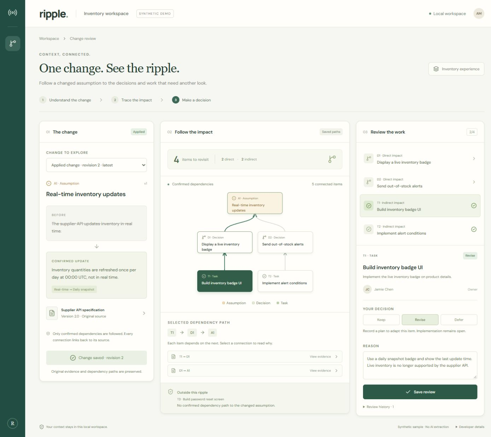
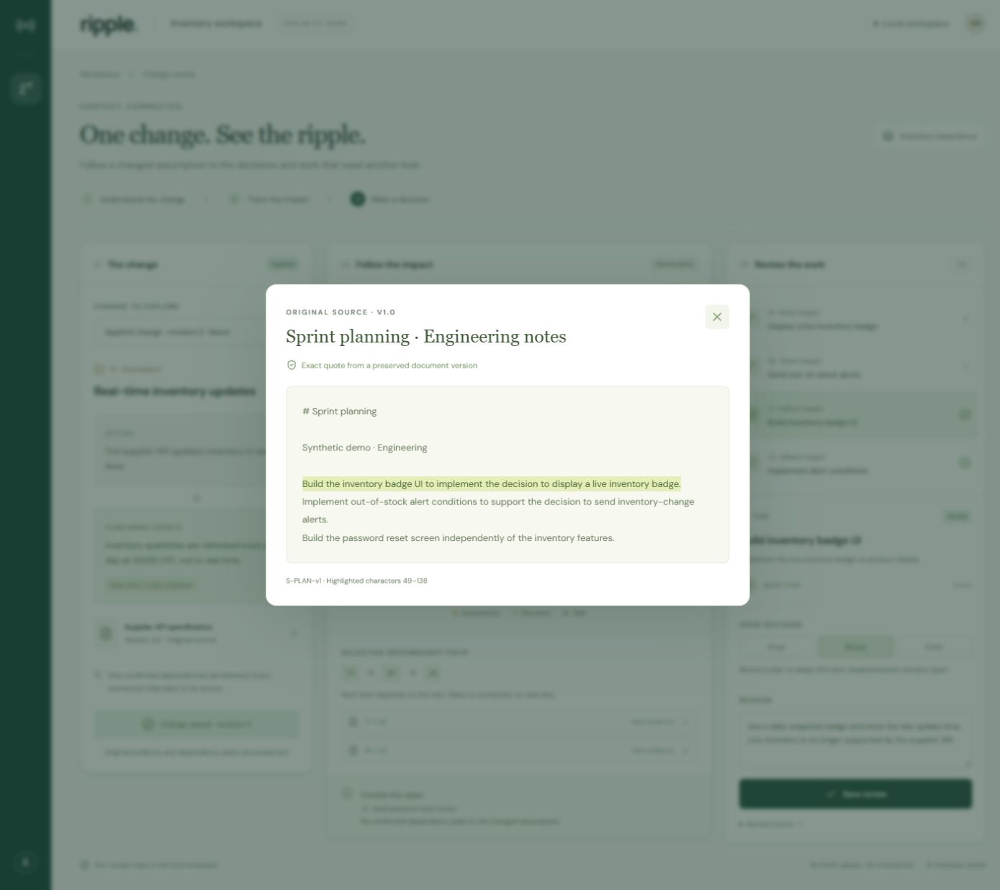

# M0/M1 verification record

## Manual M2 acceptance — 2026-11-14

The earlier M0/M1 record below remains historical evidence. This iteration uses a separate disposable native Relate store outside OneDrive at port 4318; the original demo store was untouched.

- `npm run verify`: 21 passed, 0 failed; strict types, format, skill integrity, official Relate native preflight and production build passed.
- `npm run doctor`: passed separate-process persistence. Both checkpoint and WAL tests also restore imported source versions, terminal candidate decisions and idempotency receipts.
- API/native tests verify full imported assumption/task change/review, exact hashes/UTF-16/CRLF evidence, repeated quote disambiguation, source version concurrency, idempotent retries and conflicting keys, candidate exclusion/confirmation/rejection, stale endpoints/decisions, evidence failure, atomic rollback, additive schema upgrade, input validation, cross-origin rejection and source count limits.

| Browser check             | Observed result                                                                                                                               |
| ------------------------- | --------------------------------------------------------------------------------------------------------------------------------------------- |
| Paste document            | Saved source v1, with emoji and exact original text                                                                                           |
| Create item and candidate | Imported Delivery dashboard task and dependency on A1; candidate excluded from impact                                                         |
| Evidence                  | Original v1 quote highlighted at UTF-16 characters 18–80                                                                                      |
| Confirm                   | Impact grew from 4 to 5; imported task direct, T3 excluded                                                                                    |
| Generic update            | Hourly inventory update from imported evidence opened the existing preview and applied at revision 2                                          |
| Review                    | Imported task decision/reason saved; original paths retained; history visible after reload                                                    |
| File upload               | Local UTF-8 Markdown with CRLF read and saved without normalization                                                                           |
| Repeated multiline quote  | Explicit occurrence 2 selected at 44–67; exact CRLF slice preserved                                                                           |
| Source versions           | Saved v2 and reopened unchanged v1                                                                                                            |
| Failed source save        | Deliberately blocked source request; input retained; unblocked retry succeeded                                                                |
| Failed review save        | Deliberately blocked review request; reason retained; retry succeeded, history grew to 2                                                      |
| Restart                   | Stopped dev owner, confirmed port released, started production with the same QA store; sources, candidate, applied change and review restored |
| Narrow screen             | 390×844: document form, occurrence selection, Change/Impact path/Review tabs, selection and source dialog inspected                           |
| Graph                     | Third direct node originally overlapped; horizontal scrolling now separates nodes; no document overflow                                       |
| Console                   | Final production inspection returned no warnings/errors; deliberate blocked requests were expected failures                                   |

Network blocks and viewport override were removed. Browser checks are performed through the connected browser, not a committed automated E2E suite. These are synthetic acceptance examples, not real-user accuracy measurements. Before publication, `ci:status` correctly disclosed that only the prior committed HEAD passed. M2 implementation commit `5406668` subsequently passed its own [Windows CI run](https://github.com/piecemakerz/Ripple/actions/runs/43564558780): clean installation, verify and doctor. The GitHub plugin confirmed all job steps.

Captures: [Documents](evidence/m2-documents.jpg), [impact and review](evidence/m2-impact.jpg), [390px evidence selection](evidence/m2-mobile.jpg).

## Historical M0/M1 checks

Date: **2026-11-12 KST**. Data is synthetic. No external AI extraction was used.

## Automated checks

`npm run verify` runs formatting, strict TypeScript, native integration tests and production build. Thirteen tests cover:

1. HTTP flow, input validation, stale revision and cross-origin rejection.
2. Separate-process restoration from a checkpoint.
3. Separate-process restoration from WAL without a final explicit checkpoint.
4. Idempotent seeding, exact D1/D2/T1/T2 impacts, T3 exclusion, path/evidence correctness.
5. Shared owner/words and proposed/rejected/superseded edges do not imply impact; injection-like IDs remain data.
6. Cycles terminate, target excluded, multiple paths create one review per item.
7. Atomic/idempotent changes, request reuse conflicts, stale revision and independent subsequent reviews.
8. Rollback, including an injected failure after Change/Review writes but before item update.
9. Historical paths and original content survive current graph edits.
10. Missing/invalid evidence prevents application.
11. Unicode UTF-16 offsets, exact hashes, parameter safety.
12. Depth limit disclosure and application guard.
13. Path-count limit disclosure.

Result: **13 passed, 0 failed**. `npm run doctor` passed. `npm run reproduce` verified clean npm installation and checks from a temporary checkout. These tests do not open the live DB. Results are regression evidence, not real-user accuracy/speed measurements.

## Browser acceptance

Actual local UI and Relate API/database, without mocked impact responses. Desktop 1440px and mobile 390px inspected. Final server runs the production bundle.

| Check             | Observed result                                                                                            |
| ----------------- | ---------------------------------------------------------------------------------------------------------- |
| Initial workspace | Daily refresh proposal; 2 direct + 2 indirect impacts; T3 excluded                                         |
| Select T1         | T1 → D1 → A1, two evidence links                                                                           |
| Source dialog     | Exact quote highlighted, version/offsets visible; close returns to workspace                               |
| Apply             | A1 revision 2, one Change and four pending Reviews                                                         |
| Review save       | T1 revise + reason; progress 1/4 and history entry                                                         |
| Browser reload    | Applied change, original paths and saved review restored                                                   |
| Mobile navigation | Change / Impact path / Review panels at 390px                                                              |
| Mobile graph      | Initial clipping fixed; nodes within panel                                                                 |
| Failed save       | Temporarily blocked local review request in browser devtools; failure displayed, T2 draft/reason preserved |
| Retry             | Removed network block; same draft saved as defer; progress 2/4                                             |
| Server restart    | Stopped dev process, started production, reloaded; graph/revision/both reviews preserved                   |
| Console           | No normal-flow errors observed; intentional blocked request produced an expected network error             |

Temporary network/device overrides were removed. The live sample has two recorded review decisions. Keep/revise/defer record decisions, not implementation completion.

## Captures

[Mobile viewport](evidence/mobile.jpg)

## Re-run browser checks

For an untouched proposal, use a fresh DB path from README. Follow the 2-minute flow, then inspect a saved review after process restart. For visual changes inspect three-column desktop and 390px panel layout. API/DB tests are automated; browser acceptance in this iteration used the connected browser, not a committed automated browser test suite.
