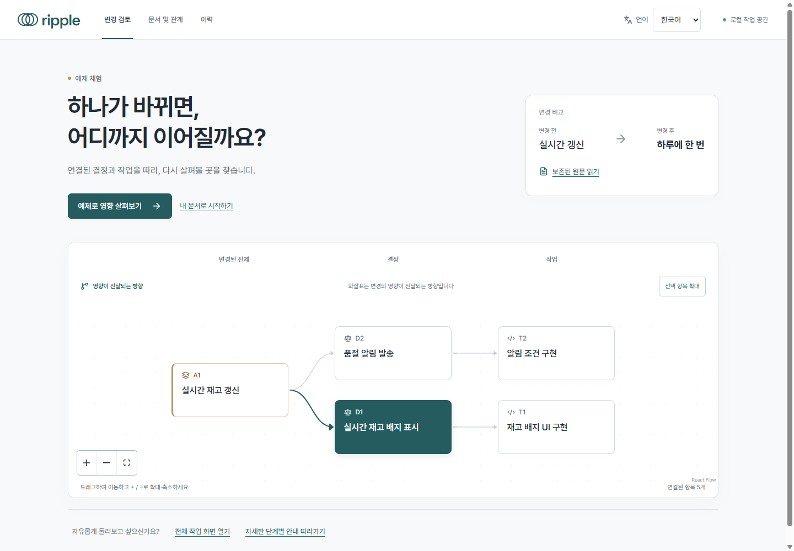
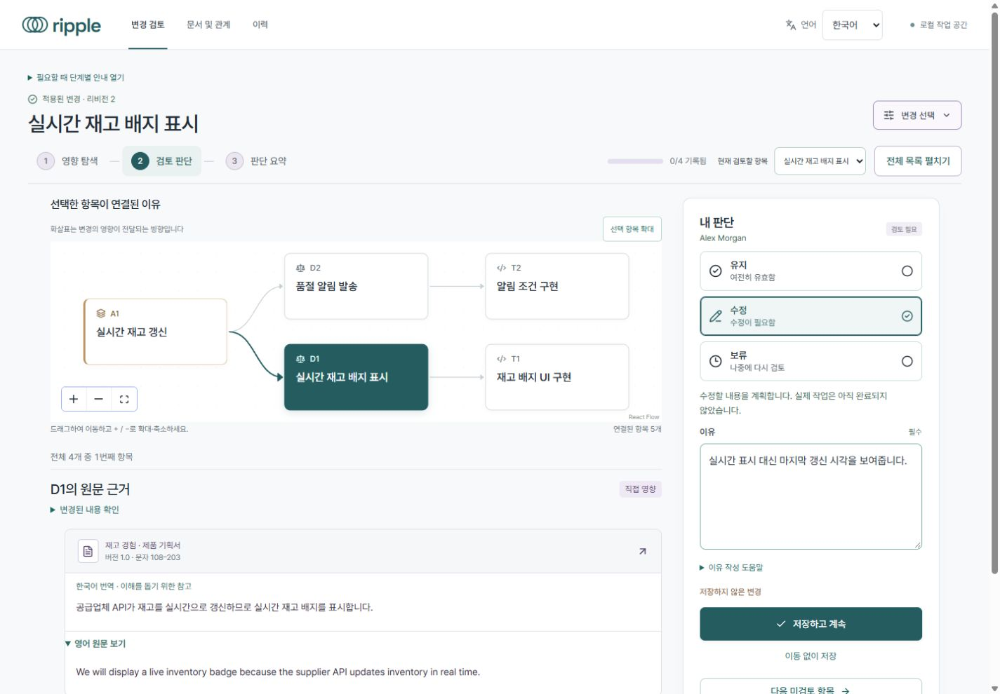

# 시각 표현 정돈 기록

2026-11-15 · 사용자가 이전 디자인의 완성도에 불만을 표현했다. Product Design audit와 프로젝트 frontend-design을 적용해 현재 실행의 화면을 캡처한 뒤 기존 첫 화면·검토 화면을 수정했다. 새 시안 선택이나 다른 제품 흐름을 도입하는 작업은 아니다. 저장된 Product Design 사용자 문맥은 없었고 현재 코드·화면·사용자 피드백을 기준으로 삼았다.

## 관측과 수정

1. **첫 화면 — 수정 후 주요 동작 확인.** [수정 전](evidence/refinement-01-before.png)의 진한 헤더, 큰 노란 변경 영역, 색칠한 범례와 노드가 함께 강조되어 주의가 분산된다. 밝은 헤더와 작은 변경 비교, 얇은 노드 경계로 정리하고 실제 체험 버튼을 설명 아래로 옮겼다. 색은 선택한 경로/행동과 작은 변경 표시를 중심으로 남겼다. [수정 후](evidence/refinement-final.png).
2. **영향과 원문 — 연결·원문 보존 확인.** T1 선택 시 A1→D1→T1과 두 근거가 나오고 영어 원문과 한국어 보조가 함께 읽힌다. 한글 글꼴·굵기·행간을 통일했고 원문 인용이나 범위는 수정하지 않았다. 모바일 선택은 해당 근거로 초점을 옮긴다. [모바일 근거](evidence/refinement-08-proof-mobile.jpg).
3. **검토와 저장 — 실패 복구·복원 확인.** [수정 전 D1](evidence/refinement-02-review-before.jpg)의 여러 상태색을 줄이고 여백과 선택 테두리로 판단 영역을 구분했다. 실제 D1 이유를 입력한 [수정 후](evidence/refinement-04-review-desktop.jpg)에서 지도, 원문, 선택과 저장 행동을 함께 읽을 수 있다. 모바일 폼과 키보드 초점도 가려지지 않았다. [모바일 판단](evidence/refinement-05-review-mobile.jpg).

## 비교 범위

이번 실행에서 저장한 전후 첫 화면과 D1 검토 캡처를 한 입력에 함께 열어 비교했다. 이전 첫 화면은 960×667 CSS / DPR 1.5의 PNG, 새 첫 화면은 1440×1000 / DPR 1의 PNG다. 이전 검토는 2160px 폭의 4/4 저장 상태와 일시정지 안내, 새 검토는 1440px 폭의 0/4 초안과 접힌 안내 상태다. 같은 D1/원문/이유를 비교했지만 픽셀 단위의 동일 상태 비교는 아니므로 크기·진행률·안내 높이 차이를 결함이나 개선 수치로 세지 않는다. 기존 JPEG 캡처 중 축소/잘림이 발생한 것은 정밀 비교 근거로 사용하지 않았다.

- **글꼴:** 로컬 Pretendard Variable 1.3.9로 한국어와 읽기 UI를 통일했다. 영어 큰 제목과 워드마크는 기존 Space Grotesk다. 브라우저에서 글꼴 가용성과 한글 제목의 computed family를 확인했다. 약 2 MB의 폰트와 전체 OFL이 추가됐으며 런타임 CDN 호출은 없다. [출처·라이선스](../THIRD_PARTY.md).
- **배치:** 실제 데이터 지도·근거·판단 구조를 유지하고 첫 행동을 위로 옮겼다. 1440×1000, 1024×900, 390×844에서 검사했다. [태블릿 검토](evidence/refinement-07-review-tablet.jpg), [모바일 첫 화면](evidence/refinement-06-entry-mobile.jpg).
- **색상:** porcelain/white 바탕, ink 본문, petrol 선택과 주요 행동, 작은 amber 변경 표식. 색 외에도 텍스트·아이콘·테두리·선택 상태를 유지한다. 전수 대비 수치 검사는 수행하지 않았다.
- **자산:** 기존 워드마크, Lucide 아이콘, 실제 React Flow 지도를 유지한다. 그림을 인터랙티브 지도처럼 삽입하지 않았다. 새 사진·장식 이미지·외부 서비스 의존성은 없다.
- **문구:** 기존 영어·한국어 메시지와 원문을 유지했다. 변경 비교에 기존 Before/After 레이블을 추가하고 중복 설명 띠를 없앴다. 버튼 위치만 바뀌었으며 저장 의미는 동일하다. [영어 첫 화면](evidence/refinement-09-entry-english.jpg).

## 검증과 남은 판단

`npm run verify` 72/72 및 모든 게이트 통과. 별도 native QA 스토어 4354에서 명시적 적용, 저장 실패 후 이유 보존/재시도, 세 판단 유형, 4/4 및 reload, 언어 전환 중 문자 그대로의 초안을 확인했다. [명령·브라우저 관측·도구 실패 기록](QA.md).

이전 화면에 대한 부정적 미적 평가는 실제 사용자 피드백이다. 새 화면이 취향에 맞거나 신규 사용자의 이해도를 높였다는 것은 아직 확인되지 않았다. 물리 기기, 스크린리더, 전수 대비 측정, 이번에 건드리지 않은 Documents/History 배치의 재검증은 수행하지 않았다. 미적 수용과 기능 통과는 별도로 판단한다. 새 로컬 미리보기는 `http://127.0.0.1:4353/`; 공개 배포하지 않았다.
